RockWheel is free, open-source firmware for the iPod Video, 5th and 5.5th generation, built on [Rockbox](https://www.rockbox.org). It brings Finder and iTunes sync to a familiar iPod interface, with Cover Flow, Live Lyrics, podcasts and audiobooks, three themes and FLAC playback.

Sync your music as usual, or copy files directly onto the iPod. Both appear in the same library.

**[Features](#features) · [Compatibility](#will-it-work-on-my-ipod) · [Install](#install) · [Update](#update) · [Build](#build-from-source)**


## Features

[Sync with Finder or iTunes](#syncing-with-finder-and-itunes) as you always have. Your songs, playlists, covers and ratings arrive as synced, and what you play and rate on the iPod goes back to your computer.

**New in 1.4**

- [Podcasts and audiobooks](#podcasts-and-audiobooks) with screens of their own: what's new in each show, one place to resume a book from, and a playback speed for each.
- [Chapters](#chapters) in podcasts, audiobooks and long recordings.
- [Three themes](#themes), each light or dark: Classic, Modern, and Neo in a color you choose.
- [Shuffle by album](#shuffle): whole albums, in a random order.
- [Albums with their covers](#artists-albums-and-songs) in every list, an album's own screen with track numbers and lengths, and names sorted as in Music on your Mac.
- [Songs by name, artist, album or year](#artists-albums-and-songs), and Recently Added.
- A scrollbar, and [a large letter to scroll by](#artists-albums-and-songs) when you turn the wheel fast.
- [A sharp cover beside the main menu](#a-familiar-interface), which can drift slowly from side to side.
- [Resume Playback](#a-familiar-interface) that starts at once, with the song's cover waiting beside the main menu.
- [Plays and ratings that reach your Mac with podcasts on the iPod](#syncing-with-finder-and-itunes).
- [Cover Flow by artist or by year](#cover-flow).

**Also included**

- [Search](#search) with the click wheel, with Smart Search passing over letters that wouldn't find anything.
- [Playlists made on the iPod](#playlists), On-The-Go, playlist folders, and [smart playlists](#playlists) that update as you listen.
- [Music you copy onto the iPod yourself](#two-ways-to-add-music), FLAC included, in the same library as your synced music, with covers.
- [Live Lyrics](#now-playing) that follow the song.
- [Now Playing in the colors of the album](#colors-from-the-album) you're listening to.
- [Night Mode](#dark-theme-and-night-mode), which dims the screen, lowers the volume and silences the wheel, and can turn itself on at the hours you choose.
- [The EQ](#volume-sound-check-and-the-eq) with iTunes' presets, Sound Check and Volume Limit.
- [Settings in folders](#a-familiar-interface), with hints, and a customizable main menu, Music menu and Now Playing menu.
- [Menus in more than forty languages](#a-familiar-interface), and song titles in Korean, Japanese, Chinese, Hebrew, Arabic and Thai, out of the box.
- A click wheel that speeds up as a stock iPod's does.
- [Photos](#photos-and-extras) you sync, in the familiar grid, and [thirteen games](#photos-and-extras).
- [Installers for Mac and Windows](#install).
- [The stock firmware](#go-back-to-the-stock-firmware) stays on the iPod, one restart away.

## Will it work on my iPod?

**Made for:** iPod Video, 5th and 5.5th generation, formatted FAT32, synced from Finder on a Mac, iTunes on Windows or [iOpenPod](https://github.com/TheRealSavi/iOpenPod).

**What it was tested on:** one iPod. A 5.5G 30 GB model with 32 MB of RAM, an iFlash card of about 256 GB, macOS 26 and a library of about 13,000 songs. The speeds this page gives were measured there.

**On Windows** it syncs from iTunes or iOpenPod, as a stock iPod does.

**On an original hard drive** it runs too: a user has it on a 5.5G 30 GB, installed as described here. RockWheel was tuned on flash, where reads are much faster, so on a hard drive expect:

- Cover Flow and covers on track changes to be slower, since they read artwork from disk, and more so when the drive has to spin up
- Battery life to be shorter, since those reads keep the drive awake
- The library update after a sync to take longer

If you use it on a hard drive, please open an issue and say how it goes.

**If your iPod feels slow, or something goes wrong,** please open an issue and attach `.rockbox/drive.txt` and `.rockbox/health.log` from it. The first describes the drive, without its serial number. The second notes what went wrong and when; it has no song names and nothing that identifies your iPod.

**Limits:**

- Music you bought from iTunes plays, apart from old copy-protected purchases, which the iPod lists and tells you it can't play. The same goes for protected audiobooks. Apple Music subscription tracks aren't supported.
- RockWheel doesn't play video. The stock firmware stays on the iPod and shares the same library: to watch your videos, turn the Hold switch on while the iPod starts.
- What you play of a podcast on the iPod — where you stopped, what you finished — stays on the iPod: Podcasts on your Mac doesn't take it.
- The sharp covers Finder prepares have been tried with Finder on macOS 26 only, not with iTunes on Windows or iOpenPod.
- Song titles in Hindi and Thai show, though their combining marks can be out of place, and those two languages aren't offered for the menus.
- Search can't type Chinese characters or Japanese kanji. Names written in them show in the library, but aren't found by Search.
- Playlists made on the iPod, On-The-Go among them, stay on the iPod: Finder and iTunes don't bring them into your library.
- At most 32,000 songs can be queued. With more than 32,767 songs, Songs can't be sorted other than by name.
- Libraries much above 25,000 songs haven't been tried on an iPod. In the simulator with 32 MB of RAM, the theme may not load after a restart straight into Updating Library, and a library of 100,000 songs doesn't start.

## Install

### Before you install

RockWheel needs the iPod formatted as FAT32.

- **An iPod set up by iTunes on Windows** already is. Installing keeps everything on it, and your library is ready at the first start.
- **An iPod formatted on a Mac** isn't, and converting it erases the iPod. First sync it once, and back up anything else you keep on it: your music comes back with a sync, but play counts and ratings not yet synced don't. On a Mac, the installer converts it for you, and stops unless you type `ERASE`. On Windows, restore it in iTunes on that PC first, which makes it FAT32.

RockWheel takes about 145 MB on the iPod, most of it typefaces, so that every theme can show every alphabet. Have about 180 MB free.

The stock firmware stays on the iPod, with the same library.

### On a Mac

Connect the iPod, open Terminal and paste this:

```sh
/bin/bash -c "$(curl -fsSL https://raw.githubusercontent.com/ssarkisy/RockWheel/main/install.sh)"
```

It downloads the files and checks them, finds the iPod, checks that it's an iPod Video and that there's room, converts it if it has to, installs Rockbox's bootloader and the firmware, and ejects it. macOS asks for your password, because the bootloader goes straight onto the disk.

It also asks whether to add eight more games to Extras. Press Return to leave them out.

### On Windows

Connect the iPod, open PowerShell, not as administrator, and paste this:

```powershell
irm https://raw.githubusercontent.com/ssarkisy/RockWheel/main/install.ps1 | iex
```

It does the same as on a Mac, apart from converting: it downloads the files and checks them, finds the iPod, checks that there's room, installs the bootloader if needed, copies the firmware, asks about the games and ejects the iPod. Windows asks for an administrator's permission to reach the iPod's disk directly, and on a first install asks once more to put the bootloader on it.

If anything goes wrong, please open an issue and include what it printed, or the output of a dry run (see the [options](#options)).

### After you install

1. **Unplug the iPod.** If it doesn't restart by itself, hold Menu and Select until it does.
2. **Connect it again and sync from Finder or iTunes as usual.** Don't choose Restore: that erases the iPod and removes RockWheel.
3. **Unplug it.** Wait for the library update to finish.

To hear about new versions, choose Watch, then Custom, then Releases, at the top of this page.

### Options

Download the installer and run it with an option: [`install.sh`](install.sh) on a Mac, as `bash install.sh --dry-run`, or [`install.ps1`](install.ps1) on Windows, as `powershell -ExecutionPolicy Bypass -File .\install.ps1 -DryRun`.

| | On a Mac | On Windows |
|---|---|---|
| See what it would do, changing nothing | `--dry-run` | `-DryRun` |
| Bring your playlist folders over, for the next sync | `--folders` | `-Folders` |
| Add the extra games, or take them off | `--games`, `--no-games` | `-Games`, `-NoGames` |
| Choose the iPod, with more than one connected | | `-Drive E:` |
| Remove the bootloader | `--uninstall` | `-Uninstall` |

Playlist folders come from the Music app on a Mac, which asks you to let Terminal read them, and from iTunes on Windows. That has to be the iTunes from Apple's website: the one from the Microsoft Store can't be reached this way.

<details>
<summary>The same steps by hand, on a Mac</summary>

The installer does these steps for you, and with `--dry-run` it shows what it would do, changing nothing. By hand, let `ipodpatcher` find the iPod instead of looking up a disk number yourself: it only ever finds iPods, never your Mac's own disks. Build it from `utils/ipodpatcher` in this repository.

1. **Make sure the iPod is FAT32.** `sudo ipodpatcher --scan` shows the iPod's disk, such as `/dev/disk4`, and `macpod` if it's Mac-formatted. Converting erases the iPod: run `sudo ipodpatcher /dev/disk4 --convert`, with the disk the scan showed. On iPods with 2048-byte sectors, which the official `ipodpatcher` refuses, it then prints the command that formats the music partition, with the right disk in it: run it as printed.
2. **Install the Rockbox bootloader** with `sudo ipodpatcher --add-bootloader bootloader-ipodvideo.ipod`, using the file from [Releases](../../releases). Given no disk, it finds the iPod by itself, and stops if there's none or more than one. The official [Rockbox Utility](https://www.rockbox.org/wiki/RockboxUtility), run as root, works too.
3. **Copy the firmware.** Download `rockbox.zip` from [Releases](../../releases) and unzip it at the root of the iPod. It needs about 180 MB free; if the copy stops for lack of room, free some and unzip it again. For the extra games, unzip `rockbox-games.zip` there too. If you had plain Rockbox before, move the old `.rockbox` folder out of the way first.
4. **Restart and sync.** Eject, restart with Menu and Select, connect it again and sync from Finder. When you unplug, the library updates.

</details>

<details>
<summary>The same steps by hand, on Windows</summary>

Users have installed it this way. If anything goes differently, please open an issue.

1. **Make sure the iPod is FAT32.** An iPod set up by iTunes on Windows already is. If your iPod is Mac-formatted, restore it in iTunes on Windows to convert it to FAT32; this erases everything on it.
2. **Install the Rockbox bootloader** with the official [Rockbox Utility](https://www.rockbox.org/wiki/RockboxUtility), run as administrator. Choose the iPod Video and install only the bootloader, not Rockbox itself. If your iPod already starts Rockbox, skip this step.
3. **Copy the firmware.** Download `rockbox.zip` from [Releases](../../releases) and extract it to the iPod's drive, so that the `.rockbox` folder is at the top of it. It needs about 180 MB free; if the copy stops for lack of room, free some and extract it again. For the extra games, extract `rockbox-games.zip` the same way. If you had plain Rockbox before, rename its `.rockbox` folder first.
4. **Restart and sync.** Eject the iPod, unplug it and hold Menu and Select until it restarts. The first start reads your library, so give it a moment. Then sync from iTunes as usual.

</details>

## Update

Run the same command as for installing, on a Mac or on Windows. Your settings, library, play counts and games are kept. It asks for your password or permission, and once, whether to add the games.

The first start after updating to 1.4 prepares the library again, once, and keeps your plays, ratings and places. 1.4 is larger than earlier versions: have about 180 MB free. [Updating to 1.4](docs/updating-to-1.4.md) tells what else changes.

If you installed by hand, unzip `rockbox.zip` to the iPod again, replacing the files, and `rockbox-games.zip` too if you added the games. Do both at every update: games from an older version don't open with a newer firmware. Saved games and high scores are kept.

## Go back to the stock firmware

To start the stock firmware once, turn the Hold switch on while the iPod starts. RockWheel comes back at the next start.

To remove RockWheel, run the installer with `--uninstall` on a Mac or `-Uninstall` on Windows (see the [options](#options)). It takes the bootloader off, and the iPod starts its stock firmware from then on, with your library as it is. The `.rockbox` folder stays on the iPod, and you can delete it from Finder or File Explorer.

## RockWheel, Rockbox and the stock firmware

| | Stock firmware | Rockbox | **RockWheel** |
|---|---|---|---|
| Sync from Finder or iTunes | Yes | No | **Yes** |
| Ratings and play counts back to your computer | Yes, but not with podcasts on macOS 26 | No | **Yes, podcasts or not** |
| Looks and behaves like an iPod | Yes | Themes get part of the way | **Yes** |
| Album art | Prepared by your computer | Read from each song as it plays, slow for large covers | **Prepared ahead, for synced and copied music** |
| Podcasts and audiobooks | Yes | As plain files | **Yes, with new-episode counts, one place per book and a speed for each** |
| Chapters | Yes | As a cue sheet, off by default | **Yes, in podcasts, audiobooks and long recordings** |
| Shuffle by album | Yes | No | **Yes** |
| On-The-Go and live smart playlists | Yes | No | **Yes** |
| Playlists made on the iPod | On-The-Go only | With an on-screen keyboard | **Yes, named with the click wheel** |
| Search with the click wheel | Yes | With an on-screen keyboard | **Yes, in the alphabets of your library** |
| Music you copy yourself, such as FLAC | No | Yes, from any folder | **Yes, in the same library, with covers** |
| Cover Flow | No | Plugin: builds its own cache first, then covers load as you scroll | **Built in, with kinetic scrolling and covers prepared ahead** |
| Live Lyrics | No | Plugin | **Built into Now Playing** |
| Now Playing in the colors of the album | No | No | **Yes** |
| Themes | One | Many, made by the community | **Three, each light or dark** |
| Night Mode, on a schedule | No | No | **Yes** |
| Videos | Yes | Converted files, or through the stock firmware | **Through the stock firmware** |
| Open source | No | Yes | **Yes, GPL** |

## Performance

RockWheel was made to be as responsive as it can be. Songs start right away, the next cover appears the moment you skip, and lists keep up with your thumb, with a library of well over ten thousand songs on a chip from 2005 and as little as 32 MB of memory. A large part of the work on RockWheel went into this.

The measurements, compared with Rockbox and the stock firmware, and how they were reached, are in [docs/performance.md](docs/performance.md).

## Music and library

### Syncing with Finder and iTunes

Plug it in and it appears in Finder as an iPod, or in iTunes on Windows, and [iOpenPod](https://github.com/TheRealSavi/iOpenPod) syncs it too. Sync the way you always have, unplug, and your library is ready.

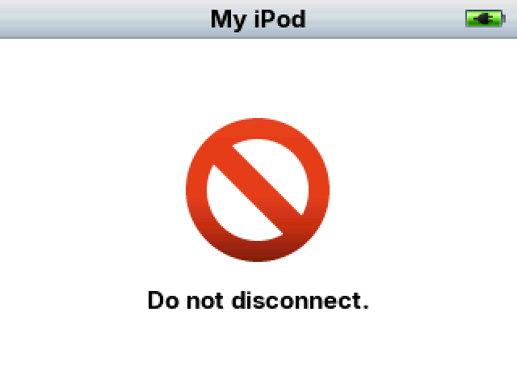 

Your songs, playlists, ratings, covers, podcasts and audiobooks arrive just as they were synced. It works both ways: what you play and rate on the iPod is on your computer after the next sync. There's no extra app to install on your computer, and nothing to set up.

That holds with podcasts on the iPod too. Finder on macOS 26 ignores an iPod's plays and ratings altogether when podcasts are synced to it, even with Apple's own software on the iPod; RockWheel hands them over in a way Finder accepts. And if a sync doesn't take them for any reason, they stay on the iPod and go again the next time you connect, never counted twice.

### Two ways to add music

| | Synced | Copied onto the iPod |
|---|---|---|
| How | Sync as usual, from Finder, iTunes or [iOpenPod](https://github.com/TheRealSavi/iOpenPod) | Copy the files into any folder outside iPod_Control, then unplug |
| Who prepares the library | Your computer: the songs' details and covers arrive ready, and the iPod only takes them in | The iPod reads the tags and prepares album art after you unplug it |
| How long that takes | Fast | Slower, the more new files there are |
| Where it appears | In your library: Artists, Albums, Search, Cover Flow, Shuffle Songs | In the same library, beside your synced music. A book in a folder named Audiobooks, or a podcast in one named Podcasts, goes to that section |
| Plays and ratings | Go back to your computer at the next sync | Stay on the iPod |
| Formats | What your sync app can sync | Also FLAC and the other formats Rockbox plays |

Some music never goes through Finder or iTunes: FLAC, for one, which neither of them plays. Copy it into any folder on the iPod outside iPod_Control, and unplug.

In iTunes or Music, a cover can be any size and format, PNG included: your computer converts it for the iPod as it syncs.

For copied music, the iPod prepares each album's cover itself, once, while the library updates, from the songs themselves or from an image in their folder. It reads standard JPEG. Covers of 400×400 or 600×600 are enough and quick to prepare; larger ones take longer and look no sharper on the iPod's screen.

Covers saved as PNG or as progressive JPEG aren't shown, since decoding them takes the iPod's processor far too long. After the library update, the iPod tells you how many albums have one. Save them again as standard JPEG, and they appear the next time you unplug.

A song you delete from the iPod leaves the library the next time you unplug, and one you move or rename keeps its plays and rating. Your smart playlists count these songs too.

### Artists, albums and songs

Everything is in the order you know from Music on your Mac: The Killers under K, accents and capitals aside, and a name filed where its Sort field puts it.

 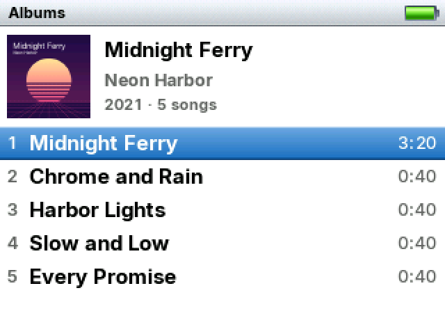

Artists lists album artists, so an album stays whole under one name. Open an artist, and their albums are in the order they came out, the year beside each, with All Songs above them.

Albums shows each album with its cover, its year and its artist. An album opens under its cover, with the track numbers before the titles and the lengths after them, and its discs apart.

Songs sorts by name, artist, album or year: Sort By, at the top of the list, steps through them. Recently Added has the fifty albums that arrived last.

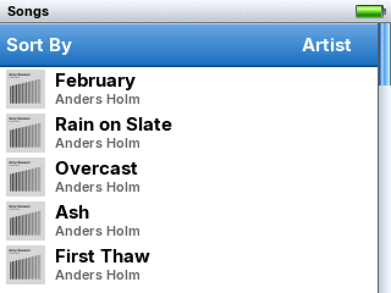 

Turn the wheel fast in a long list and a large letter appears. From then on each step is a letter, until you lift your thumb.

Hold Select on any song to go to its artist or its album. Covers in lists, the scrollbar, the jump by letter and the grouping by album artist are customizable.

### Podcasts and audiobooks

Podcasts and audiobooks you sync have their own places in Music, apart from your songs.

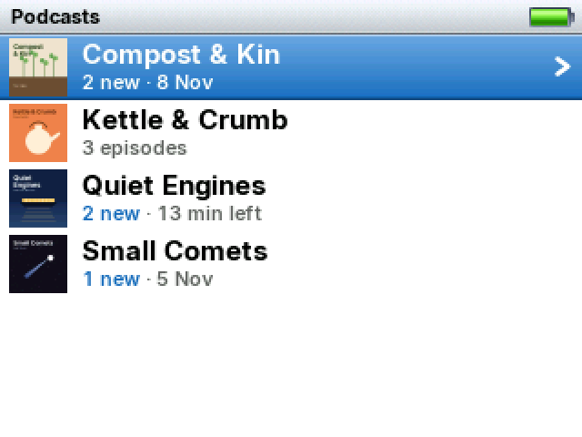 

**Podcasts** lists your shows with their covers, and tells you at a glance what's waiting: how many episodes are new, and how much is left of the one you began. Inside a show the newest episode comes first. A dot marks an episode you haven't heard and a half dot one you've begun. When an episode ends, the next one you haven't heard begins.

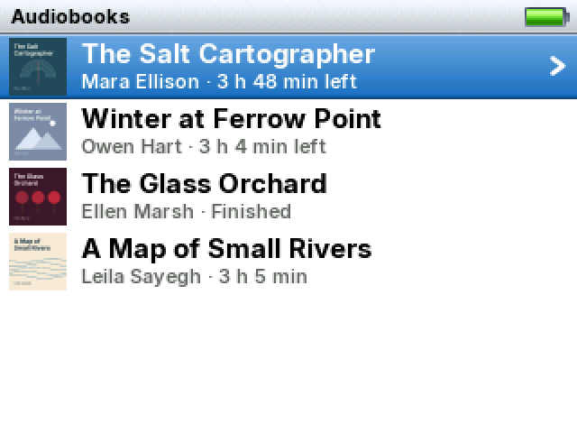 

**Audiobooks** lists your books with their authors and how much is left, the ones you've begun first. A book remembers one place, however many files it's made of: Resume takes you back to it.

Each has its own speed, from Normal to 2×, and audiobooks can also play slower. The voice keeps its pitch, and music always plays at its own speed. Set it in Settings, under Playback, or right in Now Playing: press Select past the scrubber.

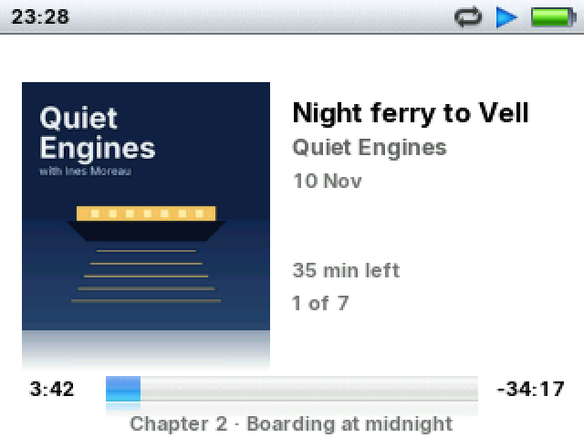 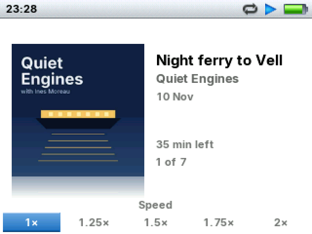

In Now Playing, a podcast shows its show, its date and the time left, and the scrubber's buttons go back 15 seconds and forward 30. Where a song has its lyrics, an episode has its notes.

Books and podcasts you copy onto the iPod yourself work the same way: an `.m4b` file, the genre Audiobook or Podcast, or a folder named Audiobooks or Podcasts is enough.

### Chapters

A podcast, an audiobook or a long recording with chapters plays by them. Next goes to the next chapter and Previous to the start of this one, Now Playing names the chapter under the bar, and Chapters, in the menu you get by holding Select, lists them all with their times.

A song counts as a long recording from ten minutes: a mix or a concert in one file. Chapters are read from MP3, M4A and M4B files.

### Search

Turn the wheel along the ring of letters and press Select to add one. Artists, albums and songs appear below as you type. As you scroll through them, the top of the list keeps telling you whether you're among artists, albums or songs.

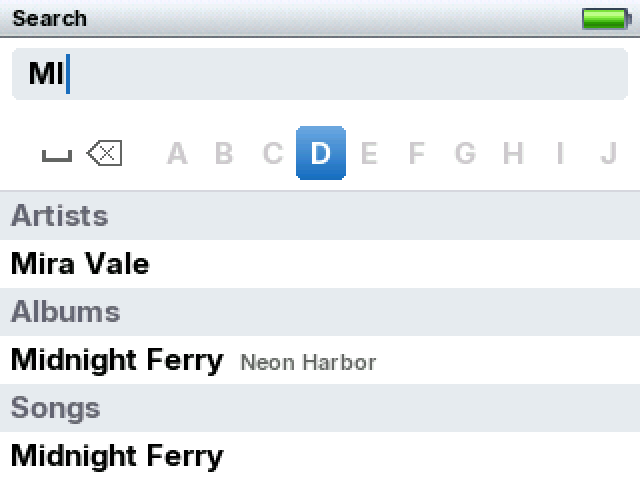

With Smart Search, on by default, the wheel passes over letters that wouldn't find anything, so a name is usually a few presses away.

The ring has the alphabets of your library, not only the Latin one, so names in Russian, Greek, Hebrew, Arabic, Thai, Korean or Japanese kana are just as quick to find. Names written in Chinese characters or kanji can't be typed.

A podcast or an audiobook is found by its name, among the albums, and opens its own screen.

Next (⏭) adds a space, Previous (⏮) deletes a letter, and Play (⏯) takes you down to what was found.

### Playlists

A playlist opens as quickly as Songs, its songs in the order you sorted them in on your computer.

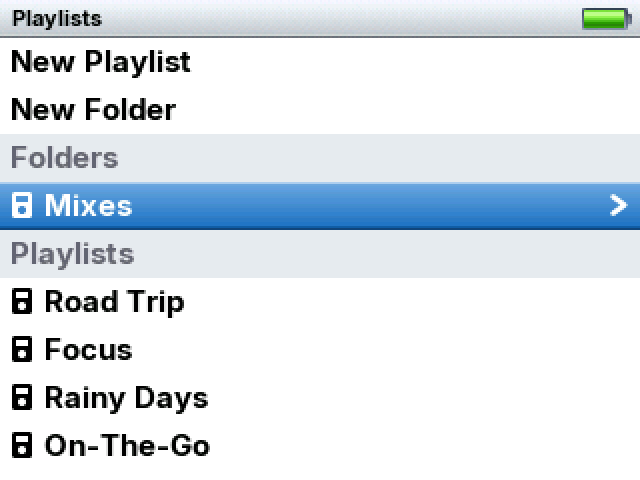 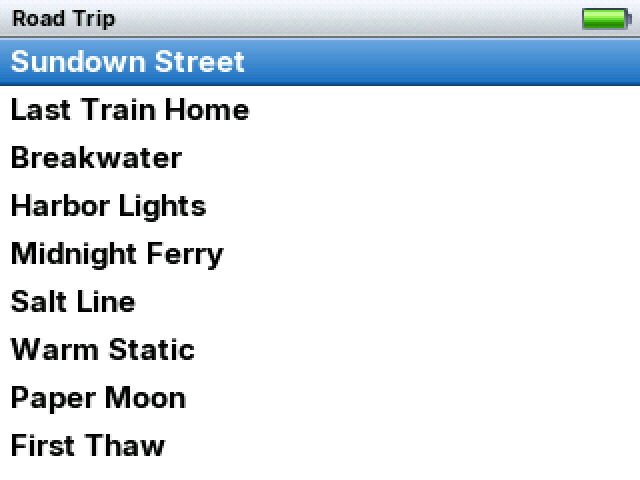

Smart playlists that go by rating, play count or kind of media update right on the iPod, with their limits by number of songs or by time. Give a song five stars and it's in your five-star playlist at once. Those with other rules, such as when a song was last played, stay as they were synced until the next sync.

Make playlists of your own on the iPod. New Playlist and New Folder are at the top of Playlists, and you name them with the click wheel.

To add music, hold Select on a song, album, artist or playlist in Music or Search, on an album in Cover Flow, or in Now Playing, and choose Add to Playlist, or Add to On-The-Go for the quickest way.

Hold Select on a playlist of your own to rename it, move it to a folder or delete it, and on one of its songs to remove it. When On-The-Go is how you want it, Save Playlist turns it into a playlist of its own.

A computer icon marks a synced playlist. An iPod icon marks a local playlist you can edit, whether you created it on the iPod or copied it into /Playlists. Local playlists stay on the iPod: Finder and iTunes don't bring them into your library. A song you delete leaves them, and a song a sync moves stays in them.

Finder leaves playlist folders behind when it syncs an iPod Video. The installer can bring them over from Music on a Mac or from iTunes on Windows: see the [options](#options).

## Cover Flow

The iPod Video never had Cover Flow. Here it's built in, laid out as on an iPod classic: large covers standing close together, on white, or on black in the dark theme.

 

Scrolling has weight. Flick the wheel and the covers pick up the speed of your thumb, glide on their own and settle gently on an album. Flick again to go faster, or rest your thumb to stop.

The albums stand by artist, each artist's in the order they came out, with the year under the cover. Hold Select and choose Sort By to see your whole library by year instead.

Press Select and the cover turns into the album's list of songs. Previous (⏮) and Next (⏭) move one album at a time. Hold one, and the covers run all the way to the first album or the last. Hold Select to add the album or one of its songs to On-The-Go or a playlist, to play it next, or to go to its artist.

On the test iPod, thousands of covers go by without waiting for any of them to load, and the motion stays smooth. By default the music pauses while you browse; this is customizable.

## Playback

### Now Playing

Press Select to move from the cover to the scrubber, your rating, a large cover and the lyrics. The lyrics follow the song line by line when the song has time-synced lyrics in it. For music you copy onto the iPod, an `.lrc` file with the same name beside the song works too. A podcast or an audiobook has its speed and its notes among these views.

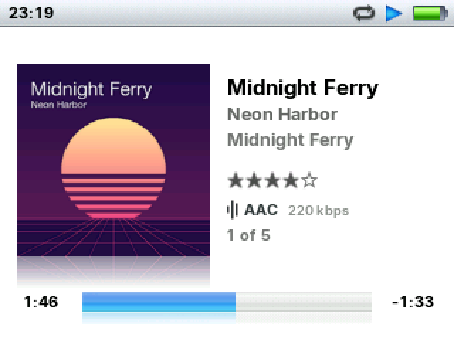 

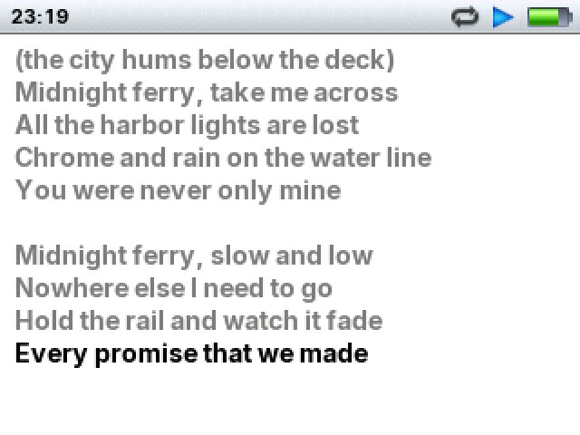 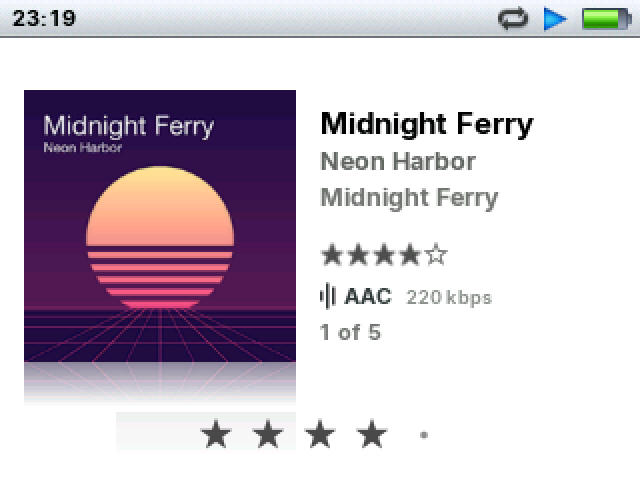

Hold Select for a short menu. From there you can open Cover Flow, go to the song's artist or album, open the list the music is playing from, see what's up next, jump to a chapter, add the song to On-The-Go or a playlist, or change shuffle, repeat, the volume limit, the EQ, Sound Check, brightness, colors, the dark theme and Night Mode. The menu is customizable.

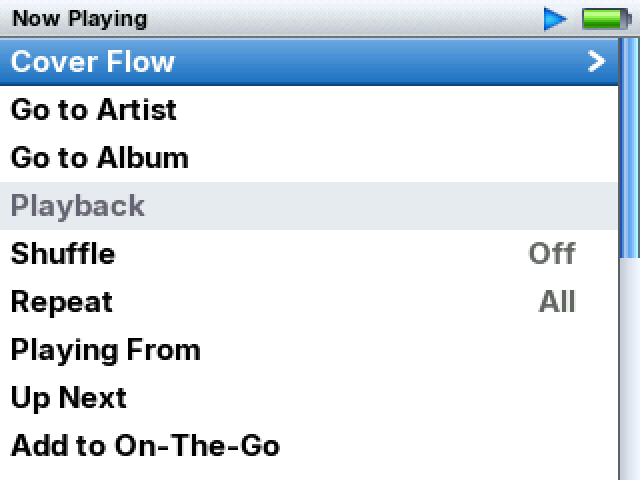 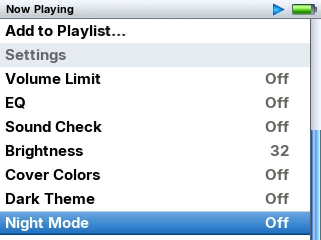

### Shuffle

Shuffle has three settings, as on a stock iPod: Off, Songs and Albums. With Albums, your music plays an album at a time, each from its first track to its last, and the next album is a surprise. It works for whatever you start: all your songs, one artist, a playlist.

Shuffle is in Settings and in the menu you get by holding Select in Now Playing. Shuffle Songs in the main menu plays everything in a new order, and Shuffle Albums can be added beside it. Podcasts and audiobooks always play in order.

### Buttons and the screen

Hold Play for Now Playing from almost anywhere, and hold Menu for the main menu.

With the screen off, Play, Previous and Next still work, and in Now Playing the wheel sets the volume; press Select or Menu to turn the screen on. During playback, the menus return to Now Playing when the screen turns off. Both are customizable, with Wake Screen and Return to Now Playing in Settings, under General.

### Volume, Sound Check and the EQ

The volume, the volume limit and Night Mode's volume are all in percent. The volume moves in a hundred even steps, and the level shows under the bar as you turn the wheel, with your limit beside it.

Sound Check plays your songs at about the same loudness, using the levels your computer has already worked out.

 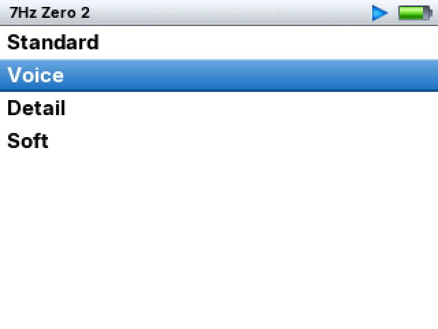

The EQ has all 22 presets from iTunes, tuned as they are there. It also has presets for three pairs of headphones: the 7Hz Zero 2 earphones, the Koss KPH30i, and the Sony WH-1000XM4C, by cable in Active Mode (headphones switched on).

## Appearance

### Themes

RockWheel comes in three themes, and each of them can be light or dark.

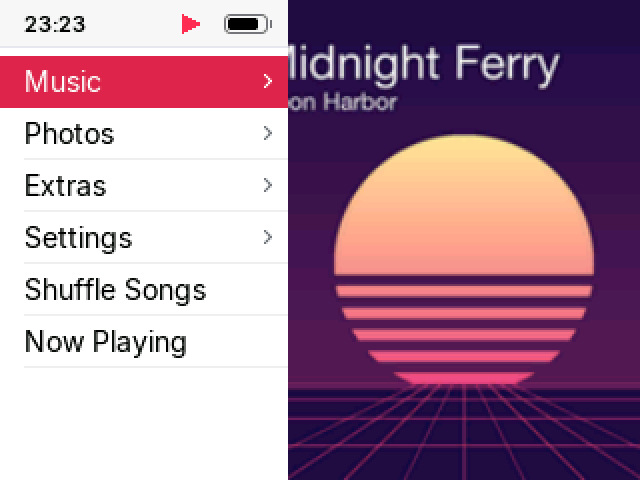 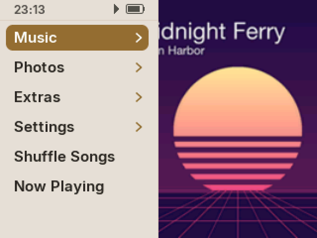

**Classic** is the iPod you remember: the same menus, the same Now Playing.

**Modern** is white and spare, with a single accent color. The row you're on is a bar of it from edge to edge, the names of sections and the artist in Now Playing are written in it, and a small chevron marks every row that leads somewhere.

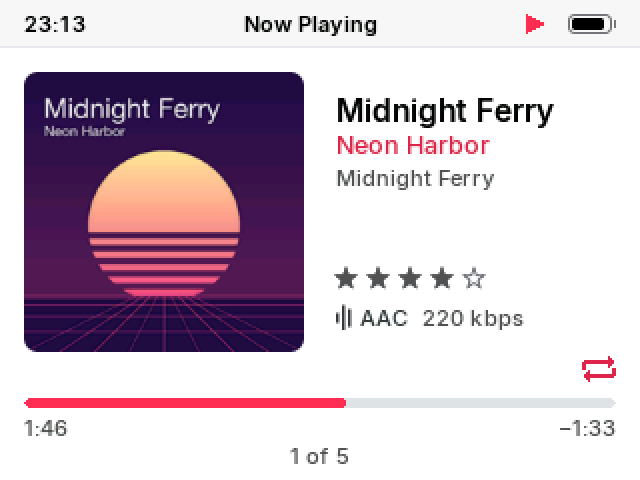 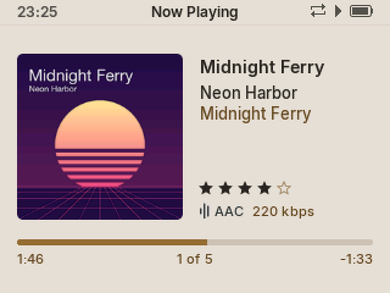

**Neo** is flat and quiet, and it's yours: you choose its color from thirteen, from Desert to Deep Blue, and every screen takes it up. The row you're on, the small print under a name, the progress bar and its knob are all in your color.

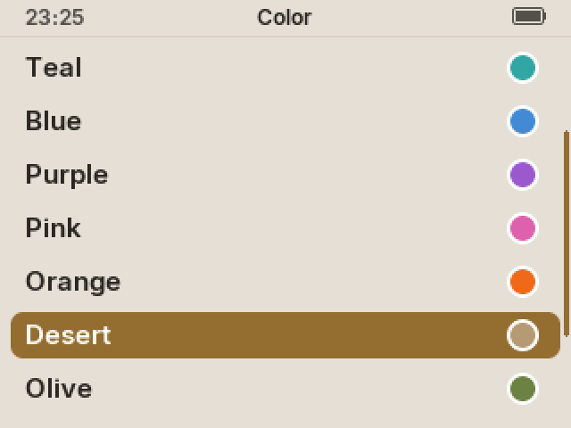 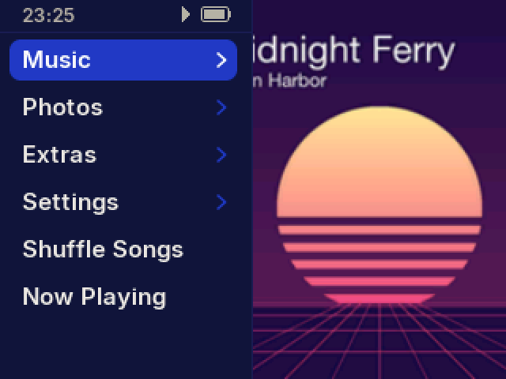

Choose a theme in Settings, under Appearance. Changing it stops the music; Resume Playback takes it up where it stopped.

### A familiar interface

 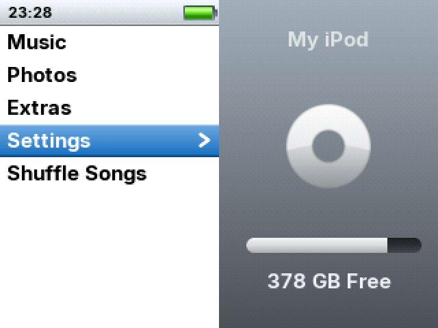

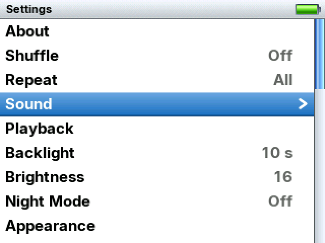 

The main menu is the one you remember, with the time at the top. Beside it you see the album that's playing, its cover sharp at its full size, a collage of your photos, or your iPod and its free space. When nothing is playing, the cover is that of the song Resume Playback will start with, and Resume Playback starts at once. With Moving Cover, the cover drifts slowly from side to side.

For music you sync, Finder prepares that cover at the size of the screen, so it's sharp the moment a song starts. For music you copy yourself, the iPod draws it from the picture in the song a few seconds in, and keeps it for next time. Music synced before 1.4 can have its covers prepared again: choose Rebuild Synced Covers in Settings, then sync.

Settings are in folders, as on later iPods, with a short hint where an option's name doesn't say enough. The main menu and the Music menu are customizable: put Artists or Songs right in the main menu, or hide what you never use.

The menus come in more than forty languages. Song titles in Korean, Japanese, Chinese, Hebrew, Arabic and Thai show out of the box, in typefaces made for them.

### The look of Now Playing

In the Classic theme, Now Playing comes in the style of the iPod Video, the cover standing over its reflection, or of the iPod classic, with Angled Cover turning it slightly away.

 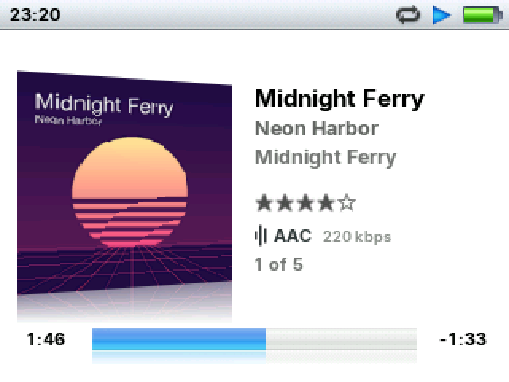

### Colors from the album

Now Playing can take on the colors of the album you're listening to, and the screen changes together with the cover.

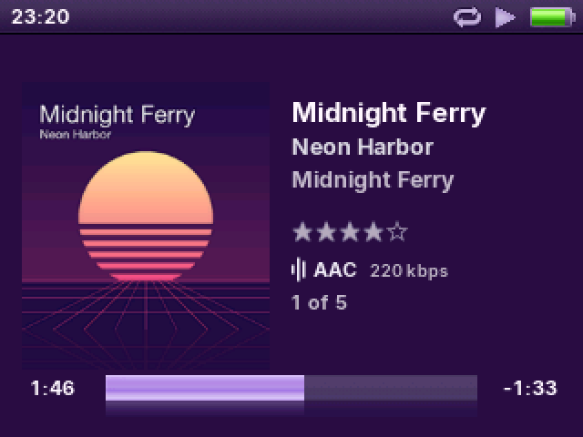 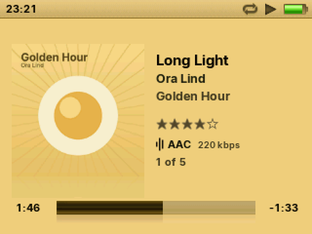

 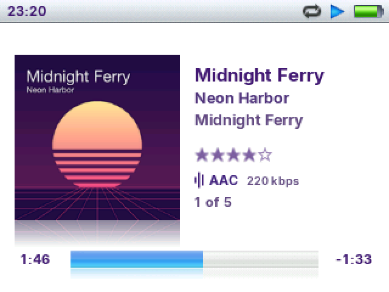

**Fill** paints the screen in the album's color, so the cover melts into it. The text turns light or dark to stay easy to read.

**Whole Screen** softly tints the whole screen, down to the status bar and the progress bar.

**Text and Stars** keeps the theme's background and colors only the words and your rating.

With Fill and Whole Screen, the battery keeps its own colors, so it still shows at a glance how full it is.

In Neo the same four choices act on Now Playing, over the color you chose for the theme; a cover that is nearly gray leaves your color in place. Modern keeps its own colors.

It's off by default. To turn it on, hold Select in Now Playing and choose Cover Colors, or find it in Settings, under Appearance.

### Dark theme and Night Mode

The whole iPod can go dark, in any theme: the menus, Now Playing, the dialogs, even the clock. To turn it on, hold Select in Now Playing, or find Dark Theme in Settings, under Appearance. The colors from the album work in the dark too.

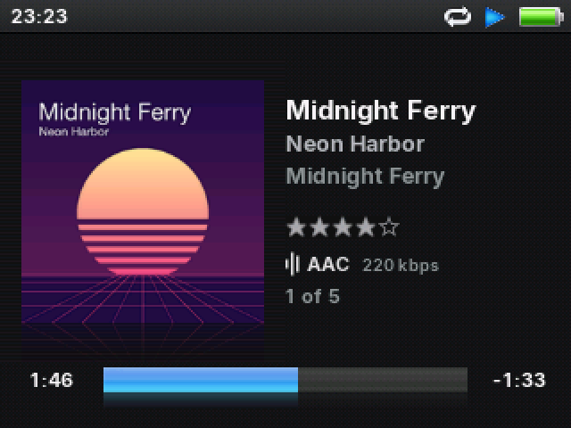 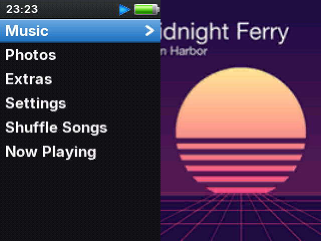

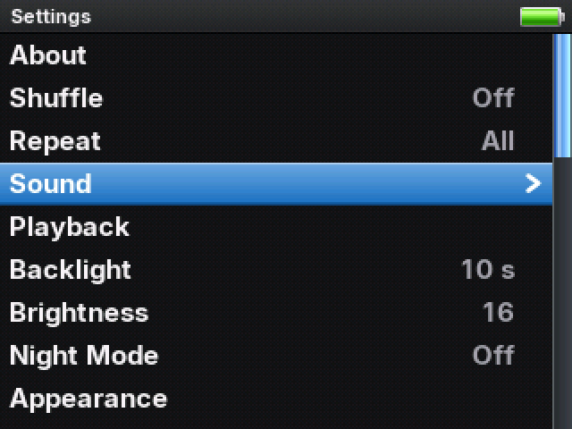 

**Night Mode** is for the end of the day. It makes the iPod dark, silences the wheel, dims the screen and lowers the volume limit. You choose which of these it does, how dim the screen gets and how quiet the music.

It can also keep its own hours. Give it a start and an end, and it turns on and off by itself. If music is still playing when it ends, the volume stays where it is, so nothing wakes you. A small moon in the status bar shows when it's on.

## Photos and Extras

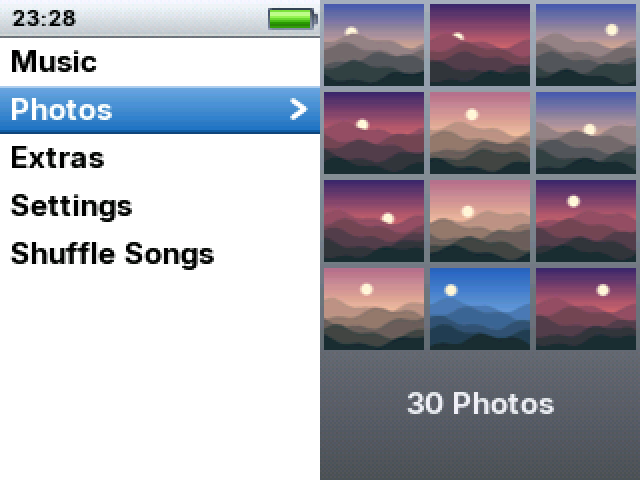 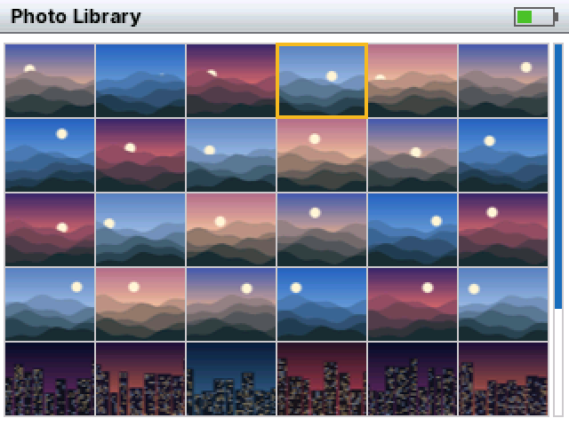

Photos you sync show in the familiar grid and full screen. A collage of them sits beside the main menu, and each album has one of its own. Play pauses the music while you look.

Extras has a clock, a calendar, a stopwatch and five games: Brick, Solitaire, Jewels, Minesweeper and Blackjack. When you install, you can add eight more games from Rockbox: Rockblox, 2048, Sudoku, Sokoban, Reversi, Space Rocks, Bubbles and Clix. In Reversi, the iPod plays the other side.


## What's next

Planned:

- Port to the iPod Photo.
- Port to the iPod classic 6G and 7G.
- Apple iPod Radio Remote: button fixes, FM radio.
- Playlists in Search, and smart playlists by date added and last played.
- A sleep timer that waits for the end of an episode.
- Custom EQ presets from files.
- Faster cover preparation for copied music.
- Faster library updates after copying music.
- Faster import of thousands of playlists.
- A backup of play counts and ratings for copied music, off the iPod.

## Build from source

You need the Rockbox ARM toolchain, which `tools/rockboxdev.sh --target=a` builds.

```sh
mkdir build && cd build
../tools/configure --target=ipodvideo --type=n
make -j8 && make zip     # gives rockbox.zip
make gameszip            # gives rockbox-games.zip, the extra games
```

For the simulator, which is how the screenshots here were made, use `--type=s` and then `make -j8 && make install && ./rockboxui`.

## Credits and license

RockWheel is built entirely on [Rockbox](https://www.rockbox.org) and the work of its contributors, from commit `f3ffe789ef`. **Please report RockWheel's bugs here, not to the Rockbox project.**

- **Code:** GNU GPL, version 2 or later. See [LICENSE](LICENSE).
- **Fixes from other projects:** several reliability fixes follow [ProkBox5g](https://github.com/prokbox/prokbox5g) by prokopto-dev, and a USB fix comes from [PodBox](https://github.com/anthonyfletcher/podbox), through Rockbox. Each is credited in its commit.
- **Theme:** Classic is modified from iClassic Square by Humberto Santana, derived from iLike by Alan Brito and Hayden Pearce, under [CC BY-SA 3.0](https://creativecommons.org/licenses/by-sa/3.0/). See [themes/README.md](themes/README.md).
- **Fonts:** [Inter](https://rsms.me/inter/) for the menus and Now Playing. For other alphabets, [Pretendard](https://github.com/orioncactus/pretendard) for Korean, [Noto Sans JP, SC and TC](https://fonts.google.com/noto) for Japanese and Chinese, Noto Sans Hebrew, [Vazirmatn](https://github.com/rastikerdar/vazirmatn) for Arabic and [IBM Plex Sans Thai](https://github.com/IBM/plex) for Thai. All of them are under the SIL Open Font License, and installed with it. GNU Unifont, from Rockbox, covers the letters none of them has.

The screenshots come from the simulator, with a made-up library: the artists, albums, covers, lyrics, podcasts, audiobooks, playlists and photos were generated for them. The disk size and the ratings in them are set by hand.

Apple, iPod, iTunes and Finder are trademarks of Apple Inc. RockWheel has nothing to do with Apple. It contains no Apple logo or firmware, and identifies itself to the computer as an iPod only so that Finder and iTunes will sync it.
