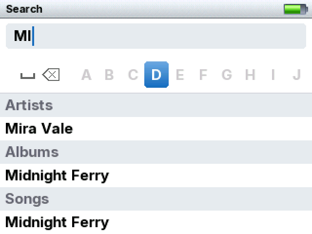
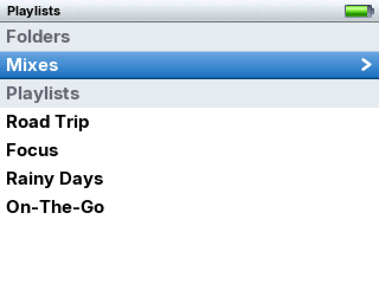
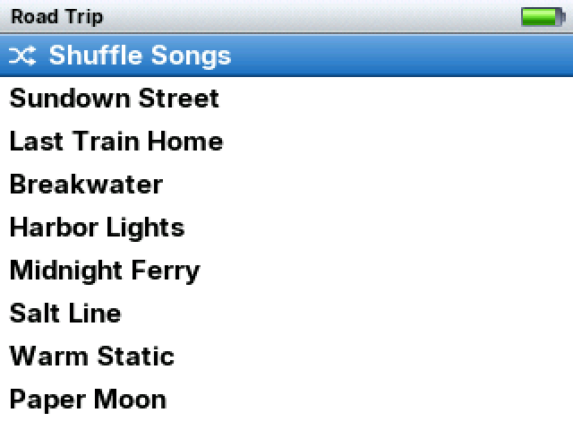
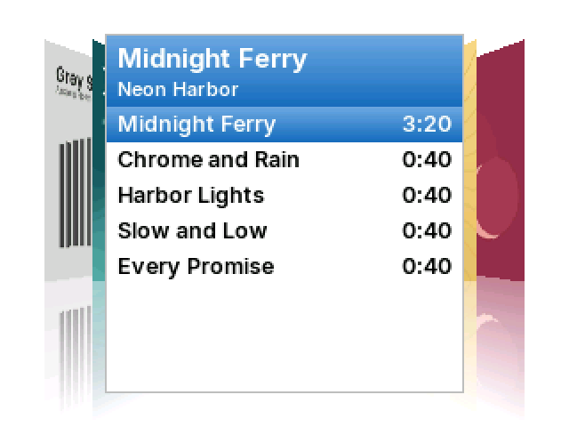
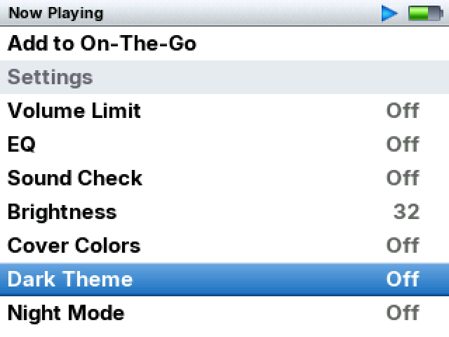
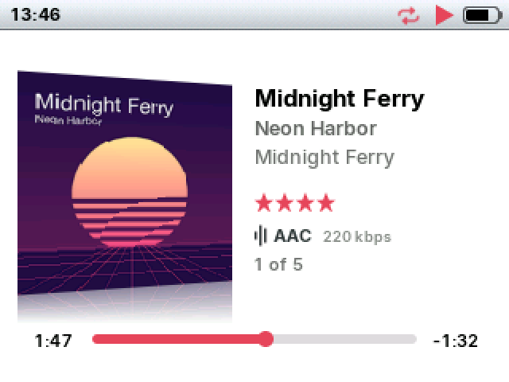
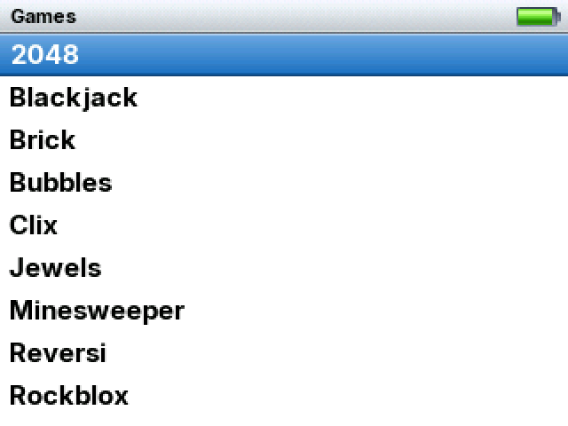

RockWheel is free, open-source firmware for the iPod Video, 5th and 5.5th generation, built on [Rockbox](https://www.rockbox.org). It brings Finder and iTunes sync to a familiar iPod interface, with Cover Flow, Live Lyrics, a dark theme and FLAC playback.

Sync your music as usual, or copy files directly onto the iPod. Both appear in the same library.

**[Features](#features) · [Compatibility](#will-it-work-on-my-ipod) · [Install](#install) · [Update](#update) · [Build](#build-from-source)**


## Features

[Sync with Finder or iTunes](#syncing-with-finder-and-itunes) as you always have. Your songs, playlists, covers and ratings arrive as synced, and what you play and rate on the iPod goes back to your computer.

**New in 1.3**

- [Search](#search) with the click wheel. With Smart Search, it passes over letters that wouldn't find anything.
- [Playlists made on the iPod](#playlists): create them, name them with the click wheel, add and remove songs, put them in folders. On-The-Go is back too, and you can save it as a playlist.
- [Smart playlists](#playlists) by rating or play count that update right on the iPod as you listen.
- [Music you copy onto the iPod yourself](#two-ways-to-add-music), FLAC included, in the same library as your synced music, with covers.
- [Cover Flow](#cover-flow) laid out as on an iPod classic.
- [An artist's albums listed by year](#artists-and-albums).
- [Playlist folders](#playlists), brought over from Music on a Mac or iTunes on Windows.
- [Settings in folders](#a-familiar-interface), with hints, and a customizable main menu, Music menu and Now Playing menu.
- A customizable [Now Playing](#the-look-of-now-playing) in the style of the iPod Video or the iPod classic.
- [Song titles in Korean, Japanese, Chinese, Hebrew, Arabic and Thai](#a-familiar-interface), shown out of the box in typefaces made for them.
- A click wheel that speeds up as a stock iPod's does.
- [Eight more games](#photos-and-extras), offered when you install.
- [An installer for Windows](#on-windows).

**Also included**

- [Live Lyrics](#now-playing) that follow the song.
- [Now Playing in the colors of the album](#colors-from-the-album) you're listening to.
- A [dark theme](#dark-theme-and-night-mode) for the whole iPod, and [Night Mode](#dark-theme-and-night-mode), which dims the screen, lowers the volume and silences the wheel, and can turn itself on at the hours you choose.
- [The EQ](#volume-sound-check-and-the-eq) with iTunes' presets, Sound Check and Volume Limit.
- [Menus in more than forty languages](#a-familiar-interface).
- [Photos](#photos-and-extras) you sync, in the familiar grid.
- [The stock firmware](#go-back-to-the-stock-firmware) stays on the iPod, one restart away.

## Will it work on my iPod?

**Made for:** iPod Video, 5th and 5.5th generation, formatted FAT32, synced from Finder on a Mac, iTunes on Windows or [iOpenPod](https://github.com/TheRealSavi/iOpenPod).

**What it was tested on:** one iPod. A 5.5G 30 GB model with 32 MB of RAM, an iFlash card of about 256 GB, macOS 26 and a library of about 13,000 songs. The speeds this page gives were measured there.

**On Windows** it syncs from iTunes or iOpenPod, as a stock iPod does.

**On an original hard drive** it runs too: a user has it on a 5.5G 30 GB, installed as described here. RockWheel was tuned on flash, where reads are much faster, so on a hard drive expect:

- Cover Flow and covers on track changes to be slower, since they read artwork from disk, and more so when the drive has to spin up
- Battery life to be shorter, since those reads keep the drive awake
- The library update after a sync to take longer

If you use it on a hard drive, please open an issue and say how it goes.

**If your iPod feels slow,** please open an issue and attach `.rockbox/drive.txt` from it. It describes the drive, without its serial number.

**Limits:**

- Music you bought from iTunes plays, apart from old copy-protected purchases. Apple Music subscription tracks aren't supported.
- RockWheel doesn't play video. The stock firmware stays on the iPod and shares the same library: to watch your videos, turn the Hold switch on while the iPod starts.
- Song titles in Hindi and Thai show, though their combining marks can be out of place, and those two languages aren't offered for the menus.
- Search can't type Chinese characters or Japanese kanji. Names written in them show in the library, but aren't found by Search.
- Playlists made on the iPod, On-The-Go among them, stay on the iPod: Finder and iTunes don't bring them into your library.
- At most 32,000 songs can be queued.
- Libraries much above 25,000 songs haven't been tried on an iPod. In the simulator with 32 MB of RAM, the theme may not load after a restart straight into Updating Library, and a library of 100,000 songs doesn't start.

## Install

### Before you install

RockWheel needs the iPod formatted as FAT32.

- **An iPod set up by iTunes on Windows** already is. Installing keeps everything on it, and your library is ready at the first start.
- **An iPod formatted on a Mac** isn't, and converting it erases the iPod. First sync it once, and back up anything else you keep on it: your music comes back with a sync, but play counts and ratings not yet synced don't. On a Mac, the installer converts it for you, and stops unless you type `ERASE`. On Windows, restore it in iTunes on that PC first, which makes it FAT32.

The stock firmware stays on the iPod, with the same library.

### On a Mac

Connect the iPod, open Terminal and paste this:

```sh
/bin/bash -c "$(curl -fsSL https://raw.githubusercontent.com/ssarkisy/RockWheel/main/install.sh)"
```

It downloads the files and checks them, finds the iPod, checks that it's an iPod Video, converts it if it has to, installs Rockbox's bootloader and the firmware, and ejects it. macOS asks for your password, because the bootloader goes straight onto the disk.

It also asks whether to add eight more games to Extras. Press Return to leave them out.

### On Windows

Connect the iPod, open PowerShell, not as administrator, and paste this:

```powershell
irm https://raw.githubusercontent.com/ssarkisy/RockWheel/main/install.ps1 | iex
```

It does the same as on a Mac, apart from converting: it downloads the files and checks them, finds the iPod, installs the bootloader if needed, copies the firmware, asks about the games and ejects the iPod. Windows asks for an administrator's permission to reach the iPod's disk directly, and on a first install asks once more to put the bootloader on it.

The Windows installer is new in 1.3, and few people have run it yet. If anything goes wrong, please open an issue and include what it printed, or the output of a dry run (see the [options](#options)).

### After you install

1. **Unplug the iPod.** If it doesn't restart by itself, hold Menu and Select until it does.
2. **Connect it again and sync from Finder or iTunes as usual.** Don't choose Restore: that erases the iPod and removes RockWheel.
3. **Unplug it.** Wait for the library update to finish.

To hear about new versions, choose Watch, then Custom, then Releases, at the top of this page.

### Options

Download the installer and run it with an option: [`install.sh`](install.sh) on a Mac, as `bash install.sh --dry-run`, or [`install.ps1`](install.ps1) on Windows, as `powershell -ExecutionPolicy Bypass -File .\install.ps1 -DryRun`.

| | On a Mac | On Windows |
|---|---|---|
| See what it would do, changing nothing | `--dry-run` | `-DryRun` |
| Bring your playlist folders over, for the next sync | `--folders` | `-Folders` |
| Add the extra games, or take them off | `--games`, `--no-games` | `-Games`, `-NoGames` |
| Choose the iPod, with more than one connected | | `-Drive E:` |
| Remove the bootloader | `--uninstall` | `-Uninstall` |

Playlist folders come from the Music app on a Mac, which asks you to let Terminal read them, and from iTunes on Windows. That has to be the iTunes from Apple's website: the one from the Microsoft Store can't be reached this way.

<details>
<summary>The same steps by hand, on a Mac</summary>

The installer does these steps for you, and with `--dry-run` it shows what it would do, changing nothing. By hand, let `ipodpatcher` find the iPod instead of looking up a disk number yourself: it only ever finds iPods, never your Mac's own disks. Build it from `utils/ipodpatcher` in this repository.

1. **Make sure the iPod is FAT32.** `sudo ipodpatcher --scan` shows the iPod's disk, such as `/dev/disk4`, and `macpod` if it's Mac-formatted. Converting erases the iPod: run `sudo ipodpatcher /dev/disk4 --convert`, with the disk the scan showed. On iPods with 2048-byte sectors, which the official `ipodpatcher` refuses, it then prints the command that formats the music partition, with the right disk in it: run it as printed.
2. **Install the Rockbox bootloader** with `sudo ipodpatcher --add-bootloader bootloader-ipodvideo.ipod`, using the file from [Releases](../../releases). Given no disk, it finds the iPod by itself, and stops if there's none or more than one. The official [Rockbox Utility](https://www.rockbox.org/wiki/RockboxUtility), run as root, works too.
3. **Copy the firmware.** Download `rockbox.zip` from [Releases](../../releases) and unzip it at the root of the iPod. For the extra games, unzip `rockbox-games.zip` there too. If you had plain Rockbox before, move the old `.rockbox` folder out of the way first.
4. **Restart and sync.** Eject, restart with Menu and Select, connect it again and sync from Finder. When you unplug, the library updates.

</details>

<details>
<summary>The same steps by hand, on Windows</summary>

Users have installed it this way. If anything goes differently, please open an issue.

1. **Make sure the iPod is FAT32.** An iPod set up by iTunes on Windows already is. If your iPod is Mac-formatted, restore it in iTunes on Windows to convert it to FAT32; this erases everything on it.
2. **Install the Rockbox bootloader** with the official [Rockbox Utility](https://www.rockbox.org/wiki/RockboxUtility), run as administrator. Choose the iPod Video and install only the bootloader, not Rockbox itself. If your iPod already starts Rockbox, skip this step.
3. **Copy the firmware.** Download `rockbox.zip` from [Releases](../../releases) and extract it to the iPod's drive, so that the `.rockbox` folder is at the top of it. For the extra games, extract `rockbox-games.zip` the same way. If you had plain Rockbox before, rename its `.rockbox` folder first.
4. **Restart and sync.** Eject the iPod, unplug it and hold Menu and Select until it restarts. The first start reads your library, so give it a moment. Then sync from iTunes as usual.

</details>

## Update

Run the same command as for installing, on a Mac or on Windows. Your settings, library, play counts and games are kept. It asks for your password or permission, and once, whether to add the games.

If you installed by hand, unzip `rockbox.zip` to the iPod again, replacing the files, and `rockbox-games.zip` too if you added the games. Do both at every update: games from an older version don't open with a newer firmware. Saved games and high scores are kept.

## Go back to the stock firmware

To start the stock firmware once, turn the Hold switch on while the iPod starts. RockWheel comes back at the next start.

To remove RockWheel, run the installer with `--uninstall` on a Mac or `-Uninstall` on Windows (see the [options](#options)). It takes the bootloader off, and the iPod starts its stock firmware from then on, with your library as it is. The `.rockbox` folder stays on the iPod, and you can delete it from Finder or File Explorer.

## RockWheel, Rockbox and the stock firmware

| | Stock firmware | Rockbox | **RockWheel** |
|---|---|---|---|
| Sync from Finder or iTunes | Yes | No | **Yes** |
| Ratings and play counts back to your computer | Yes | No | **Yes** |
| Looks and behaves like an iPod | Yes | Themes get part of the way | **Yes** |
| Album art | Prepared by your computer | Read from each song as it plays, slow for large covers | **Prepared ahead, for synced and copied music** |
| On-The-Go and live smart playlists | Yes | No | **Yes** |
| Playlists made on the iPod | On-The-Go only | With an on-screen keyboard | **Yes, named with the click wheel** |
| Search with the click wheel | Yes | With an on-screen keyboard | **Yes, in the alphabets of your library** |
| Music you copy yourself, such as FLAC | No | Yes, from any folder | **Yes, in the same library, with covers** |
| Cover Flow | No | Plugin: builds its own cache first, then covers load as you scroll | **Built in, with kinetic scrolling and covers prepared ahead** |
| Live Lyrics | No | Plugin | **Built into Now Playing** |
| Now Playing in the colors of the album | No | No | **Yes** |
| Dark theme | No | Some themes | **Built in, for the whole iPod** |
| Night Mode, on a schedule | No | No | **Yes** |
| Videos | Yes | Converted files, or through the stock firmware | **Through the stock firmware** |
| Open source | No | Yes | **Yes, GPL** |

## Performance

RockWheel was made to be as responsive as it can be. Songs start right away, the next cover appears the moment you skip, and lists keep up with your thumb, with a library of well over ten thousand songs on a chip from 2005 and as little as 32 MB of memory. A large part of the work on RockWheel went into this.

The measurements, compared with Rockbox and the stock firmware, and how they were reached, are in [docs/performance.md](docs/performance.md).

## Music and library

### Syncing with Finder and iTunes

Plug it in and it appears in Finder as an iPod, or in iTunes on Windows, and [iOpenPod](https://github.com/TheRealSavi/iOpenPod) syncs it too. Sync the way you always have, unplug, and your library is ready.

 

Your songs, playlists, ratings, covers, podcasts and audiobooks arrive just as they were synced. It works both ways: what you play and rate on the iPod is on your computer after the next sync. There's no extra app to install on your computer, and nothing to set up.

### Two ways to add music

| | Synced | Copied onto the iPod |
|---|---|---|
| How | Sync as usual, from Finder, iTunes or [iOpenPod](https://github.com/TheRealSavi/iOpenPod) | Copy the files into any folder outside iPod_Control, then unplug |
| Who prepares the library | Your computer: the songs' details and covers arrive ready, and the iPod only takes them in | The iPod reads the tags and prepares album art after you unplug it |
| How long that takes | Fast | Slower, the more new files there are |
| Where it appears | In your library: Artists, Albums, Search, Cover Flow, Shuffle Songs | In the same library, beside your synced music |
| Plays and ratings | Go back to your computer at the next sync | Stay on the iPod |
| Formats | What your sync app can sync | Also FLAC and the other formats Rockbox plays |

Some music never goes through Finder or iTunes: FLAC, for one, which neither of them plays. Copy it into any folder on the iPod outside iPod_Control, and unplug.

In iTunes or Music, a cover can be any size and format, PNG included: your computer converts it for the iPod as it syncs.

For copied music, the iPod prepares each album's cover itself, once, while the library updates, from the songs themselves or from an image in their folder. It reads standard JPEG. Covers of 400×400 or 600×600 are enough and quick to prepare; larger ones take longer and look no sharper on the iPod's screen.

Covers saved as PNG or as progressive JPEG aren't shown, since decoding them takes the iPod's processor far too long. After the library update, the iPod tells you how many albums have one. Save them again as standard JPEG, and they appear the next time you unplug.

A song you delete from the iPod leaves the library the next time you unplug, and one you move or rename keeps its plays and rating. Your smart playlists count these songs too.

### Artists and albums

Open an artist, and their albums are in the order they came out, the year beside each. Albums lists your whole library the same way, or by name: Sort By, at the top of the list, switches between the two.

### Search

Turn the wheel along the ring of letters and press Select to add one. Artists, albums and songs appear below as you type.



With Smart Search, on by default, the wheel passes over letters that wouldn't find anything, so a name is usually a few presses away.

The ring has the alphabets of your library, not only the Latin one, so names in Russian, Greek, Hebrew, Arabic, Thai, Korean or Japanese kana are just as quick to find. Names written in Chinese characters or kanji can't be typed.

Next (⏭) adds a space, Previous (⏮) deletes a letter, and Play (⏯) takes you down to what was found.

### Playlists

A playlist opens as quickly as Songs, its songs in the order you sorted them in on your computer.

 

Smart playlists that go by rating, play count or kind of media update right on the iPod, with their limits by number of songs or by time. Give a song five stars and it's in your five-star playlist at once. Those with other rules, such as when a song was last played, stay as they were synced until the next sync.

Make playlists of your own on the iPod. New Playlist and New Folder are at the top of Playlists, and you name them with the click wheel.

To add music, hold Select on a song, album, artist or playlist in Music or Search, on an album in Cover Flow, or in Now Playing, and choose Add to Playlist, or Add to On-The-Go for the quickest way.

Hold Select on a playlist of your own to rename it, move it to a folder or delete it, and on one of its songs to remove it. When On-The-Go is how you want it, Save Playlist turns it into a playlist of its own.

A computer icon marks a synced playlist. An iPod icon marks a local playlist you can edit, whether you created it on the iPod or copied it into /Playlists. Local playlists stay on the iPod: Finder and iTunes don't bring them into your library. A song you delete leaves them, and a song a sync moves stays in them.

Finder leaves playlist folders behind when it syncs an iPod Video. The installer can bring them over from Music on a Mac or from iTunes on Windows: see the [options](#options).

## Cover Flow

The iPod Video never had Cover Flow. Here it's built in, laid out as on an iPod classic: large covers standing close together, on white, or on black in the dark theme.

 

Scrolling has weight. Flick the wheel and the covers pick up the speed of your thumb, glide on their own and settle gently on an album. Flick again to go faster, or rest your thumb to stop.

Press Select and the cover turns into the album's list of songs. Previous (⏮) and Next (⏭) move one album at a time, and keep going while you hold them. Hold Select to add the album or one of its songs to On-The-Go or a playlist, or to play it next.

On the test iPod, thousands of covers go by without waiting for any of them to load, and the motion stays smooth. By default the music pauses while you browse; this is customizable.

## Playback

### Now Playing

Press Select to move from the cover to the scrubber, your rating, a large cover and the lyrics. The lyrics follow the song line by line when the song has time-synced lyrics in it. For music you copy onto the iPod, an `.lrc` file with the same name beside the song works too.

 

 

Hold Select for a short menu. From there you can open Cover Flow, go to the song's artist or album, see what's playing next, add the song to On-The-Go or a playlist, or change shuffle, repeat, the volume limit, the EQ, Sound Check, brightness, colors, the dark theme and Night Mode. The menu is customizable.

 

### Buttons and the screen

Hold Play for Now Playing from almost anywhere, and hold Menu for the main menu.

With the screen off, Play, Previous and Next still work, and in Now Playing the wheel sets the volume; press Select or Menu to turn the screen on. During playback, the menus return to Now Playing when the screen turns off. Both are customizable, with Wake Screen and Return to Now Playing in Settings, under General.

### Volume, Sound Check and the EQ

The volume, the volume limit and Night Mode's volume are all in percent. The volume moves in a hundred even steps, and the level shows under the bar as you turn the wheel, with your limit beside it.

Sound Check plays your songs at about the same loudness, using the levels your computer has already worked out.

 

The EQ has all 22 presets from iTunes, tuned as they are there. It also has presets for three pairs of headphones: the 7Hz Zero 2 earphones, the Koss KPH30i, and the Sony WH-1000XM4C, by cable in Active Mode (headphones switched on).

## Appearance

### A familiar interface

 

 

The main menu is the one you remember, with your iPod's name at the top. Beside it you see the album that's playing, a collage of your photos, or your iPod and its free space.

Settings are in folders, as on later iPods, with a short hint where an option's name doesn't say enough. The main menu and the Music menu are customizable: put Artists or Songs right in the main menu, or hide what you never use.

The menus come in more than forty languages. Song titles in Korean, Japanese, Chinese, Hebrew, Arabic and Thai show out of the box, in typefaces made for them.

### The look of Now Playing

Now Playing comes in the style of the iPod Video, the cover standing over its reflection, or of the iPod classic, with Angled Cover turning it slightly away. Status Bar, Rating and Progress Bar each have a second look, inspired by Music on iOS 13.

 

### Colors from the album

Now Playing can take on the colors of the album you're listening to, and the screen changes together with the cover.

 

 

**Fill** paints the screen in the album's color, so the cover melts into it. The text turns light or dark to stay easy to read.

**Whole Screen** softly tints the whole screen, down to the status bar and the progress bar.

**Text and Stars** keeps the theme's background and colors only the words and your rating.

With Fill and Whole Screen, the battery keeps its own colors, so it still shows at a glance how full it is.

It's off by default. To turn it on, hold Select in Now Playing and choose Cover Colors, or find it in Settings, under Appearance.

### Dark theme and Night Mode

The whole iPod can go dark: the menus, Now Playing, the dialogs, even the clock. On the test iPod it switches in about half a second. To turn it on, hold Select in Now Playing, or find Dark Theme in Settings, under Appearance. The colors from the album work in the dark too.

 

 

**Night Mode** is for the end of the day. It makes the iPod dark, silences the wheel, dims the screen and lowers the volume limit. You choose which of these it does, how dim the screen gets and how quiet the music.

It can also keep its own hours. Give it a start and an end, and it turns on and off by itself. If music is still playing when it ends, the volume stays where it is, so nothing wakes you. A small moon in the status bar shows when it's on.

## Photos and Extras

 

Photos you sync show in the familiar grid and full screen, and a collage of them sits beside the main menu.

Extras has a clock, a calendar, a stopwatch and five games: Brick, Solitaire, Jewels, Minesweeper and Blackjack. When you install, you can add eight more games from Rockbox: Rockblox, 2048, Sudoku, Sokoban, Reversi, Space Rocks, Bubbles and Clix. In Reversi, the iPod plays the other side.



## What's next

Planned:

- Port to the iPod Photo.
- Port to the iPod classic 6G and 7G.
- Apple iPod Radio Remote: button fixes, FM radio.
- Custom EQ presets from files.
- Faster cover preparation for copied music.
- Faster library updates after copying music.
- Faster import of thousands of playlists.
- A backup of play counts and ratings for copied music.

## Build from source

You need the Rockbox ARM toolchain, which `tools/rockboxdev.sh --target=a` builds.

```sh
mkdir build && cd build
../tools/configure --target=ipodvideo --type=n
make -j8 && make zip     # gives rockbox.zip
make gameszip            # gives rockbox-games.zip, the extra games
```

For the simulator, which is how the screenshots here were made, use `--type=s` and then `make -j8 && make install && ./rockboxui`.

## Credits and license

RockWheel is built entirely on [Rockbox](https://www.rockbox.org) and the work of its contributors, from commit `f3ffe789ef`. **Please report RockWheel's bugs here, not to the Rockbox project.**

- **Code:** GNU GPL, version 2 or later. See [LICENSE](LICENSE).
- **Theme:** modified from iClassic Square by Humberto Santana, derived from iLike by Alan Brito and Hayden Pearce, under [CC BY-SA 3.0](https://creativecommons.org/licenses/by-sa/3.0/). See [themes/README.md](themes/README.md).
- **The iOS look:** the status bar's icons, the stars and the progress bar, drawn by Linus (u/Linusssk), inspired by Music on iOS 13, used with his permission.
- **Fonts:** [Inter](https://rsms.me/inter/) for the menus and Now Playing. For other alphabets, [Pretendard](https://github.com/orioncactus/pretendard) for Korean, [Noto Sans JP, SC and TC](https://fonts.google.com/noto) for Japanese and Chinese, Noto Sans Hebrew, [Vazirmatn](https://github.com/rastikerdar/vazirmatn) for Arabic and [IBM Plex Sans Thai](https://github.com/IBM/plex) for Thai. All of them are under the SIL Open Font License, and installed with it. GNU Unifont, from Rockbox, covers the letters none of them has.

The screenshots come from the simulator, with a made-up library: the artists, albums, covers, lyrics, playlists and photos were generated for them. The disk size and the ratings in them are set by hand.

Apple, iPod, iTunes and Finder are trademarks of Apple Inc. RockWheel has nothing to do with Apple. It contains no Apple logo or firmware, and identifies itself to the computer as an iPod only so that Finder and iTunes will sync it.
