<a href="https://github.com/sponsors/ssarkisy"><picture><source media="(prefers-color-scheme: dark)" srcset="docs/images/sponsor-dark.svg"></picture></a> <a href="https://buymeacoffee.com/sarkisian"><picture><source media="(prefers-color-scheme: dark)" srcset="docs/images/coffee-dark.svg"></picture></a>

RockWheel is free, open-source firmware for the iPod Video, 5th and 5.5th generation, built on [Rockbox](https://www.rockbox.org). It combines Finder and iTunes sync with the stock iPod layout, Cover Flow, Live Lyrics, podcasts, audiobooks, three themes and FLAC playback.

Sync your music as usual, or copy files directly onto the iPod. Both appear in the same library.

**[Features](#features) · [Compatibility](#will-it-work-on-my-ipod) · [Install](#install) · [Update](#update) · [Build](#build-from-source)**

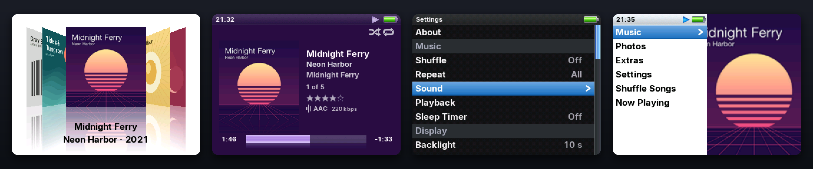

## Features

- [Finder and iTunes sync](#syncing-with-finder-and-itunes), including songs, playlists, covers, podcasts and audiobooks. Play counts and ratings sync back to your computer.
- [Copied music](#two-ways-to-add-music), including FLAC, in the same library as your synced music, with instant album art.
- [Podcasts and audiobooks](#podcasts-and-audiobooks) with new-episode counts, saved playback positions, adjustable speed and [chapters](#chapters).
- [Cover Flow](#cover-flow) with kinetic scrolling and albums sorted by artist or year.
- [Library sorting](#artists-albums-and-songs) by name, artist, album or year, Recently Added, and revamped [Search](#search) with the click wheel.
- [Playlists](#playlists) you can create and organize on the iPod, On-The-Go, playlist folders and smart playlists that update as you listen.
- [Now Playing](#now-playing) with Live Lyrics, ratings, a large cover view and optional [colors from the album art](#colors-from-the-album).
- [Classic, Modern and Neo themes](#themes), each with light and dark modes, plus [Night Mode](#dark-theme-and-night-mode) on a schedule.

RockWheel also includes [Sound Check, EQ presets and Volume Limit](#volume-sound-check-and-the-eq), [photos and thirteen games](#photos-and-extras), and [customizable menus in more than forty languages](#a-familiar-interface).

[Installers are available for Mac and Windows](#install). The stock firmware stays on the iPod, and you can [start it at any time](#go-back-to-the-stock-firmware).

See the [1.4.1 release notes](https://github.com/ssarkisy/RockWheel/releases/tag/v1.4.1) for the latest changes.

## Will it work on my iPod?

RockWheel supports the iPod Video, 5th and 5.5th generation, formatted as FAT32. You can sync with Finder on a Mac, iTunes on Windows or [iOpenPod](https://github.com/TheRealSavi/iOpenPod), as you would with the stock firmware.

I've tested it on one iPod: a 5.5G 30 GB model with 32 MB of RAM, an iFlash card of about 256 GB, macOS 26 and about 13,000 songs. All performance measurements on this page come from that device.

A user has also reported running it on a 5.5G 30 GB with its original hard drive, installed using the instructions below. RockWheel was tuned on flash storage, so on a hard drive expect:

- Slower Cover Flow and album art loading, especially when the drive has to spin up.
- Shorter battery life, because artwork reads keep the drive awake.
- Longer library updates after syncing.

If you use it on a hard drive, please open an issue and describe how it runs.

If the iPod is slow or something goes wrong, please attach `.rockbox/drive.txt` and `.rockbox/health.log` to an issue. `drive.txt` describes the drive without its serial number. `health.log` records errors and when they occurred, without song names or information that identifies your iPod.

**Limits:**

- Music purchased from iTunes plays unless it has copy protection. Protected songs and audiobooks appear in the library, but RockWheel reports that it can't play them. Apple Music subscription tracks aren't supported.
- RockWheel doesn't play video. To watch videos in the stock firmware, which shares the same library, turn the Hold switch on while the iPod starts.
- Podcast playback positions and completion status don't sync back to Podcasts on the Mac yet. This is still being investigated.
- The high-resolution covers prepared by Finder have only been tested with Finder on macOS 26, not with iTunes on Windows or iOpenPod.
- Hindi and Thai song titles are displayed, but their combining marks can be misplaced. Neither language is available for the menus.
- Search can't enter Chinese characters or Japanese kanji. Names written in them appear in the library, but can't be found through Search.
- Playlists created on the iPod, including On-The-Go, stay on the iPod. Finder and iTunes don't import them into your computer's library.
- The playback queue holds at most 32,000 songs. With more than 32,767 songs, the Songs list can only be sorted by name.
- Libraries much larger than 25,000 songs haven't been tested on an iPod. In the simulator with 32 MB of RAM, the theme may not load if the iPod restarts straight into Updating Library. A library of 100,000 songs doesn't start.

## Install

### Before you install

RockWheel requires FAT32.

- An iPod set up by iTunes on Windows is already FAT32. Installing preserves its contents, and the library is available on the first boot.
- A Mac-formatted iPod needs to be converted, which erases it. Sync first, then back up anything else you keep on it. Music can be synced again afterward; play counts and ratings that haven't reached the Mac will be lost. The Mac installer handles the conversion and requires you to type `ERASE` before proceeding. On Windows, restore the iPod in iTunes on that PC first to format it as FAT32.

RockWheel uses about 120 MB, mostly for fonts that support different writing systems in every theme. Allow about 160 MB of free space for installation.

The stock firmware stays installed and uses the same library.

### On a Mac

Connect the iPod, open Terminal and paste this:

```sh
/bin/bash -c "$(curl -fsSL https://raw.githubusercontent.com/ssarkisy/RockWheel/main/install.sh)"
```

The installer downloads and verifies the files, finds the iPod, checks its model and free space, and converts it to FAT32 if necessary. It then installs Rockbox's bootloader and the firmware, and ejects the iPod. macOS asks for your password because installing the bootloader requires direct disk access.

It also asks whether to add eight extra games to Extras. Press Return to skip them. Your choice is saved for future updates. To add the games later, run the same command with `--games` at the end.

### On Windows

Connect the iPod, open PowerShell without administrator privileges and paste this:

```powershell
irm https://raw.githubusercontent.com/ssarkisy/RockWheel/main/install.ps1 | iex
```

The installer downloads and verifies the files, finds the iPod and checks its free space. It installs the bootloader if needed, copies the firmware, asks about the extra games and ejects the iPod. It doesn't convert Mac-formatted iPods; restore those in iTunes on Windows first.

Windows asks for administrator permission to access the iPod's disk directly. On the first install, it asks again to install the bootloader.

If installation fails, please open an issue with the installer's output or the output of a dry run (see [options](#options)).

### After you install

1. **Unplug the iPod.** If it doesn't restart by itself, hold Menu and Select until it does.
2. **Connect it again and sync from Finder or iTunes as usual.** Don't choose Restore: that erases the iPod and removes RockWheel.
3. **Unplug it.** Wait for the library update to finish.

To get release notifications, choose Watch → Custom → Releases at the top of this page.

### Options

Add options at the end of the install command. On a Mac:

```sh
/bin/bash -c "$(curl -fsSL https://raw.githubusercontent.com/ssarkisy/RockWheel/main/install.sh)" --games
```

On Windows, `irm … | iex` can't accept options. Use this form instead:

```powershell
& ([scriptblock]::Create((irm https://raw.githubusercontent.com/ssarkisy/RockWheel/main/install.ps1))) -Games
```

You can also download the installer and run it locally: [`install.sh`](install.sh) as `bash install.sh --dry-run`, or [`install.ps1`](install.ps1) as `powershell -ExecutionPolicy Bypass -File .\install.ps1 -DryRun`.

| Option | Mac | Windows |
|---|---|---|
| Preview the installation without making changes | `--dry-run` | `-DryRun` |
| Import playlist folders for the next sync | `--folders` | `-Folders` |
| Add or remove the extra games | `--games`, `--no-games` | `-Games`, `-NoGames` |
| Choose an iPod when more than one is connected | | `-Drive E:` |
| Remove the bootloader | `--uninstall` | `-Uninstall` |

Playlist folders are imported from Music on a Mac or iTunes on Windows. On the Mac, you'll be asked to let Terminal read them. On Windows, this requires iTunes from Apple's website; the Microsoft Store version doesn't support this import method.

<details>
<summary>Manual installation on a Mac</summary>

The installer handles these steps automatically. Use `--dry-run` to preview them without making changes.

For a manual install, build `ipodpatcher` from `utils/ipodpatcher` in this repository. Let it detect the iPod rather than guessing a disk number: it only detects iPods, not your Mac's internal disks.

1. **Check the format.** `sudo ipodpatcher --scan` shows the iPod's disk, such as `/dev/disk4`, and reports `macpod` if it's Mac-formatted. To convert it, run `sudo ipodpatcher /dev/disk4 --convert`, using the disk shown by the scan. This erases the iPod. For iPods with 2048-byte sectors, which the official `ipodpatcher` refuses, the tool prints a command to format the music partition. Run that command as printed; it includes the correct disk.
2. **Install the Rockbox bootloader.** Download `bootloader-ipodvideo.ipod` from [Releases](../../releases) and run `sudo ipodpatcher --add-bootloader bootloader-ipodvideo.ipod`. Without a disk argument, it detects the iPod automatically and stops if it finds none or more than one. The official [Rockbox Utility](https://www.rockbox.org/wiki/RockboxUtility), run as root, works too.
3. **Copy the firmware.** Download `rockbox.zip` from [Releases](../../releases) and unzip it at the root of the iPod. Allow about 160 MB of free space. If extraction stops because the disk is full, free some space and unzip it again. For the extra games, unzip `rockbox-games.zip` there too. If you previously used plain Rockbox, move its old `.rockbox` folder out of the way first.
4. **Restart and sync.** Eject the iPod, restart with Menu and Select, reconnect and sync from Finder. The library updates after you unplug it.

</details>

<details>
<summary>Manual installation on Windows</summary>

Users have installed RockWheel this way. If these steps don't work for you, please open an issue.

1. **Check the format.** An iPod set up by iTunes on Windows is already FAT32. To convert a Mac-formatted iPod, restore it in iTunes on Windows. This erases everything on it.
2. **Install the Rockbox bootloader.** Run the official [Rockbox Utility](https://www.rockbox.org/wiki/RockboxUtility) as administrator. Choose the iPod Video and install only the bootloader. Skip this step if the iPod already boots Rockbox.
3. **Copy the firmware.** Download `rockbox.zip` from [Releases](../../releases) and extract it to the iPod's drive, with `.rockbox` at the root. Allow about 160 MB of free space. If extraction stops because the disk is full, free some space and try again. Extract `rockbox-games.zip` the same way if you want the extra games. If you previously used plain Rockbox, rename its `.rockbox` folder first.
4. **Restart and sync.** Eject and unplug the iPod, then hold Menu and Select until it restarts. The first boot reads your library. After that, sync from iTunes as usual.

</details>

## Update

Run the installation command again on Mac or Windows. Your settings, library, play counts and games are preserved. The installer asks for your password or administrator permission. If you haven't chosen whether to install the extra games before, it asks once and saves your choice.

After an update from 1.3 or earlier, the first boot rebuilds the library while preserving play counts, ratings and playback positions. See [Updating to 1.4](docs/updating-to-1.4.md) for the other changes, and the [1.4.1 release notes](https://github.com/ssarkisy/RockWheel/releases/tag/v1.4.1) for the latest update.

For a manual update, extract `rockbox.zip` to the iPod and replace the existing files. If you installed the extra games, extract `rockbox-games.zip` too. Update both archives each time: games from an older version won't run with newer firmware. Saved games and high scores are preserved.

## Go back to the stock firmware

To start the stock firmware once, turn the Hold switch on while the iPod starts. RockWheel starts again on the next boot.

To remove RockWheel, run the installer with `--uninstall` on Mac or `-Uninstall` on Windows (see [options](#options)). This removes the bootloader, so the iPod starts its stock firmware on every boot. Your library is preserved. You can then delete the remaining `.rockbox` folder using Finder or File Explorer.

## RockWheel, Rockbox and the stock firmware

| | Stock firmware | Rockbox | RockWheel |
|---|---|---|---|
| Finder or iTunes sync | Yes | No | Yes |
| Play counts and ratings synced back to your computer | Yes, except when podcasts are synced on macOS 26 | No | Yes, including when podcasts are synced |
| Stock iPod layout and controls | Yes | Partly, through themes | Yes |
| Album art | Prepared by your computer | Read during playback; large covers load slowly | Prepared in advance for synced and copied music |
| Podcasts and audiobooks | Yes | As plain files | New-episode counts, a saved position per book and adjustable speed |
| Chapters | Yes | Cue sheets, disabled by default | In podcasts, audiobooks and long recordings |
| Shuffle by album | Yes | No | Yes |
| On-The-Go and live smart playlists | Yes | No | Yes |
| Playlists created on the iPod | On-The-Go only | Named with an on-screen keyboard | Named with the click wheel |
| Search with the click wheel | Yes | Uses an on-screen keyboard | Uses the alphabets present in your library |
| Copied music, including FLAC | No | From any folder | In the same library as synced music, with covers |
| Cover Flow | No | Plugin; builds its own cache, then loads covers as you scroll | Built in, with kinetic scrolling and covers prepared in advance |
| Live Lyrics | No | Plugin | Built into Now Playing |
| Now Playing colors from album art | No | No | Yes |
| Themes | One | Community themes | Three, each with light and dark modes and accent colors |
| Scheduled Night Mode | No | No | Yes |
| Videos | Yes | Converted files or stock firmware | Through the stock firmware |
| Open source | No | Yes | Yes, GPL |

## Performance

On the test iPod, with about 13,000 songs and 32 MB of RAM, opening Songs takes 0.21 seconds. Album art appears in 0.07–0.25 seconds after a track change.

See [performance measurements](docs/performance.md) for comparisons with Rockbox, earlier RockWheel builds and the stock firmware, along with details of the changes behind them.

## Music and library

### Syncing with Finder and iTunes

Connect the iPod and sync from Finder on a Mac, iTunes on Windows or [iOpenPod](https://github.com/TheRealSavi/iOpenPod). After you unplug it, RockWheel updates the library.

 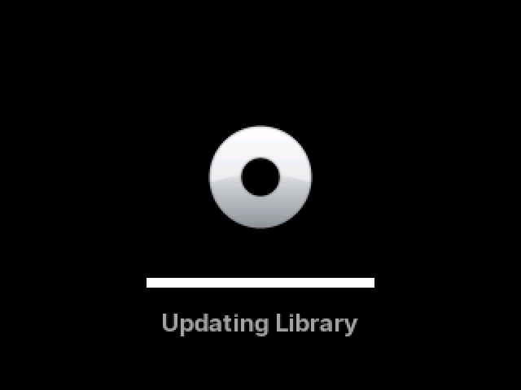

Sync includes songs, playlists, ratings, covers, podcasts and audiobooks. Play counts and ratings sync back to your computer the next time you connect. No additional sync app or configuration is required.

Finder on macOS 26 normally ignores play counts and ratings when podcasts are synced to an iPod, even one running Apple's firmware. RockWheel works around this. If a sync doesn't import the counts and ratings, they're kept on the iPod for the next connection without being counted twice.

### Two ways to add music

| | Synced music | Copied music |
|---|---|---|
| How to add it | Sync from Finder, iTunes or [iOpenPod](https://github.com/TheRealSavi/iOpenPod) | Copy files into any folder outside `iPod_Control`, then unplug |
| Library preparation | Your computer prepares track details and covers; the iPod imports them | The iPod reads tags and prepares album art after you unplug |
| Update time | Fast | Longer, depending on the number of new files |
| Where it appears | Artists, Albums, Search, Cover Flow and Shuffle Songs | The same library as synced music; files in Audiobooks or Podcasts folders go to those sections |
| Play counts and ratings | Sync back to your computer | Stay on the iPod |
| Formats | Formats supported by your sync app | Also FLAC and other formats supported by Rockbox |

For formats that Finder and iTunes don't support, such as FLAC, copy the files to any folder outside `iPod_Control` and unplug the iPod.

For synced music, album art can be any size or format supported by iTunes or Music, including PNG. Your computer converts it during sync.

For copied music, RockWheel prepares each album's artwork once during the library update, using an embedded cover or an image in the album's folder. It supports standard JPEG. A 400×400 or 600×600 image is enough; larger images take longer to prepare without looking sharper on the iPod's screen.

PNG and progressive JPEG covers aren't displayed because they take too long to decode on the iPod. After the library update, RockWheel reports how many albums have unsupported covers. Convert those images to standard JPEG; they'll appear after the next connection and unplug.

Deleted files are removed from the library after the next connection and unplug. Moved or renamed files keep their play counts and ratings. Copied music is included in smart playlists too.

### Artists, albums and songs

Names sort as they do in Music on the Mac: The Killers under K, ignoring case and accents, and using each name's Sort field when set.

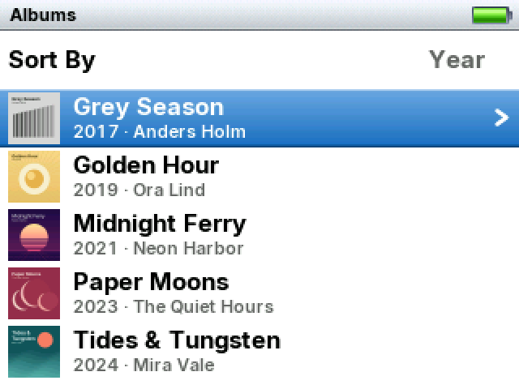 

Artists groups music by album artist to keep each album together. An artist's albums are listed by release year, with All Songs above them.

Albums shows each album's cover, year and artist. Use Sort By at the top to cycle through year, name and artist. When sorted by artist, each artist's albums appear in release order. Open an album to see its cover and track list, with track numbers, durations and separate discs.

Songs can be sorted by name, artist, album or year. Recently Added shows the fifty most recently added albums.

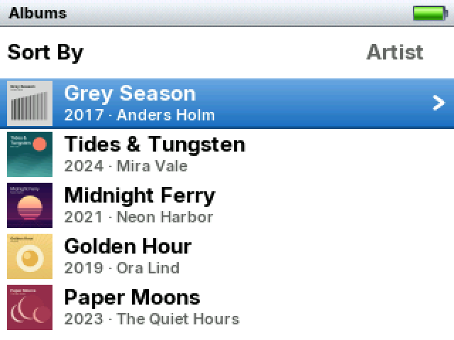 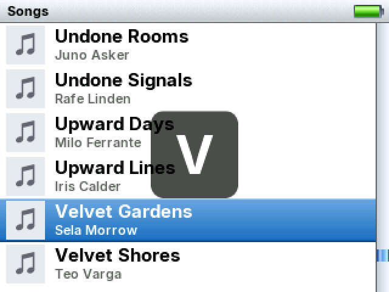

The wheel accelerates as it does on a stock iPod. Turn it quickly in a long list and a large letter appears. Each wheel step then jumps by one letter until you lift your thumb.

Hold Select on a song to open its artist or album. You can customize covers in lists, the scrollbar, letter jumping and grouping by album artist.

### Podcasts and audiobooks

Podcasts and audiobooks have separate sections in Music.

 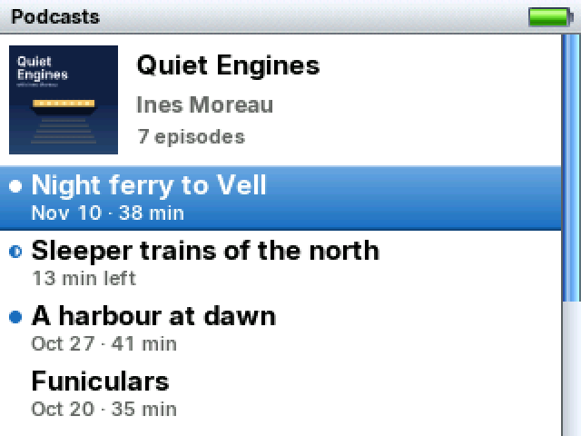

Podcasts shows each show's cover, new-episode count and progress through the current episode. Episodes are listed newest first. A dot marks an unplayed episode; a half dot marks one you've started. When an episode ends, playback continues with the next unplayed episode.

 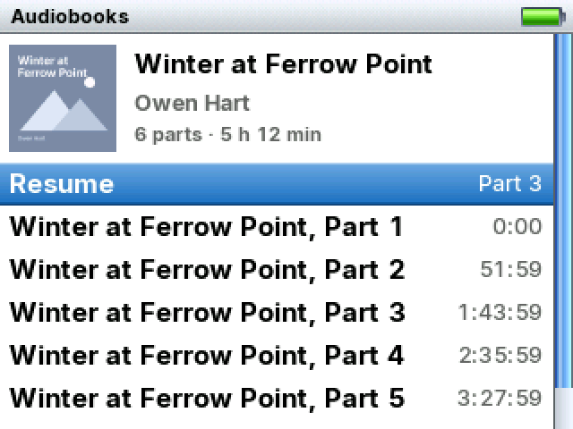

Audiobooks shows each book's author and remaining time, with books you've started listed first. RockWheel saves one playback position per book, even if the book spans several files. Choose Resume to continue from that position.

Each podcast or audiobook has its own playback speed, from Normal to 2×. Audiobooks also support slower speeds. Pitch is preserved, and music plays at its normal speed. Change the speed in Settings → Playback, or press Select past the scrubber in Now Playing.

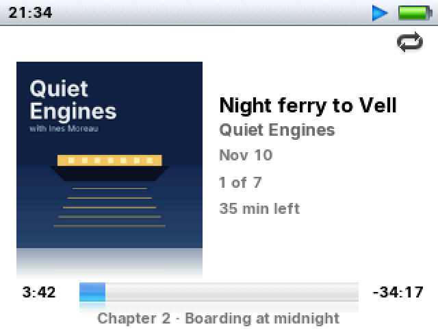 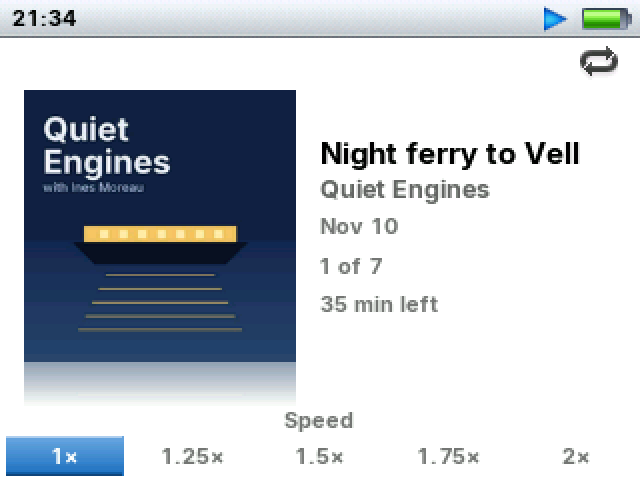

For podcasts, Now Playing shows the show name, date and remaining time. The scrubber's buttons skip back 15 seconds or forward 30 seconds. Episode notes appear in place of lyrics.

Copied books and podcasts work the same way. RockWheel recognizes them by the `.m4b` extension, the Audiobook or Podcast genre, or a folder named Audiobooks or Podcasts.

### Chapters

Podcasts, audiobooks and recordings of ten minutes or longer support chapters. Next skips to the next chapter; Previous returns to the start of the current one. Now Playing shows the chapter name below the progress bar. Hold Select and choose Chapters to see the full list with timestamps.

Chapters are read from MP3, M4A and M4B files. This also works for mixes and concerts stored as a single file.

### Search

Turn the wheel to choose a letter and press Select to enter it. Matching artists, albums and songs appear below. A heading shows which type of result you're browsing.


Smart Search is on by default. It skips letters that wouldn't produce any matches.

The letter ring includes the alphabets used in your library: Russian, Greek, Hebrew, Arabic, Thai, Korean and Japanese kana, as well as Latin. Chinese characters and Japanese kanji can't be entered.

Podcasts and audiobooks appear by name among the album results and open in their own screens.

Next (⏭) adds a space, Previous (⏮) deletes a letter, and Play (⏯) moves to the results.

### Playlists

Playlists can be sorted A–Z or Z–A, using the same ordering as Music on the Mac, and retain any imported folders. They open as quickly as Songs and preserve the track order set on your computer.

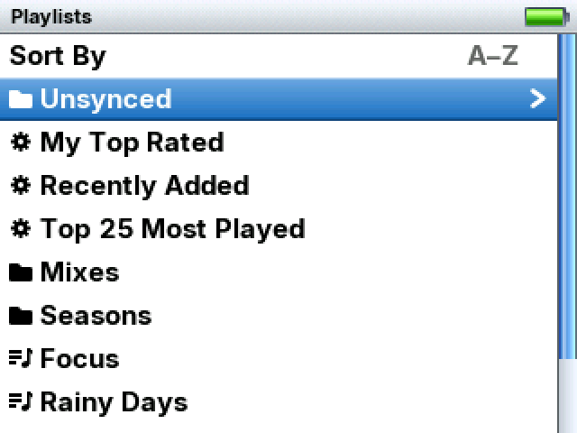 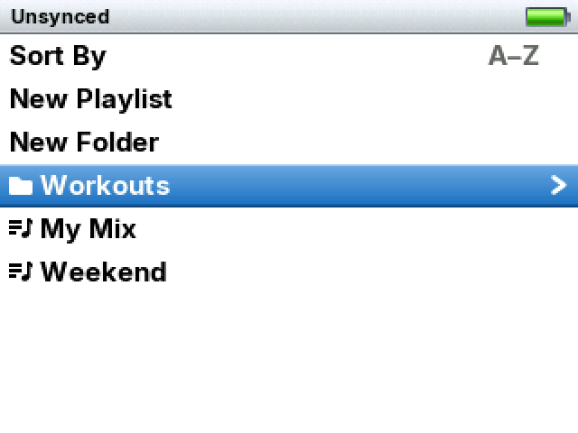

Smart playlists are grouped at the top and marked with a gear. Rules based on rating, play count or media type update on the iPod, including limits by track count or duration. Rate a song five stars and it immediately appears in your five-star playlist. Other rules, such as last played, update only when you sync.

Create playlists and folders in Unsynced, at the top of Playlists, using New Playlist and New Folder. Names are entered with the click wheel.

To add music, hold Select and choose Add to Playlist or Add to On-The-Go. This works on songs, albums, artists and playlists in Music or Search, on albums in Cover Flow, and in Now Playing.

Hold Select on a playlist you've created to rename, move or delete it. Hold Select on one of its songs to remove that song. Use Save Playlist to save On-The-Go as a separate playlist in Unsynced.

Unsynced also includes playlists you copy into `/Playlists`. These playlists stay on the iPod; Finder and iTunes don't import them into your computer's library. Deleted songs are removed from them, and songs moved by a sync remain in them.

Finder doesn't sync playlist folders to the iPod Video. The installer can import them from Music on a Mac or iTunes on Windows (see [options](#options)).

## Cover Flow

Cover Flow is built into RockWheel, using the iPod classic layout. The background is white in the light theme and black in the dark theme.

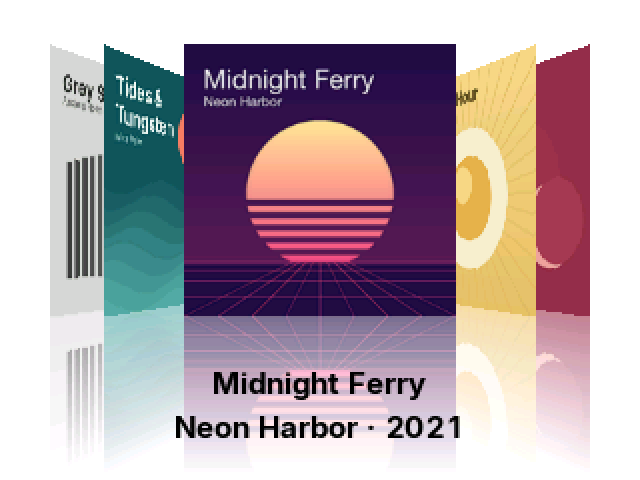 

Flick the wheel and the covers keep scrolling after you lift your thumb. Flick again to go faster, or rest your thumb on the wheel to stop.

Albums are sorted by artist, then by release year, with the year below each cover. Hold Select and choose Sort By to sort the whole library by year instead.

Press Select to open an album's track list. Previous (⏮) and Next (⏭) move one album at a time; hold either to scroll to the first or last album. Hold Select to add an album or song to On-The-Go or another playlist, play it next, or open its artist.

On the test iPod, scrolling through thousands of covers stays smooth without waiting for artwork to load. Music pauses while you browse by default; you can change this setting.

## Playback

### Now Playing

Now Playing uses the stock iPod layout: title, artist, album, track number and rating beside the cover, with Shuffle and Repeat icons in the corner. In Settings → Appearance, you can choose when ratings appear and whether to show format and bitrate.

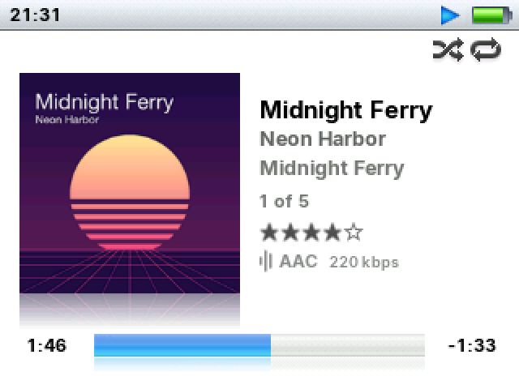 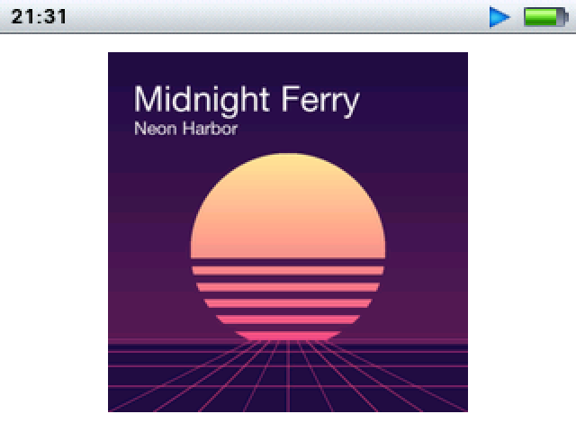

Press Select to cycle through the cover, scrubber, rating, large cover and lyrics. Live Lyrics follows the song line by line when timed lyrics are embedded in the file. For copied music, you can also place an `.lrc` file with the same name beside the song. Podcasts and audiobooks have speed controls and notes in these views.

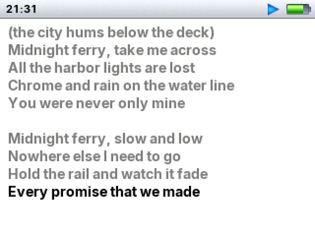 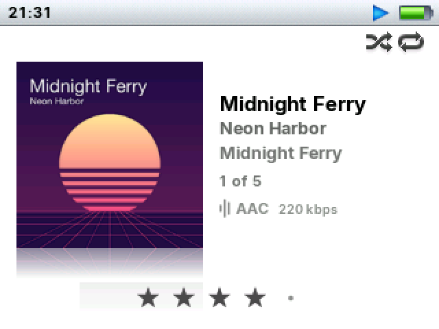

Hold Select to open the Now Playing menu. It includes Cover Flow, artist and album links, the current playlist, the upcoming queue, chapters and playlist actions. You can also change shuffle, repeat, Volume Limit, EQ, Sound Check, brightness, Cover Colors, Dark Theme and Night Mode. The menu is customizable.

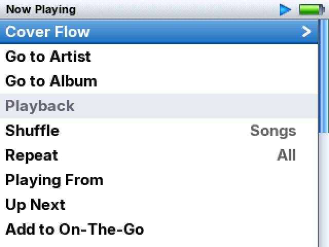 

### Shuffle

Shuffle has three settings: Off, Songs and Albums. Albums plays whole albums in random order, keeping each album's tracks in order. It works with all songs, an artist or a playlist.

Change shuffle in Settings or by holding Select in Now Playing. Shuffle Songs in the main menu shuffles the whole library. You can add Shuffle Albums to the main menu too. Podcasts and audiobooks always play in order.

### Buttons and the screen

Hold Play to open Now Playing from almost anywhere. Hold Menu to return to the main menu.

When the screen is off, Play, Previous and Next still work. In Now Playing, the wheel still adjusts volume. Press Select or Menu to wake the screen. During playback, the interface returns to Now Playing when the screen turns off.

You can change this behavior with Wake Screen and Return to Now Playing in Settings → General.

### Volume, Sound Check and the EQ

Volume, Volume Limit and Night Mode's volume setting are shown as percentages. Volume adjusts in 100 equal steps. The current level and your limit appear below the volume bar as you turn the wheel.

Sound Check keeps songs at a similar loudness using the levels calculated by your computer.

 

The EQ includes all 22 iTunes presets with the same tuning, plus presets for the 7Hz Zero 2, Koss KPH30i and Sony WH-1000XM4C. The Sony presets are for a wired connection in Active Mode, with the headphones switched on.

## Appearance

### Themes

RockWheel has three themes, each with light and dark modes.

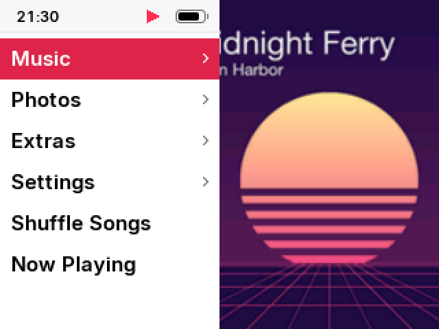 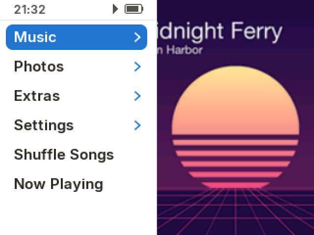

Classic follows the stock iPod menus and Now Playing layout, with a choice of accent colors from blue to graphite.

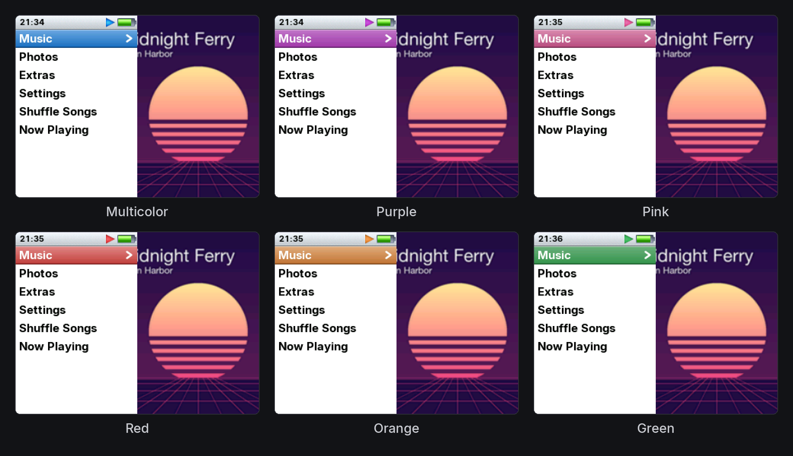

Modern uses a white background, larger text and a single accent color. The selected row is highlighted across the full width of the screen. Section headings and the artist in Now Playing use the accent color too. Chevrons mark rows that open another screen. Settings uses a light gray selection highlight, like Music on the Mac.

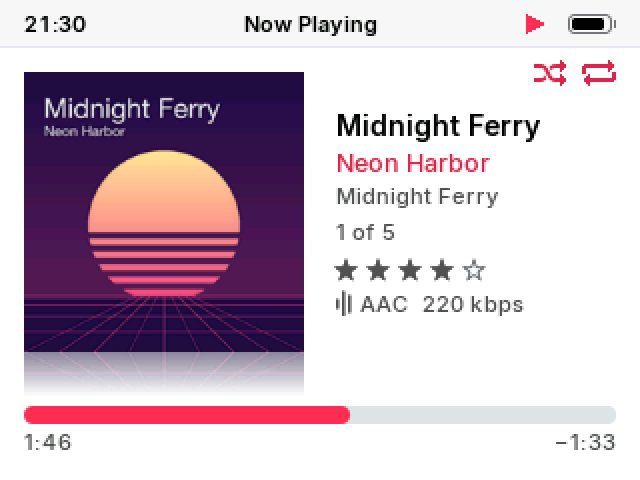 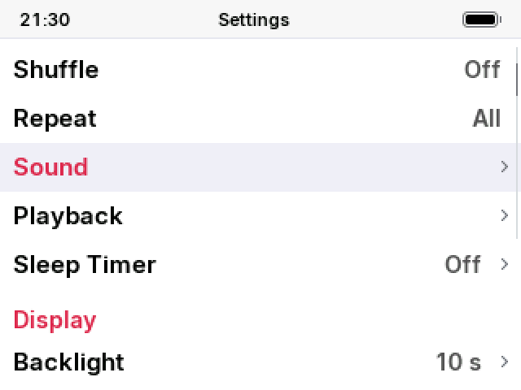

Neo uses a flat design with a neutral background. Its Multicolor option assigns red to music, purple to podcasts, orange to audiobooks and blue to everything else, like on the Mac. You can also choose one of thirteen colors, from Desert to Deep Blue, for every screen. The accent color applies to selections, icons, the artist name and bars. A tinted background is optional.

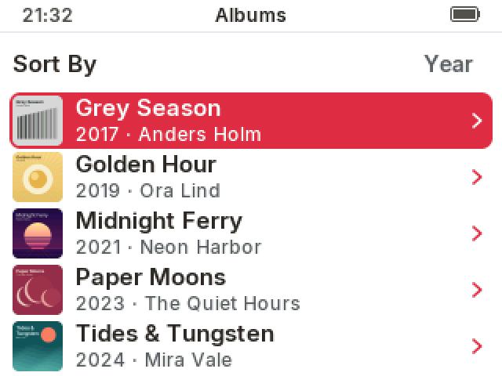 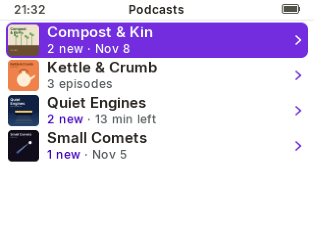

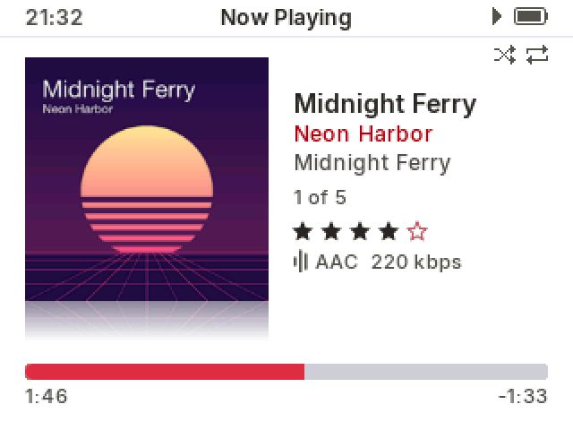 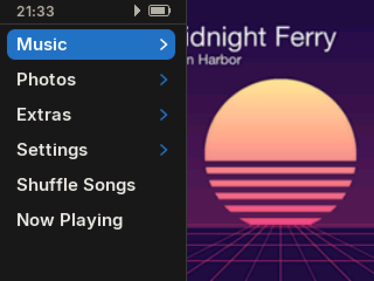

Choose a theme in Settings → Appearance. Changing themes stops playback. Use Resume Playback to continue from where you stopped.

### A familiar interface

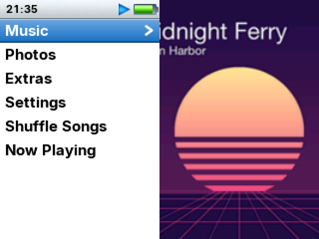 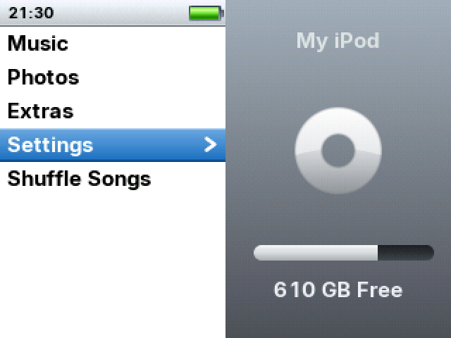

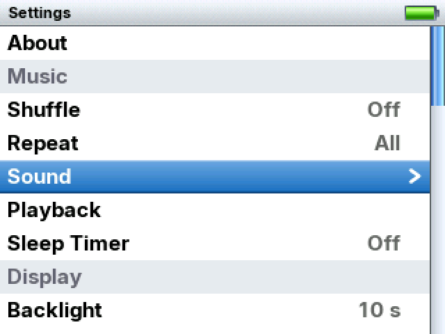 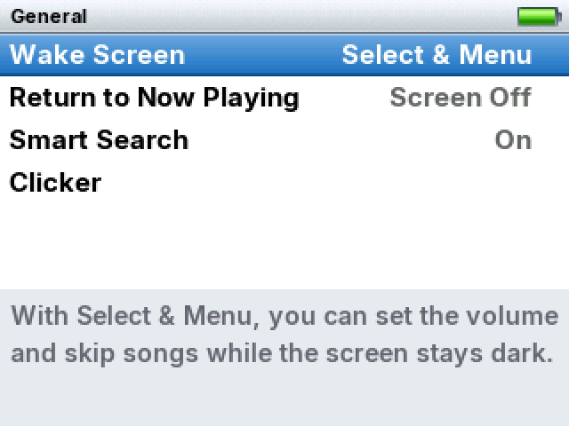

The main menu follows the stock layout, with the time at the top. Its side panel shows the current album cover, a photo collage, or your iPod and its free space. When playback is stopped, it shows the cover of the song saved for Resume Playback. Resume Playback starts without a loading delay. Moving Cover adds a slow horizontal animation to the artwork.

For synced music, Finder prepares the full-size cover in advance, so it appears as soon as a song starts. For copied music, the iPod generates it from the embedded artwork a few seconds into playback and saves it for later. To update covers synced before 1.4, choose Rebuild Synced Covers in Settings, then sync.

Settings is organized into sections and folders, with hints for options that need explanation. You can customize the main menu and Music menu: add Artists or Songs to the main menu, or hide items you don't use.

Menus are available in more than forty languages. Fonts for Korean, Japanese, Chinese, Hebrew, Arabic and Thai song titles are included.

### The look of Now Playing

Every theme supports the iPod Video layout, with a reflection below the cover, and the iPod classic style, with a tilted cover. Enable Angled Cover for the latter.

 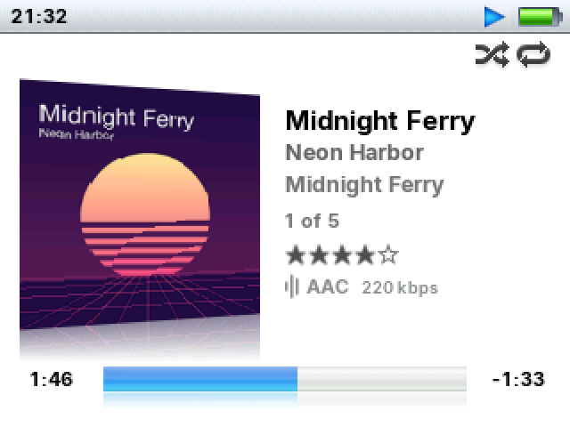

### Colors from the album

Now Playing can use colors from the current album's artwork. The colors update when the cover changes.

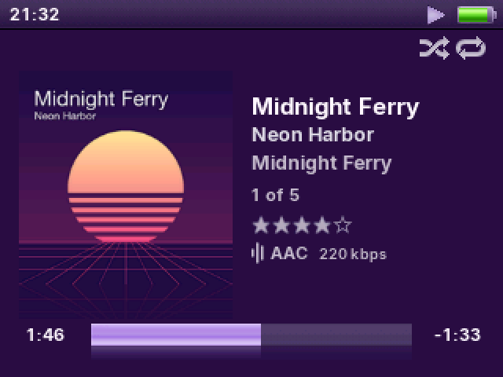 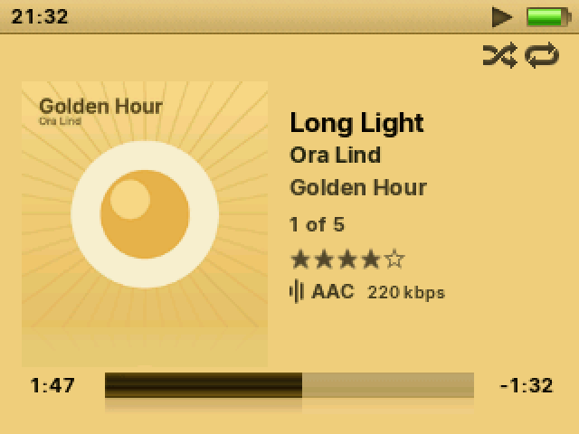

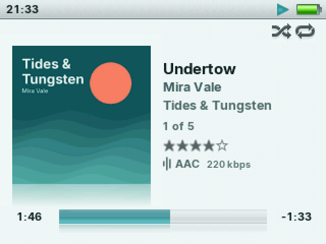 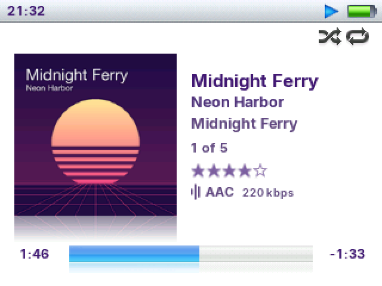

- **Fill** uses the album color as the background. Text switches to light or dark for readability.
- **Whole Screen** tints the screen, including the status and progress bars.
- **Text and Stars** applies the album color to text and ratings, keeping the theme's background.

Fill and Whole Screen preserve the battery indicator's own colors.

In Neo, these options apply over the theme's accent color. Nearly gray artwork leaves that color unchanged. Modern keeps its own colors.

Cover Colors is off by default. To enable it, hold Select in Now Playing and choose Cover Colors, or open Settings → Appearance.

### Dark theme and Night Mode

Dark Theme applies to menus, Now Playing, dialogs and the clock in all three themes. Enable it by holding Select in Now Playing or through Settings → Appearance → Dark Theme. Colors from album art work in the dark theme too.

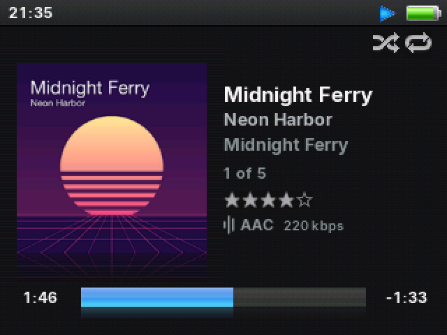 

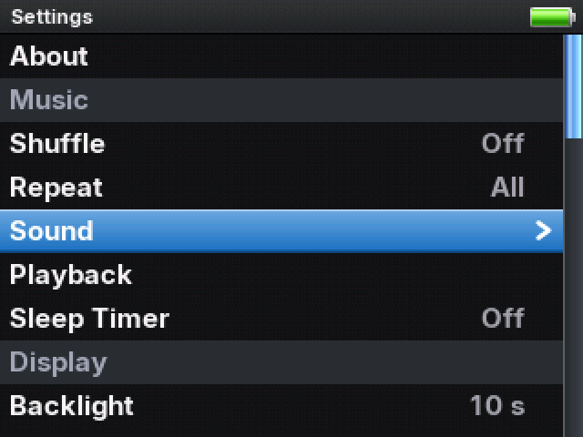 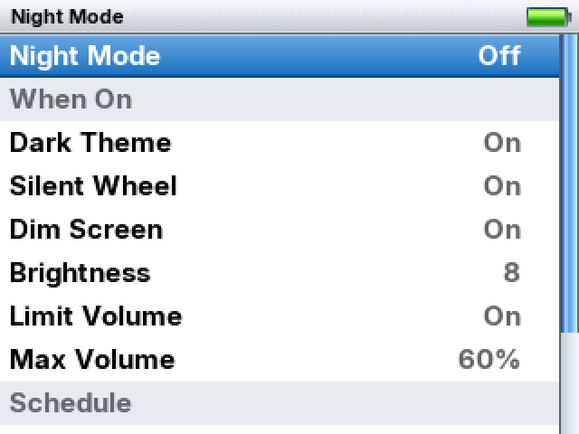

Night Mode can enable the dark theme, mute wheel clicks, dim the screen and lower the volume limit. You choose which actions it takes, the brightness and the volume limit.

Turn it on manually or set a start and end time. If music is playing when Night Mode ends, the volume stays at its current level. A moon icon in the status bar shows when it's active.

## Photos and Extras

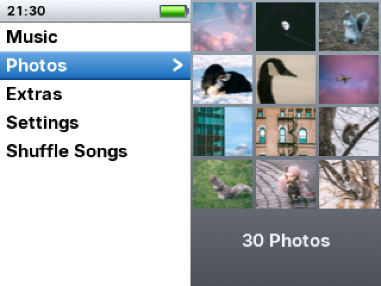 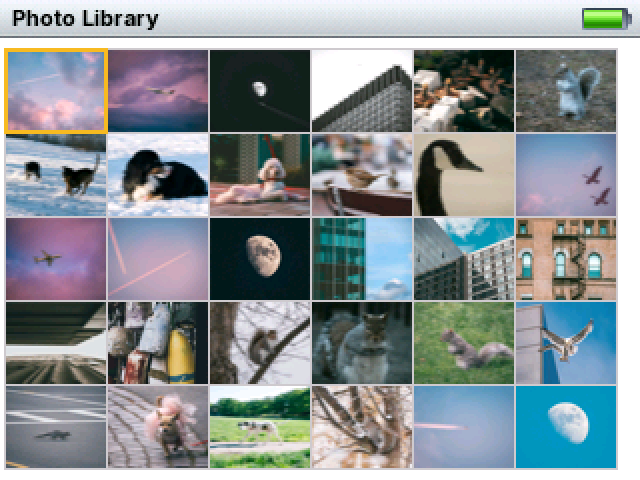

Synced photos can be viewed in a grid or full screen. Photo collages appear beside the main menu and for each photo album. Press Play to pause the music while browsing.

Extras includes a clock, calendar, stopwatch and five games: Brick, Solitaire, Jewels, Minesweeper and Blackjack. The installer can add eight more Rockbox games: Rockblox, 2048, Sudoku, Sokoban, Reversi, Space Rocks, Bubbles and Clix. Reversi includes a computer opponent.

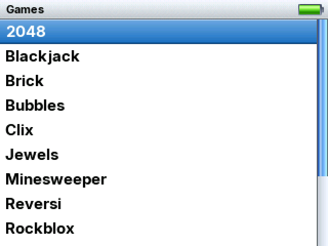

## What's next

These are planned features. The version targets may change.

Planned for 1.5:

- Longer battery life through sleep instead of shutdown, and lower CPU use in audio decoding and the EQ.
- Faster lists, Search, library updates for copied music and importing large numbers of playlists.
- Last.fm scrobbling.

Planned for 1.6:

- Notes, Contacts, Calendar, world clocks, Music Quiz and Parachute, as on the stock iPod.
- A customizable EQ.
- Apple iPod Radio Remote button fixes and FM radio support.
- Podcast progress synced back to Podcasts on the Mac.
- Playlists in Search, and smart playlist rules for date added and last played.
- A sleep timer that waits for the end of an episode or chapter.

Later:

- Support for the iPod Photo.
- Support for the iPod classic 6G and 7G.
- Backups of play counts and ratings for copied music, stored outside the iPod.

## Build from source

Build the Rockbox ARM toolchain with `tools/rockboxdev.sh --target=a`, then build the firmware:

```sh
mkdir build && cd build
../tools/configure --target=ipodvideo --type=n
make -j8 && make zip     # gives rockbox.zip
make gameszip            # gives rockbox-games.zip, the extra games
```

For the simulator, use `--type=s`, then run `make -j8 && make install && ./rockboxui`. The screenshots on this page were made with the simulator.

## Credits and license

RockWheel is based on [Rockbox](https://www.rockbox.org) at commit `f3ffe789ef` and the work of its contributors. **Please report RockWheel bugs in this repository, not to the Rockbox project.**

- **Code:** GNU GPL, version 2 or later. See [LICENSE](LICENSE).
- **Fixes from other projects:** includes fixes from later Rockbox versions. Several reliability fixes follow [ProkBox5g](https://github.com/prokbox/prokbox5g) by prokopto-dev. A USB fix and a memory fix come from [PodBox](https://github.com/anthonyfletcher/podbox), the USB fix through Rockbox. Each is credited in its commit.
- **Themes:** Classic is modified from iClassic Square by Humberto Santana, derived from iLike by Alan Brito and Hayden Pearce. Modern and Neo are designed by Sergei Sarkisian. All three are under [CC BY-SA 3.0](https://creativecommons.org/licenses/by-sa/3.0/); Modern and Neo also under the GNU GPL, version 2 or later, at your choice, as their icons are built into the firmware too. See [themes/README.md](themes/README.md).
- **Fonts:** [Inter](https://rsms.me/inter/) for menus and Now Playing; [Pretendard](https://github.com/orioncactus/pretendard) for Korean; [Noto Sans JP, SC and TC](https://fonts.google.com/noto) for Japanese and Chinese; Noto Sans Hebrew; [Vazirmatn](https://github.com/rastikerdar/vazirmatn) for Arabic; and [IBM Plex Sans Thai](https://github.com/IBM/plex) for Thai. Each is distributed with its SIL Open Font License. GNU Unifont, from Rockbox, provides fallback glyphs.

Screenshots were made in the simulator using a generated library of artists, albums, covers, lyrics, podcasts, audiobooks, playlists and photos. Disk size and ratings were set manually.

Apple, iPod, iTunes and Finder are trademarks of Apple Inc. RockWheel is not affiliated with Apple. It contains no Apple logo or firmware, and identifies itself to the computer as an iPod so that Finder and iTunes can sync it.
