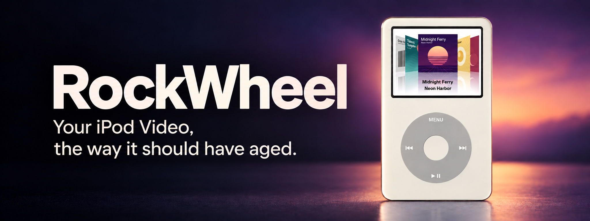

RockWheel is free, open-source firmware for the iPod Video, 5th and 5.5th generation, built on [Rockbox](https://www.rockbox.org). It keeps Rockbox's engine and adds two things Rockbox doesn't have: Finder sees it as an iPod, and it looks and behaves like one.

Your iPod syncs with Finder/iTunes as it always did, and now has what it never got: Cover Flow with kinetic scrolling, lyrics that follow the song, a Now Playing screen that takes on the colours of the album, a dark theme with a Night Mode on a schedule, and room for a very large library without slowing down.

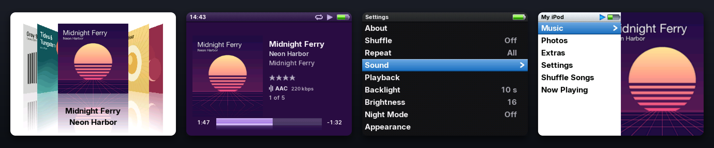

> [!WARNING]
> **Tested by me on one iPod:** a 5.5G with 32 MB of RAM, converted to an iFlash card of about 256 GB. Users now run it on other 5G and 5.5G iPods too, one of them with its original hard drive. See [Will it work on my iPod?](#will-it-work-on-my-ipod) before you install.

## Why RockWheel

| | Stock firmware | Rockbox | **RockWheel** |
|---|---|---|---|
| Sync from Finder | Yes | No, Finder doesn't see it as an iPod | **Yes** |
| Ratings and play counts back to Finder | Yes | No | **Yes** |
| Looks and behaves like an iPod | Yes | Themes get part of the way | **Yes** |
| Finder's album art, shown at once | Yes | Slow with large embedded art | **Yes** |
| Cover Flow | No | Plugin, with its own cache to build | **First item in Music, with kinetic scrolling** |
| Time-synced lyrics | No | Plugin | **Built into Now Playing** |
| Now Playing in the colours of the album | No | No | **Yes** |
| Dark theme | No | Some themes | **Built in, and changes while the music plays** |
| Night Mode, on a schedule if you like | No | No | **Yes** |
| Videos | Yes | Converted files, or the stock firmware, one restart away | **The stock firmware, one restart away** |
| Open source | No | Yes | **Yes, GPL** |

## Works with Finder

Plug it in and it appears in Finder as an iPod. Sync the way you always have, unplug, and your library is ready.

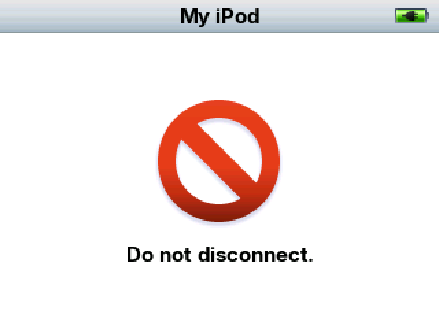 

Your songs, playlists, ratings, covers, podcasts and audiobooks arrive just as Finder synced them. It works both ways: what you play and rate on the iPod is on your Mac after the next sync. There's no app to install and nothing to set up.

## A large library that stays fast

RockWheel was developed with a real library of well over ten thousand songs, on a chip from 2005 with as little as 32 MB of memory.

Any song from the list of all your songs starts in under a second. When you skip, the next song and its cover appear the moment you press, and the music follows right after.

Lists keep up with your thumb. Turn the wheel slowly and the list moves row by row. Turn it quickly and you pass hundreds of songs in seconds. As your thumb slows down, so does the list, and you stop on the row you wanted.

Hundreds of new songs are in your library seconds after you unplug.

## Cover Flow

The iPod Video never had Cover Flow. Here it's the first item in the Music menu, with seven covers on the screen at once.


Scrolling has weight. Flick the wheel and the covers pick up the speed of your thumb, glide on their own and settle gently on an album. Flick again to go faster, or rest your thumb to stop. It feels like the first iPod touch, on a click wheel.

Thousands of covers go by without waiting for any of them to load, and the motion stays smooth.

## Now Playing

Press Select to move from the cover to the scrubber, your rating, a large cover and the lyrics. The lyrics follow the song line by line, if the track has time-synced lyrics or a `.lrc` file.

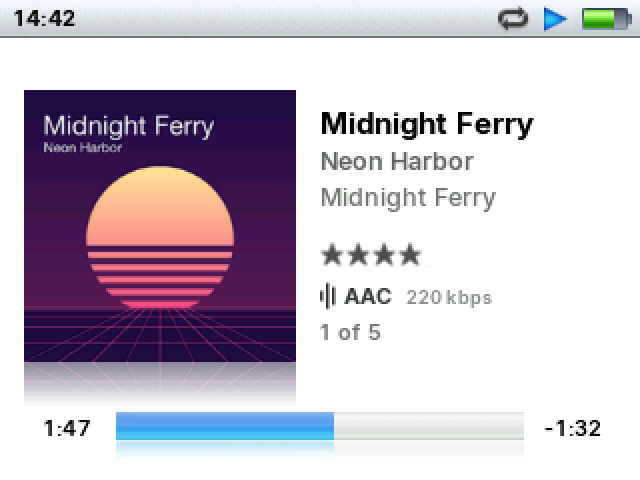 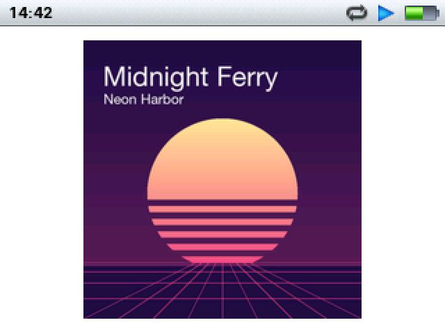

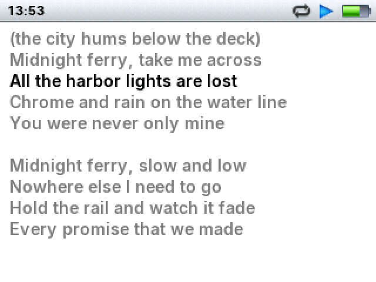 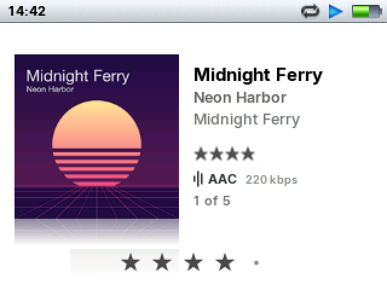

## Colours from the album

Now Playing can take on the colours of the album you're listening to, and the screen changes together with the cover.

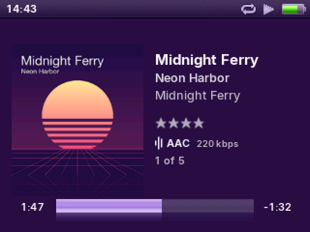 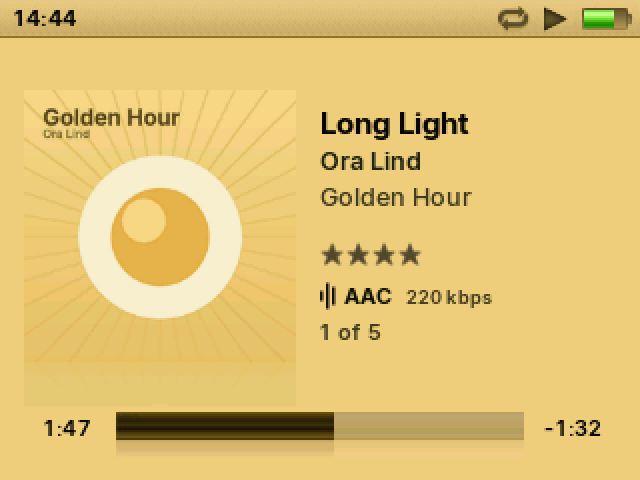

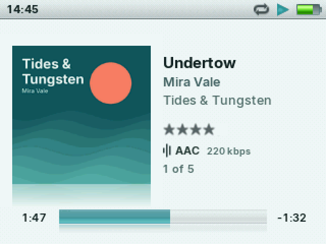 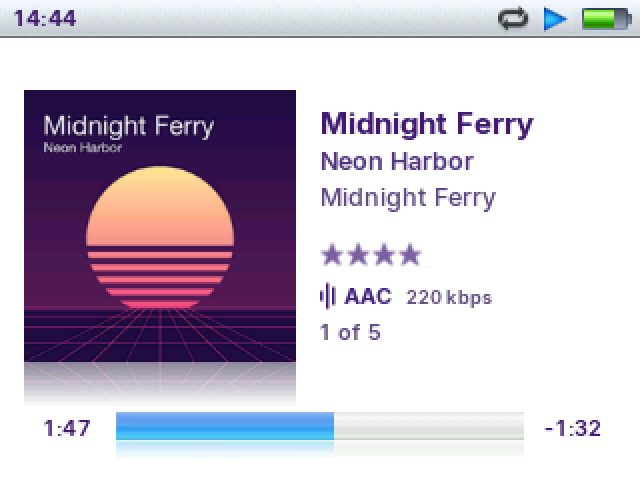

**Fill** paints the screen in the album's colour, so the cover melts into it. The text turns light or dark to stay easy to read.

**Whole Screen** keeps the screen light and tints all of it softly, down to the status bar and the progress bar.

**Text and Stars** leaves the screen white and colours only the words and your rating.

It's off by default. To turn it on, hold Select in Now Playing and choose Colours, or find Cover Colours in Settings.

## Dark theme and Night Mode

The whole iPod can go dark: the menus, Now Playing, the dialogs, even the clock. It switches in about half a second. To turn it on, hold Select in Now Playing, or find Dark Theme in Settings. The colours from the album work in the dark too.

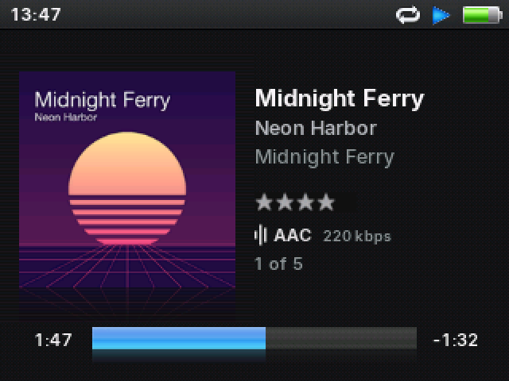 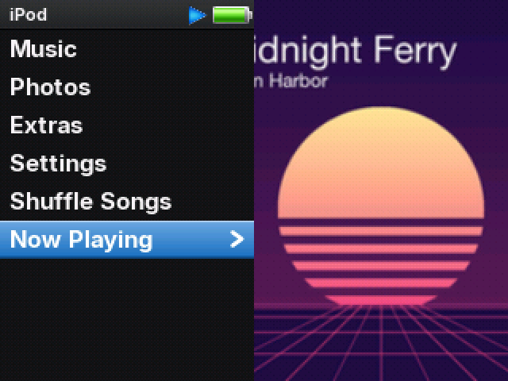

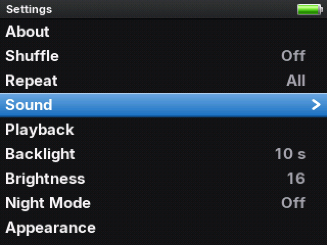 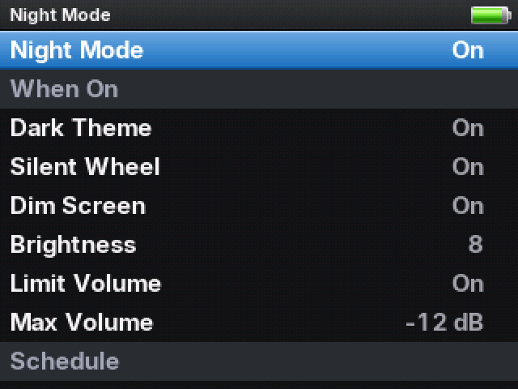

**Night Mode** is for the end of the day. It makes the iPod dark, silences the wheel, dims the screen and lowers the volume limit. You choose which of these it does, how dim the screen gets and how quiet the music.

It can also keep its own hours. Give it a start and an end, and it turns on and off by itself. If music is still playing when it ends, the volume stays where it is, so nothing wakes you.

## It feels like an iPod

 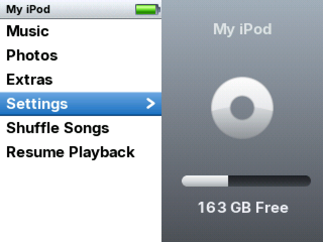

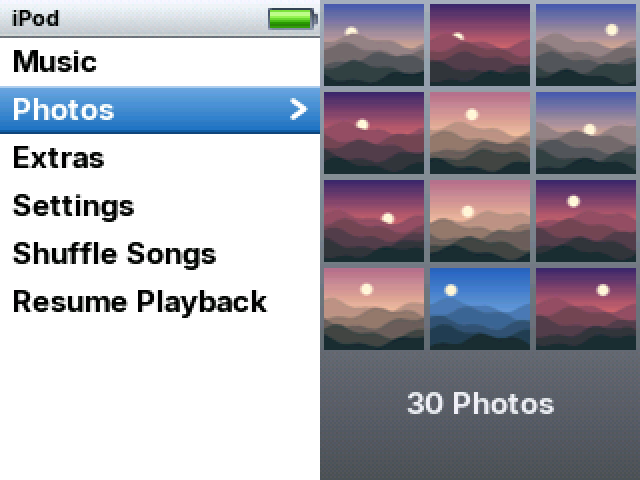 

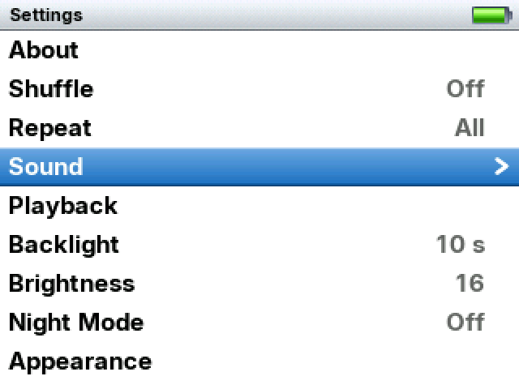 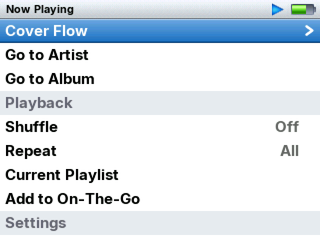

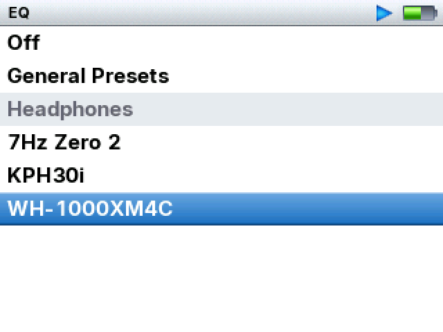 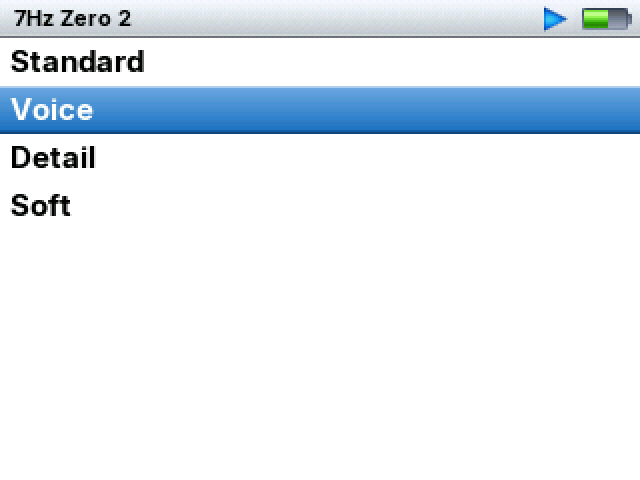

The main menu is the one you remember: Music, Photos, Extras, Settings, Shuffle Songs and Now Playing, with your iPod's name at the top. Beside it you see the album that's playing, a collage of your photos, or your iPod and its free space.

Settings are in one list, in groups, with each value beside its name. Most of them change with a single press.

Hold Select in Now Playing for a short menu. From there you can open Cover Flow, go to the song's artist or album, or change shuffle, repeat, the EQ, Sound Check, colours, the dark theme and Night Mode.

The EQ has all 22 presets from iTunes, tuned as they are there. It also has presets for two pairs of headphones, the 7Hz Zero 2 earphones and the Koss KPH30i.

## Also

- The volume, the volume limit and Night Mode's volume are all in percent, and the level shows under the bar as you turn the wheel.
- Sound Check plays your songs at about the same loudness, using the levels Finder has already worked out.
- Photos synced by Finder show in the familiar grid and full screen.
- Podcasts and audiobooks pick up where you left off.
- Hold Play for Now Playing from almost anywhere, and hold Menu for the main menu. After holding Play, press Menu to go back to the list you started the music from.
- The menus come in more than forty languages, from Japanese and Arabic to Icelandic, and song titles show properly in nearly any alphabet.
- A small moon in the status bar shows when Night Mode is on.
- Your videos are still there. RockWheel doesn't play video, but the stock firmware stays on the iPod and shares the same library. To watch them, turn the Hold switch on while the iPod starts.

## Under the hood

The iPod Video has two ARM7TDMI cores at 80 MHz and 32 or 64 MB of RAM. RockWheel was developed on the 32 MB model, the harder of the two. Making that feel fast took work in nearly every layer: the codecs, the database, the file system, the USB stack and the drawing code.

Covers now appear and long lists start playing about ten times faster. A library update after a sync is more than five times faster. While MP3s play, list frame rates nearly double. Cover Flow shows more than twice as many covers at a higher frame rate. Writing music over USB is at least twice as fast as in Apple's disk mode.

All of these were measured on the test iPod. "Before" is Rockbox's behaviour or an earlier RockWheel build, whichever the work started from.

| | Before | RockWheel |
|---|---:|---:|
| List scrolling while MP3 plays | 11 fps | **20.7 fps** |
| List scrolling while AAC plays | 17 fps | **20.2 fps** |
| Cover Flow | 14–17 fps with 3 covers, about 8 with music playing | **24 fps with 7 covers**, music paused while you browse |
| Showing a cover on track change | 2–3 s from a 1000×1000 embedded JPEG | **0.07–0.25 s** |
| Music after pressing Next | 0.65–1.1 s | **0.45–0.6 s** |
| A step of the volume | about 100 ms | **11 ms** |
| Opening a menu after a pause | 0.78 s | **0.13 s** |
| Getting a list of 13,180 songs ready to play | 4.5 s | **0.3–0.5 s** |
| Library update after a sync | about 90 s for 200 new songs | **about 17 s for 200–300 new**, in a library of 6,810 |
| Sending your play counts to Finder, at each connection | 1.8 s | **0.18 s** |
| Writing over USB | 3.2 MB/s in Apple's disk mode, 6.6 MB/s in Rockbox | **8.4–8.7 MB/s** |
| Connecting until mounted on the Mac | about 12 s | **about 9 s** |
| Changing the theme while music plays | 8 s | **0.45–0.65 s** |
| Parsing the skins, at every start | 282 ms | **54 ms** |

How that was done:

- **Cover Flow draws front to back.** Half of each frame is rendered on the second core.
- **Decoding moved to the second core.** MP3 and AAC frames are decoded on the COP into a queue, so the main CPU is free for the UI.
- **Faster codecs.** A new IMDCT path in libmad takes MP3 decoding from 7.8 to 6.7 ms a frame, and libfaad clears and copies less, taking AAC from 11.4 to 10.55 ms.
- **The next cover at the press.** When you skip, Now Playing reads the cover from Finder's artwork itself, along with the title from the database, instead of waiting for playback to open the song. Meanwhile the decoder no longer spends half the processor on the song you're leaving.
- **The whole database in RAM.** Paths are included, and hash tables replace repeated disk searches.
- **Reads and writes lined up for DMA.** The disk controller only uses DMA from aligned memory, so Play Counts, playlists, Cover Flow's images and the files of a library update were copied by the processor instead. They now line up, Play Counts goes out in whole blocks, and Sound Check finds a song with one read.
- **A sync with nothing new is recognised.** The library update compares Finder's songs with those of the last update and skips the rest, and removing songs no longer reads every tag file from start to end.
- **Fonts load in a few large reads** at every start, rather than one read for each letter.
- **Work done ahead of time.** Cover Flow's images, each album's colour, the collage of photos and the playlist of all songs are prepared while the library updates, so nothing has to be built when you open them.
- **A new colour in about 65 ms, drawing included.** The memory for it is only taken when you choose Whole Screen or Fill.
- **EQ presets keep their level.** The EQ lowers the signal by the peak its bands add up to, so loud songs can't clip. The volume then rises by the same amount. For this, the volume scale stops at 0 dB and leaves the amplifier's last 6 dB to the EQ. Only a preset that boosts more than 6 dB is a little quieter at the very top.
- **Fewer writes to the sound chip.** Each write waits for the chip's bus. A step of the volume used to take twelve writes, and now takes two. After a skip, the decoder also lets the menus run while it refills, unless the music is about to run out.
- **Flash stays powered while the screen is on.** An iFlash card used to be switched off a few seconds after every read, like a hard drive, and took 0.6 s to come back. Now, while the screen is on, it only sleeps and wakes in 35–50 ms. It also starts waking as soon as the screen lights up. A hard drive works as before.
- **The cover beside the menus comes from memory.** It's the copy Now Playing already holds, so a menu opened after a pause doesn't wait for the disk.
- **Less reading at startup.** Letters of other alphabets load only when a song title needs them. Folders stay in a larger disk cache instead of being read again for each file. The albums' colours are read in large blocks. The menus are ready about a third of a second sooner.
- **Sound Check from Finder's own values.** They're looked up on disk as a track loads. It only ever lowers a track, since Finder's database doesn't say where its peaks are.
- **Faster theme changes.** A theme's pictures are packaged in the screen's own format and come in one DMA read rather than a row at a time, which took a backdrop from about a second to 14 ms with music playing. The fonts stay loaded, and the album art slots are held, so the audio buffer is never rebuilt.
- **An index on the skin tags.** Looking them up again and again while scanning ahead took 80% of the parser's time.
- **Journaled library updates.** Cut off at 10 different points in the simulator, an update recovered every time.
- **Device description on demand.** The one Finder asks for is generated from the iPod's own flash the first time it's needed.
- **Finder's database is read once,** as a stream in aligned 64 KB blocks, because it doesn't fit in memory.
- **FAT seek marks.** A jump deep into a 500 MB artwork file doesn't walk the whole chain.
- **Flash-friendly formatting.** The installer places the clusters on 4 MiB boundaries, which raised write speed in disk mode from 1.3 to 3.2 MB/s on the test card.
- **USB write-behind.** Blocks are written while the next command arrives, on a dedicated thread with 16 slots.
- **Assembly dithering, and a mixer that ramps volume changes across samples.** The ramp also removed fade clicks.

## Will it work on my iPod?

**Made for:** iPod Video, 5th and 5.5th generation, formatted FAT32, synced from Finder.

**What it was tested on:** one iPod. A 5.5G 30 GB model with 32 MB of RAM, an iFlash card of about 256 GB, macOS 26 and a library of about 13,000 songs.

**On an original hard drive** it runs too: a user has it on a 5.5G 30 GB, installed as described here. RockWheel was tuned on flash, where a read costs almost nothing, so on a hard drive expect:

- Cover Flow and covers on track changes to be slower, since they read artwork from disk, and more so when the drive has to spin up
- Battery life to be shorter, since those reads keep the drive awake
- The library update after a sync to take longer

If you use it on a hard drive, please open an issue and say how it goes.

**Not tested yet:**

- The 60 and 80 GB models with 64 MB of RAM. With twice the memory, they should do even better.
- Syncing from iTunes on Windows. The iPod presents itself to iTunes the same way it does to Finder, so it should work, but only Finder on macOS has been tried.
- Libraries beyond about 13,000 songs on a real iPod. In the simulator, with the memory of a 32 MB iPod, lists, playback, Shuffle and Cover Flow all worked with 40,000 songs. From about 25,000, if the iPod restarts straight into a library update, the theme may not load until the next restart. With 100,000 songs it won't start. Up to 32,000 songs can be queued at a time.
- Audiobooks on a real iPod, since the test library has none.

Music you bought from iTunes plays, apart from old copy-protected purchases. Apple Music subscription tracks aren't supported. Song titles in Hindi and Thai show, though their combining marks can be out of place, and those two languages aren't offered for the menus.

## Install

1. **Make sure the iPod is formatted as FAT32.** RockWheel needs it, and an iPod formatted on a Mac isn't. Converting erases the iPod, so first sync it once and back up anything else you keep on it: your music comes back with a sync, but play counts and ratings not yet synced to the Mac don't. The installer does the conversion for you, and stops unless you type `ERASE`.

2. **Connect the iPod to your Mac, open Terminal and paste this:**

   ```sh
   /bin/bash -c "$(curl -fsSL https://raw.githubusercontent.com/ssarkisy/RockWheel/main/install.sh)"
   ```

   It finds the iPod, checks that it's an iPod Video, converts it if it has to, installs Rockbox's bootloader and the firmware, and ejects it. macOS asks for your password, because the bootloader goes straight onto the disk.

3. **Unplug it.** If it doesn't restart by itself, hold Menu and Select until it does.

4. **Connect it again and sync from Finder as usual.** Don't choose Restore in Finder: that erases the iPod and removes RockWheel.

The stock firmware stays on the iPod, with the same library. To use it, turn the Hold switch on while the iPod starts.

- **To update,** run the same command. Your settings, library and play counts are kept, and all it asks for is your password.
- **To hear about new versions,** choose Watch, then Custom, then Releases, at the top of this page.
- **To see what it would do first,** download [`install.sh`](install.sh) and run `bash install.sh --dry-run`. It changes nothing.
- **On Windows,** there's no installer yet. The steps by hand are below.
- **To go back,** `bash install.sh --uninstall` removes the bootloader, and the iPod starts its stock firmware.

<details>
<summary>The same steps by hand</summary>

Be careful with disk numbers: pointing these tools at the wrong disk erases that disk.

1. **Make sure the iPod is FAT32.** To convert a Mac-formatted one, which erases it, build `ipodpatcher` from `utils/ipodpatcher` in this repository and use `--convert`. It also handles the 2048-byte sectors the official `ipodpatcher` refuses, but you format those yourself, with your iPod's disk number in place of `N`: `newfs_msdos -F 32 -c 16 -v IPOD /dev/rdiskNs2`.
2. **Install the Rockbox bootloader** with `ipodpatcher /dev/diskN --add-bootloader bootloader-ipodvideo.ipod`, using the file from [Releases](../../releases), or with the official [Rockbox Utility](https://www.rockbox.org/wiki/RockboxUtility). Either needs root on macOS.
3. **Copy the firmware.** Download `rockbox.zip` from [Releases](../../releases) and unzip it at the root of the iPod. If you had plain Rockbox before, move the old `.rockbox` folder out of the way first.
4. **Restart and sync.** Eject, restart with Menu and Select, connect it again and sync from Finder. When you unplug, the library updates.

</details>

<details>
<summary>Installing from Windows</summary>

I haven't been able to try these steps myself. If anything goes differently, please open an issue.

1. **Make sure the iPod is FAT32.** An iPod set up by iTunes on Windows already is: it shows up as a drive in File Explorer. If it doesn't, it was formatted on a Mac. Restoring it in iTunes makes it FAT32, but erases everything on it.
2. **Install the Rockbox bootloader** with the official [Rockbox Utility](https://www.rockbox.org/wiki/RockboxUtility), run as administrator. Choose the iPod Video and install only the bootloader, not Rockbox itself. If your iPod already starts Rockbox, skip this step.
3. **Copy the firmware.** Download `rockbox.zip` from [Releases](../../releases) and extract it to the iPod's drive, so that the `.rockbox` folder is at the top of it. If you had plain Rockbox before, rename its `.rockbox` folder first.
4. **Restart and sync.** Eject the iPod, unplug it and hold Menu and Select until it restarts. The first start reads your library, so give it a moment. Then sync from iTunes as usual.

</details>

## Build from source

You need the Rockbox ARM toolchain, which `tools/rockboxdev.sh --target=a` builds.

```sh
mkdir build && cd build
../tools/configure --target=ipodvideo --type=n
make -j8 && make zip     # gives rockbox.zip
```

For the simulator, which is how the screenshots here were made, use `--type=s` and then `make -j8 && make install && ./rockboxui`.

## Credits and license

RockWheel is built entirely on [Rockbox](https://www.rockbox.org) and the work of its contributors, from commit `f3ffe789ef`. **Please report RockWheel's bugs here, not to the Rockbox project.**

- **Code:** GNU GPL, version 2 or later. See [LICENSE](LICENSE).
- **Theme:** modified from iClassic Square by Humberto Santana, derived from iLike by Alan Brito and Hayden Pearce, under [CC BY-SA 3.0](https://creativecommons.org/licenses/by-sa/3.0/). See [themes/README.md](themes/README.md).
- **Fonts:** [Inter](https://rsms.me/inter/), under the SIL Open Font License, and GNU Unifont from Rockbox for the alphabets Inter doesn't have.

The screenshots come from the simulator, with a made-up library: the artists, albums, covers, lyrics and photos were generated for them. The disk size, the progress bar and the ratings in them are set by hand.

Apple, iPod, iTunes and Finder are trademarks of Apple Inc. RockWheel has nothing to do with Apple. It contains no Apple logo or firmware, and identifies itself to the Mac as an iPod only so that Finder will sync it.
