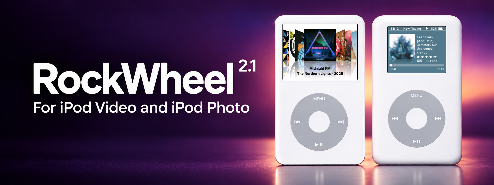

<a href="https://github.com/sponsors/ssarkisy"><picture><source media="(prefers-color-scheme: dark)" srcset="docs/images/sponsor-dark.svg"></picture></a> <a href="https://buymeacoffee.com/sarkisian"><picture><source media="(prefers-color-scheme: dark)" srcset="docs/images/coffee-dark.svg"></picture></a>

**Supporters: u/Bauhaus0, ArmstRNG, Ryan Muniz, Martina Cadi, u/mrstorey, u/armanverma**<br>
Thank you for your donations! They help me keep the project going.

RockWheel is free firmware for the iPod Video and iPod Photo. Everything on it is fast: menus, Cover Flow, album covers, starting a song, library updates and copying music over USB.

It feels like the iPod you remember. The main menu looks like Apple's, the click wheel works the same way, and you keep syncing with Finder or iTunes. It also adds things your iPod never had: Cover Flow, FLAC and other formats, lyrics that follow the song and a dark theme.

A free app for Mac and Windows installs RockWheel and keeps it up to date. Apple's firmware stays on the iPod, so you can still start it whenever you like.

**[Download for Mac](https://github.com/ssarkisy/RockWheel/releases/latest/download/RockWheel-mac.dmg) · [Download for Windows](https://github.com/ssarkisy/RockWheel/releases/latest/download/RockWheel-windows-setup.exe)** · [Which iPods](#supported-ipods)

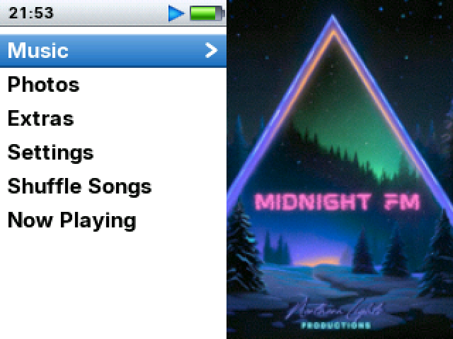 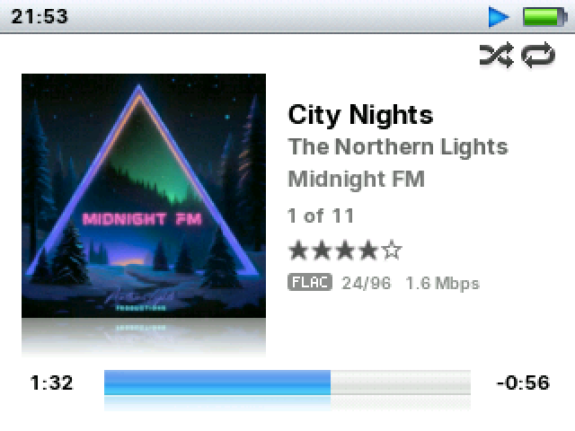

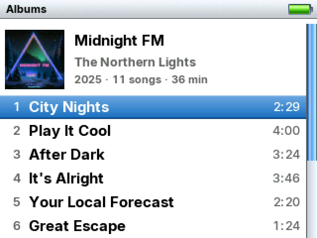 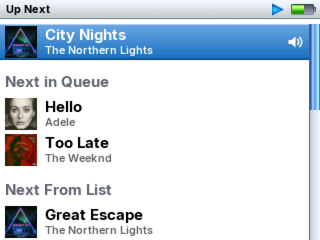

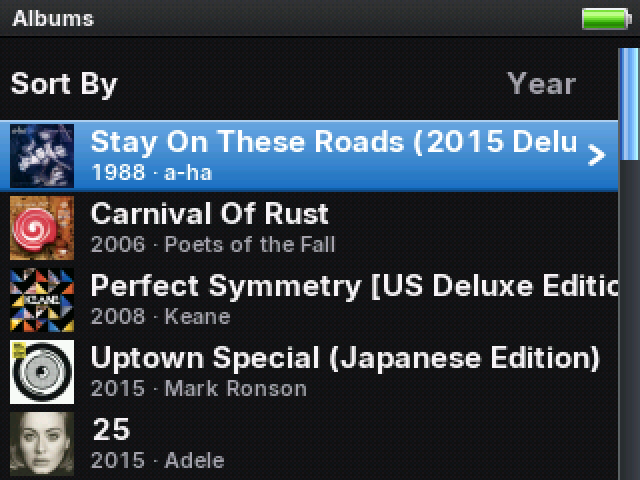 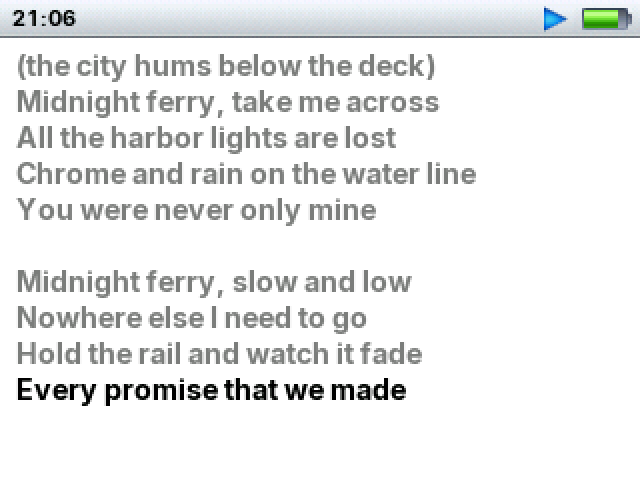

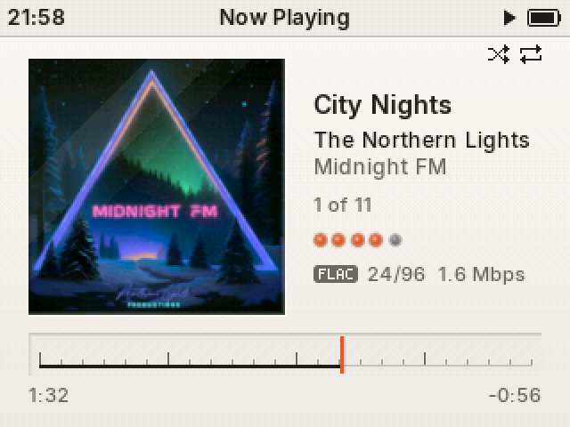 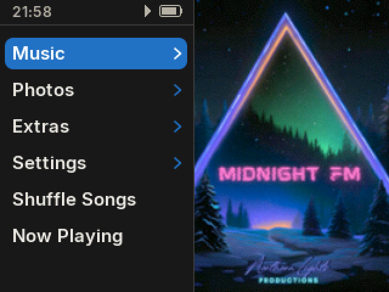

## Syncing with Finder and iTunes

You can keep syncing your iPod over USB with Finder on a Mac or iTunes on Windows. Sync your whole music library or choose individual artists, albums and playlists. Album artwork comes with the music, and you can also sync podcasts, audiobooks and photos.

If you give a synced song five stars on your iPod, you'll see those five stars in Music or iTunes the next time you sync. Play counts for synced songs go back to your computer, too.

Finder doesn't copy playlist folders to these iPods. To get yours, use the **Playlist folders** feature in the RockWheel desktop app. It reads the folders from Music on a Mac or iTunes on Windows, and they appear under Playlists after your next sync. Bring them over again whenever you rearrange them.

You can also drag a folder of FLAC or Opus files onto the iPod. RockWheel reads their tags and artwork and adds them to the same library as your synced music. Ratings and play counts for music you copy yourself stay on the iPod. If a cover is a PNG or a progressive JPEG, the iPod can't show it on its own. Choose **Make Covers** in the app, and it prepares those covers for the iPod.

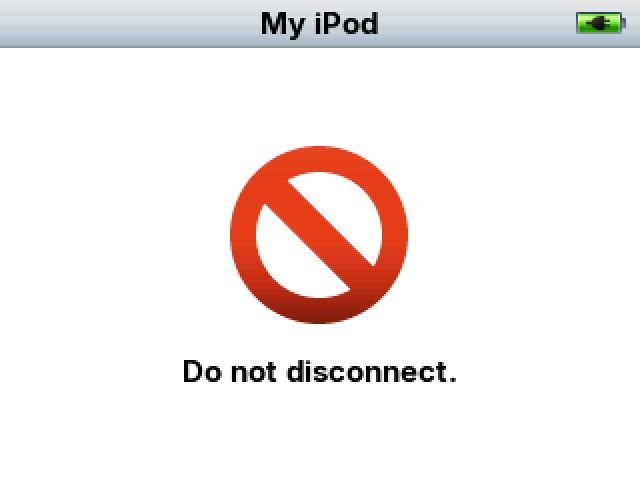 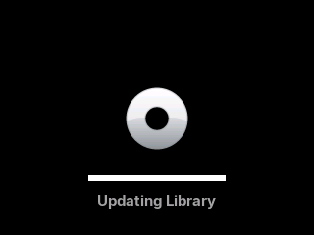

## Cover Flow

Apple's firmware for these iPods never had Cover Flow: it came later, with the iPod classic. On RockWheel you can flip through your synced albums and the albums you copied yourself together. When a cover catches your eye, press Select to see its songs, or hold Select and choose **Play Next** to hear that album after the current song. Flick the wheel and the covers keep scrolling after you lift your thumb; rest your thumb on the wheel to stop. Albums are sorted by artist, or by year if you prefer. In Now Playing, press Select and Play together to jump to the playing album in Cover Flow.

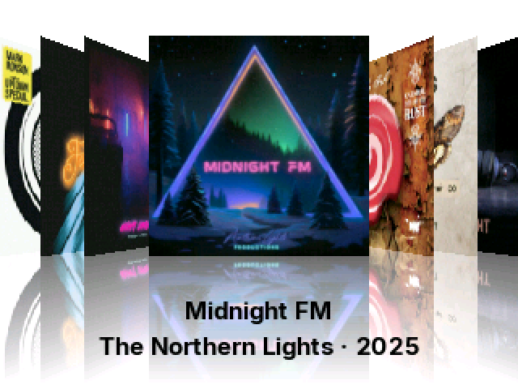 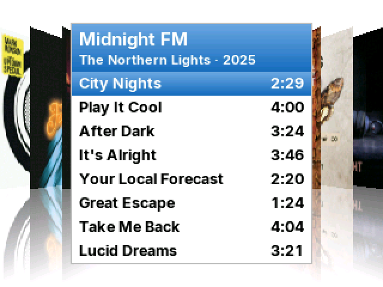

## Finding music

A quick spin of the wheel takes you through Artists by letter. Each artist shows a cover and the number of albums and songs. You'll find The Killers under K, with their albums in release order. You can also sort an artist's albums by name. The wheel speeds up the way Apple's does, and a finger resting on it doesn't move the list.

Songs can be sorted by name, artist, album or year, and Recently Added shows the albums you added last. When you spin the wheel fast, a big letter shows where you are in the list.

Compilations have their own section, so artists who appear only on those records don't fill up your Artists list. To keep Artists as it was, turn Compilations off in Settings › Music Menu.

If you remember the first few letters of a name, Search brings up matching artists, albums and songs together. The wheel skips letters that wouldn't give you a match.

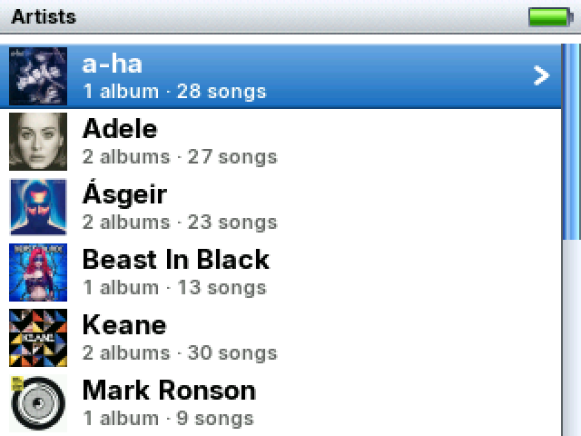 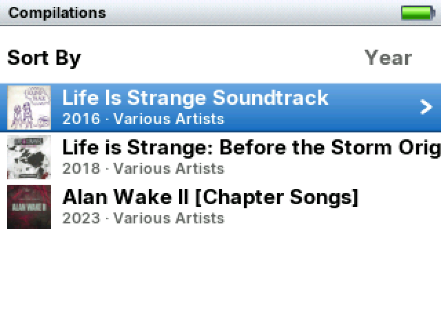

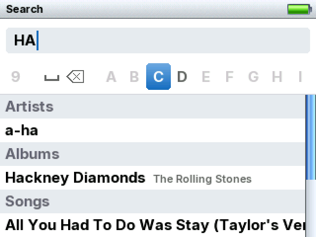

## Playlists and Up Next

If you're halfway through a playlist and feel like hearing a whole album, hold Select on the album and choose **Play Next**. RockWheel finishes the current song, plays the album, then picks up with the next song in your playlist. **Play Last** adds a song after the ones already queued. **Up Next** shows the queue and what follows it. You'll find it at the top of the Now Playing menu.

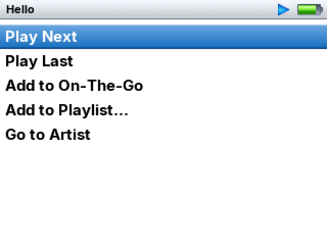

Playlists shows each playlist with a collage of its albums' covers, how many songs it has and how long it plays. A playlist's songs open under the same collage.

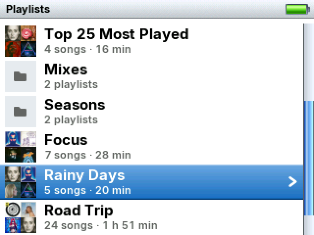 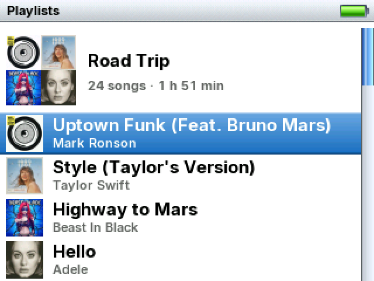

Smart playlists can change while you're out listening. Give a song five stars on the iPod and it appears in your five-star playlist, even if you copied the song yourself. You can make your own playlists on the iPod too, and name them with the click wheel. Playlists you make on the iPod, On-The-Go included, stay on the iPod: Finder and iTunes don't import them into your library.

Shuffle works as on a stock iPod: Off, Songs or Albums. Albums plays each album from start to finish and picks the next album at random.

## Podcasts and audiobooks

Podcasts shows which episodes are new and how much is left in the one you've started. You can set each show to play faster, up to twice its speed. Music always plays at normal speed. Your place in an episode and the episodes you've finished stay on the iPod, and Podcasts on the Mac doesn't get them back. You can sort shows by name or by their newest episode. Episodes you copied yourself can be deleted on the iPod, one at a time or all of a show's played episodes at once.

In Audiobooks, the books you've started appear first, with the listening time left in each. Choose **Resume** to pick up where you left off, even in a book split across several files.

When an episode, a book or a long mix has chapters, Next and Previous move between them, and Now Playing shows which chapter you're in.

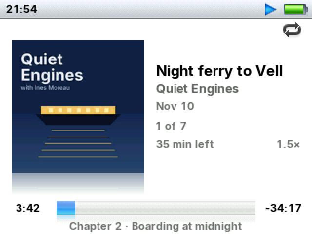 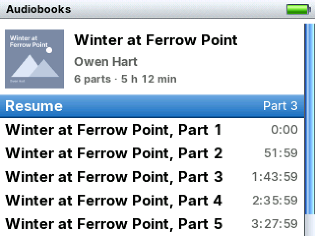

## Themes and Now Playing

Classic looks like Apple's own menus and Now Playing. Modern and Neo are flatter and use more color. Dieter shows your place in the song as a needle on a radio dial. Each theme has a light and a dark version. Choose one in Settings › Appearance › Theme. In Classic and Neo, **Cover Colors** can take the background from the album cover. Neo can show Music in red, Podcasts in purple and Audiobooks in orange, as on a Mac. It can also use one of thirteen colors instead. Classic comes in the accent color you choose. With **Moving Cover** on, the cover beside the main menu drifts slowly from side to side.

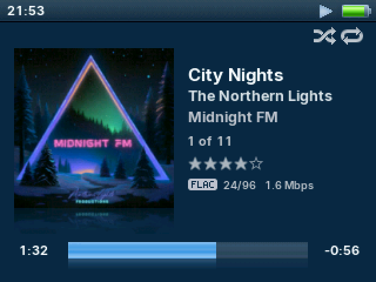 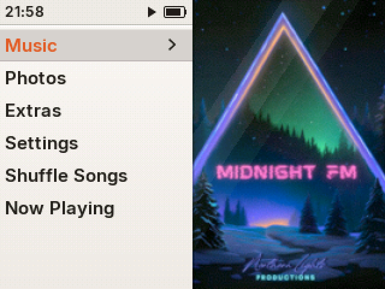

When a song has timed lyrics, **Live Lyrics** highlights each line as it's sung. **Sound Check** uses the loudness levels from your library to keep the volume even from song to song. Set it to Albums and it uses the album gain in the files, so each album keeps its own balance between quiet and loud songs.

The equalizer has iTunes' presets, presets for some headphones and user presets. Make one in the editor or copy AutoEq's files to the iPod. The editor shows all ten bands and their curve. Hold Play there to hear the music without the equalizer, at the same loudness.

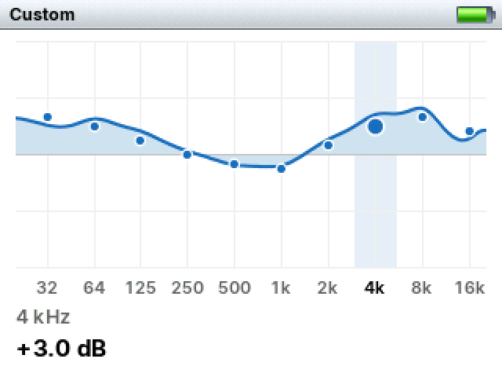 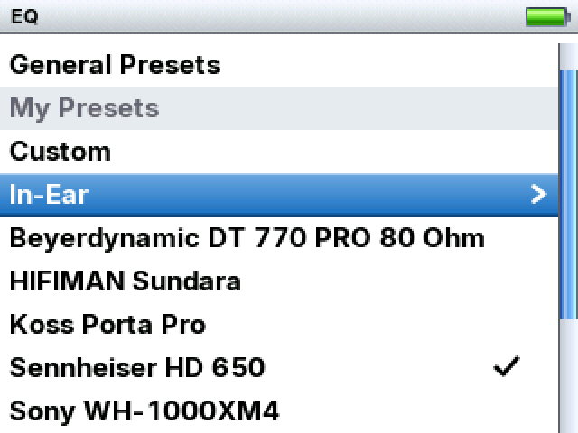

Press Select in Now Playing to switch between the cover, the scrubber, your rating, a large view of the cover and the lyrics. Now Playing can also show each song's format and bitrate, such as FLAC 24/96.

## Settings and languages

Settings comes in sections, with a short hint under the setting you're on. You can choose what the main menu and Music show. **Battery Percentage** shows the battery level next to its icon, and **Wheel Sensitivity** sets how far you turn the wheel for each row. With **Wake Screen** on Stock, a button you press while the screen is dark does its job and lights the screen. The menus come in more than forty languages, and fonts for Korean, Japanese, Chinese, Hebrew, Arabic and Thai song titles are built in.

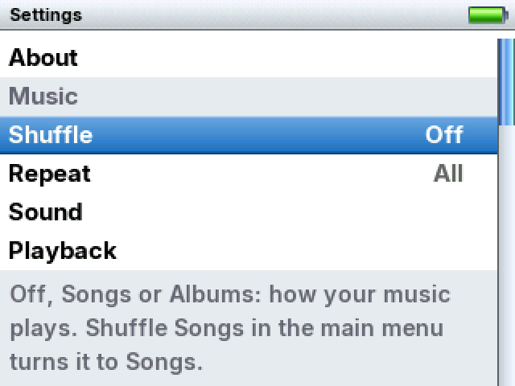 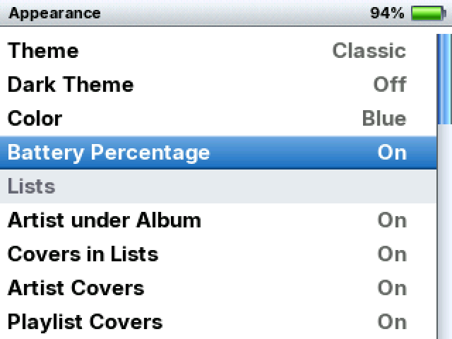

## Last.fm

Turn on **Send my plays to Last.fm** in the RockWheel desktop app and sign in once. From then on, each time you connect the iPod to that computer, the app sends what you played, with the time you played it. Last.fm only takes plays from the last two weeks, so connect at least that often. Podcasts and audiobooks aren't sent, and plays are only logged while the iPod's clock is set.

## Dark theme

Every theme has a dark version. The menus, Now Playing, dialogs and the clock all turn dark, and your covers stand out against it. Colors from the album cover work in the dark theme too. Turn on **Dark Theme** by holding Select in Now Playing, or in Settings › Appearance › Dark Theme.

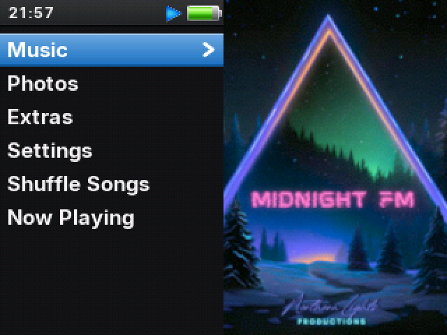 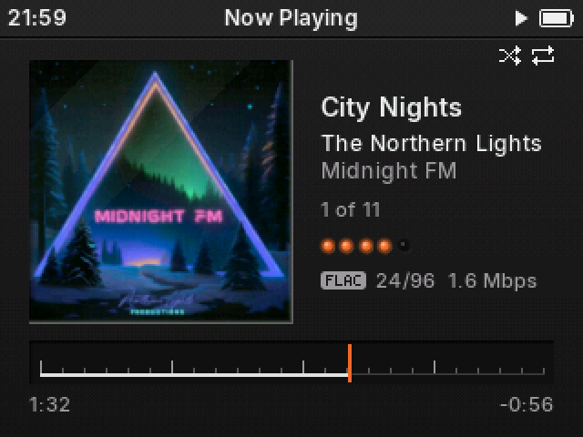

## Night Mode and sleep

If you listen in bed, **Night Mode** can switch to the dark theme, dim the screen, silence the wheel's clicks and lower the volume limit. Turn it on by hand or set a start and end time. A moon in the status bar shows when it's on.

Hold Play until the screen goes dark to put the iPod to sleep. Turn the wheel to wake it and you're back on the screen you left. To turn it off, keep holding Play until "Shutting down..." appears, or choose Settings › Turn Off. On a charger, it only goes to sleep.

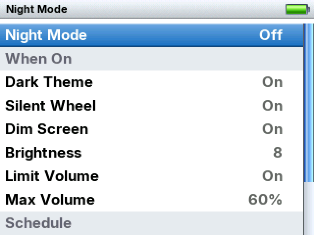 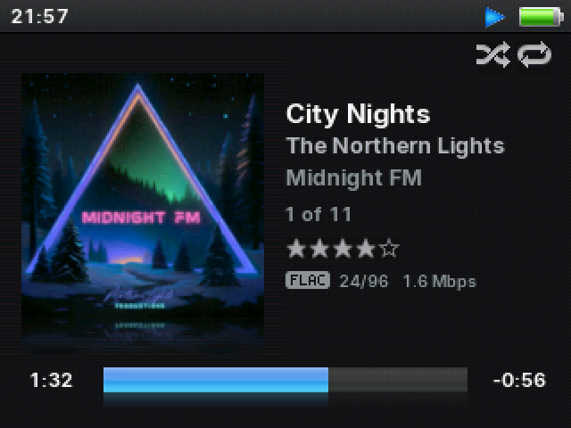

## Photos and Extras

Photos shows the photos you sync in a grid or full screen, and a collage of them appears beside the main menu. Extras has a clock, a calendar, a stopwatch and five games: Brick, Solitaire, Jewels, Minesweeper and Blackjack. The app can add eight more.

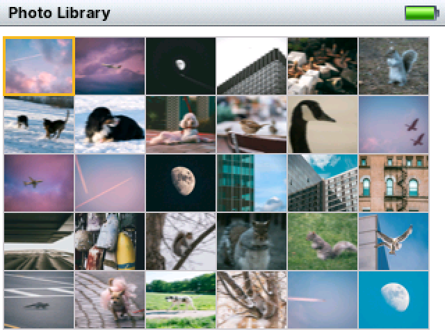 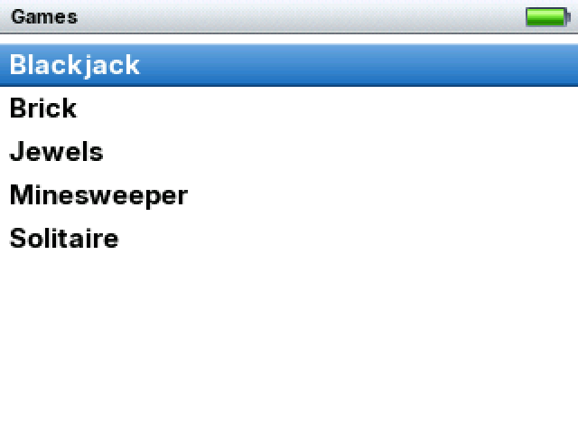

## Coming from Rockbox

RockWheel keeps Rockbox's formats, its EQ and copying files straight onto the iPod. It adds Finder and iTunes sync, Apple's menus, and covers prepared in advance. On my iPod Video with RockWheel 1.4:

- lists scrolled at about 20 frames per second while MP3 played, where Rockbox managed 11;
- Songs opened in 0.21 s instead of 0.85 s, with 13,000 songs;
- a cover appeared 0.07–0.25 s after a track change, instead of 2–3 s.

[Performance measurements](docs/performance.md) has the rest. RockWheel uses its own four themes. Of Rockbox's plugins, it keeps Cover Flow, Photos, the clock, the calendar, the stopwatch and the games.

## Good to know

- Apple's firmware stays on the iPod. To start it, slide the Hold switch on while the iPod starts. RockWheel doesn't play videos, so on the Video that's how you watch them.
- Playlists you make on the iPod, On-The-Go included, stay on the iPod. Finder and iTunes don't import them.
- Your place in a podcast stays on the iPod and doesn't reach Podcasts on the Mac.
- DRM-free iTunes purchases play. Copy-protected songs and audiobooks don't, and neither do Apple Music downloads.
- If RockWheel detects a freeze, it tells you on screen how to restart it. Please send me the `crash.log` it mentions.
- Car stereos that control the iPod over USB don't recognize RockWheel yet. If your car has an AUX input, you can use the iPod's headphone jack or line out.
- The app installs and updates RockWheel but doesn't remove it. To go back to Apple's firmware for good, use the command in [Removing RockWheel](docs/advanced.md#removing-rockwheel). You can also restore the iPod in Finder or iTunes, but that erases it.

## Supported iPods

| Model | Tested hardware |
| --- | --- |
| iPod Video (5th and 5.5th generation) | I use a 30 GB 5.5G with about 13,000 songs and a flash card (iFlash) in place of its hard drive. With the original hard drive, covers take longer to appear when the disk spins up, the battery runs down sooner and library updates take longer. The 60 and 80 GB models have more memory, and I haven't tested RockWheel on one yet. |
| iPod Photo, and the 4th-generation iPod with a color screen | Beta. Support for it is newer than for the Video, and so far I've tested it on a single 30 GB iPod Photo. At first it had its original hard drive, and now it has a 256 GB SD card in its place. |

I tested both models with Finder on macOS 26. On Windows, I've updated an iPod Video with the app and brought playlist folders over from iTunes. A first install, Last.fm and making covers haven't been tried on Windows yet, and neither has syncing an iPod Photo with iTunes. [Tested setups](docs/advanced.md#tested-setups)

## Install

The RockWheel app recognizes your iPod and downloads the firmware for that model. On macOS 11 or later, open the disk image and drag RockWheel into Applications. On Windows 10 or 11 (64-bit), run the installer.

**[Download for Mac](https://github.com/ssarkisy/RockWheel/releases/latest/download/RockWheel-mac.dmg) · [Download for Windows](https://github.com/ssarkisy/RockWheel/releases/latest/download/RockWheel-windows-setup.exe)**

The Windows installer isn't signed yet, so Windows SmartScreen may warn you the first time. Click **More info**, then **Run anyway**.

### Before your first install

- Sync once to save your ratings and play counts to your computer, and back up any files you copied by hand.
- The Video needs Apple's iPod software 1.3 and about 160 MB of free space. The Photo needs 1.2.1 and about 100 MB. Finder or iTunes shows the version on the iPod's page. If you need a newer one, choose **Update** there.
- RockWheel uses FAT32. A first install on a FAT32 iPod keeps your music, and an iPod set up with iTunes on Windows is already FAT32. **Converting a Mac-formatted iPod to FAT32 erases it.** On a Mac, the RockWheel app can do the conversion after you type `ERASE`. On Windows, use **Restore** in iTunes to convert a Mac-formatted iPod before you install. The app tells you which format your iPod has before it changes anything.

### Install with the app

1. Connect the iPod, open the RockWheel app and choose **Install**. macOS asks for your password; Windows asks for administrator permission. Before it writes the bootloader, the app backs up the part of the iPod it replaces and keeps that backup on your computer. It reads every file back to check it. If the iPod already has Rockbox, the app keeps Rockbox's folder and renames it to `.rockbox-old-` followed by the date. Your Rockbox settings stay in that folder.
2. Wait until the app says it has ejected the iPod, then unplug it. If it doesn't restart by itself, hold Menu and Select until it does.
3. Connect it again and choose **Sync** in Finder or iTunes. Don't choose Restore: that erases the iPod and removes RockWheel. When the sync is done, eject and unplug the iPod. Your music is ready once Updating Library finishes.

For future updates, connect your iPod and choose **Update** in the app. Your settings, ratings, play counts and playback positions carry over. If you're coming from 1.4.1, read Before you update in the [2.0 release notes](https://github.com/ssarkisy/RockWheel/releases/tag/v2.0.0), because the wheel, the queue and Artists work a little differently.

In **Options** you can add eight games from Rockbox: Rockblox, 2048, Sudoku, Sokoban, Reversi, Space Rocks, Bubbles and Clix.

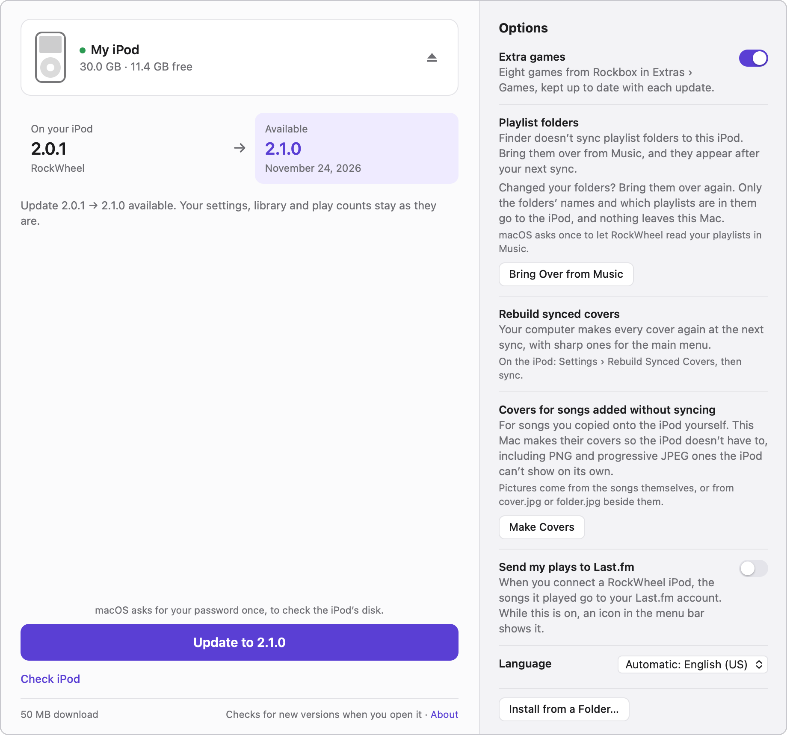

### Install with a script

If you prefer Terminal or PowerShell, a script does the same install. Connect the iPod and paste one line.

On a Mac, in Terminal:

```sh
/bin/bash -c "$(curl -fsSL https://raw.githubusercontent.com/ssarkisy/RockWheel/main/install.sh)"
```

On Windows, in PowerShell, not as administrator:

```powershell
irm https://raw.githubusercontent.com/ssarkisy/RockWheel/main/install.ps1 | iex
```

The script finds the iPod, downloads and checks the files for its model, installs the bootloader if needed, copies the firmware and ejects the iPod. macOS asks for your password, and Windows asks for administrator permission. On a Mac, the script can also convert a Mac-formatted iPod after you type `ERASE`. It asks whether to add the extra games. After the install, sync as in step 3 above. To update later, run the same line again. The script's options are in the [advanced guide](docs/advanced.md#script-options).

[Advanced guide](docs/advanced.md) · [Removing RockWheel](docs/advanced.md#removing-rockwheel) · [Report a problem](https://github.com/ssarkisy/RockWheel/issues)

## Credits and license

RockWheel is based on [Rockbox](https://www.rockbox.org). It includes fixes and the ALAC decoder's assembly code from [PodBox](https://github.com/anthonyfletcher/podbox), and reliability ideas from [ProkBox5g](https://github.com/prokbox/prokbox5g).

The firmware is licensed under the GNU General Public License, version 2 or later. The installer uses version 3 or later of the same license. [Firmware license](LICENSE) · [Installer source and license](https://github.com/ssarkisy/RockWheel-Installer) · [Theme and font credits](themes/README.md)

The firmware screenshots come from the iPod Video simulator.

RockWheel is an independent project. Apple, iPod, iTunes and Finder are trademarks of Apple Inc.
