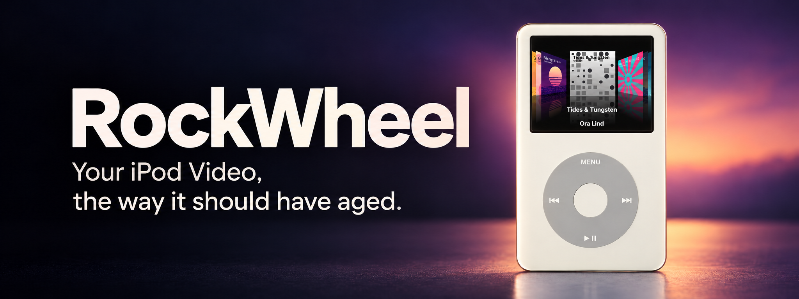

RockWheel is free, open-source firmware for the iPod Video, 5th and 5.5th generation, built on [Rockbox](https://www.rockbox.org). It keeps the engine that made Rockbox great, and adds the two things it never had: a place in Finder, and the manners of a real iPod.

Your iPod syncs with Finder as it always did, and now has what it never got: Cover Flow with kinetic scrolling, lyrics that follow the song, a Now Playing screen that takes on the colours of the album, and room for a very large library without slowing down.

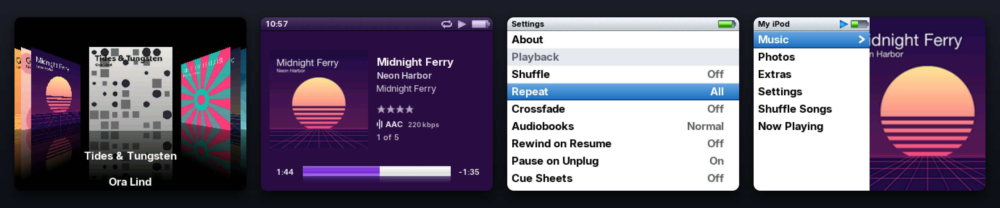

> [!WARNING]
> **Tested on exactly one iPod:** a 5.5G with 32 MB of RAM, converted to an iFlash card of about 256 GB. **It has never been run on an original hard drive.** See [Will it work on my iPod?](#will-it-work-on-my-ipod) before you install.

## Why RockWheel

| | Stock firmware | Rockbox | **RockWheel** |
|---|---|---|---|
| Sync from Finder | Yes | No, Finder doesn't see it as an iPod | **Yes** |
| Ratings and play counts back to Finder | Yes | No | **Yes** |
| Looks and behaves like an iPod | Yes | Themes get part of the way | **Yes** |
| Finder's album art, shown at once | Yes | Slow with large embedded art | **Yes** |
| Cover Flow | No | Plugin, with its own cache to build | **First item in Music, with kinetic scrolling** |
| Time-synced lyrics | No | Plugin | **Built into Now Playing** |
| Now Playing in the colours of the album | No | No | **Yes** |
| Videos | Yes | Converted files, or the stock firmware, one restart away | **The stock firmware, one restart away** |
| Open source | No | Yes | **Yes, GPL** |

## Works with Finder

Plug it in and it appears in Finder as an iPod. Sync the way you always have, unplug, and your library is ready.

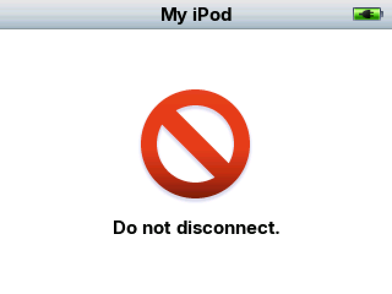 

**Your library comes across as Finder synced it:** songs, playlists, ratings, covers, podcasts and audiobooks.

**It goes both ways.** What you played and rated on the iPod is on your Mac after the next sync.

**There's nothing to set up.** No sync app to install, and no settings to find.

## A large library that stays fast

RockWheel was built on a real library of well over ten thousand songs, on a chip from 2005 with as little as 32 MB of memory.

**Music starts right away.** Pick a song from the list of everything you own, and it plays within half a second.

**Skipping is instant.** The next song is there, with its cover, the moment you press.

**Scrolling is smooth and fast.** Lists keep up with your thumb, even while music plays. A slow turn of the wheel moves row by row, a quick one takes you through hundreds of songs in seconds, and as your thumb slows down the list does too, so you stop on the row you meant.

**New music is ready quickly.** Hundreds of new songs are in your library seconds after you unplug.

## Cover Flow

The iPod Video never had Cover Flow. Here it's the first item in the Music menu, with seven covers on the screen at once.


**Scrolling has weight to it.** Flick the wheel and the covers pick up the speed of your finger, glide on by themselves and settle gently on an album. Flick again and they go faster. Rest your finger and they stop. It's the feeling of scrolling on the first iPod touch, on a click wheel.

**Nothing has to load.** Thousands of covers are ready before you open it, so you can go through all of them without waiting for any.

**It stays smooth,** at 24 frames a second.

## Now Playing

Press Select to move from the cover to the lyrics, the scrubber and your rating.

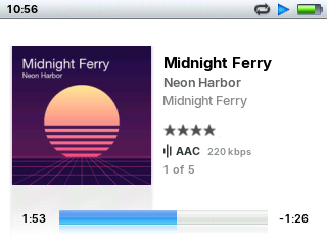 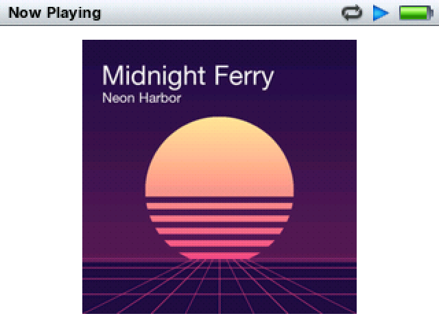

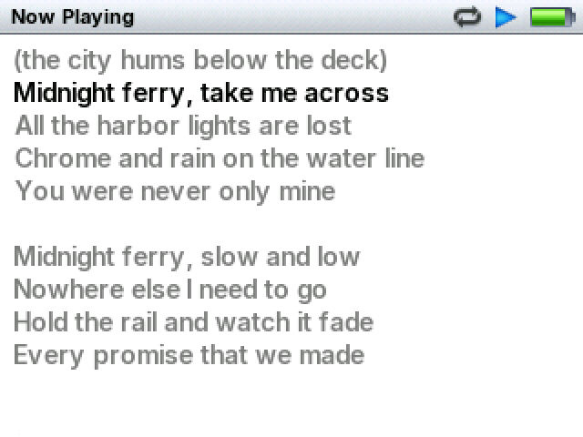 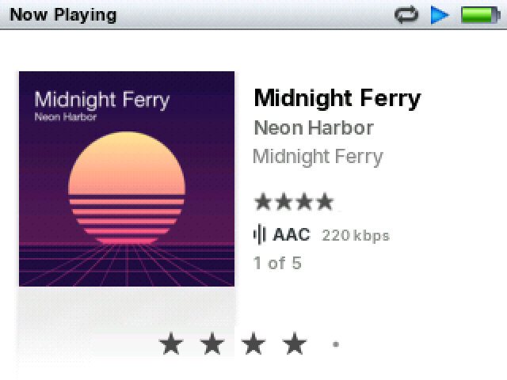

**Lyrics follow the song,** line by line, if the track has timed lyrics or a `.lrc` file.

## Colours from the album

Now Playing can take on the colours of whatever you're listening to. Every album's colour is ready before you play it, so the screen changes together with the cover.

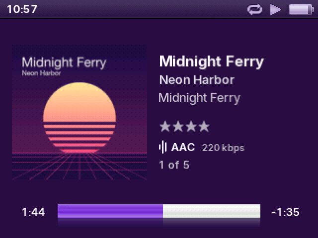 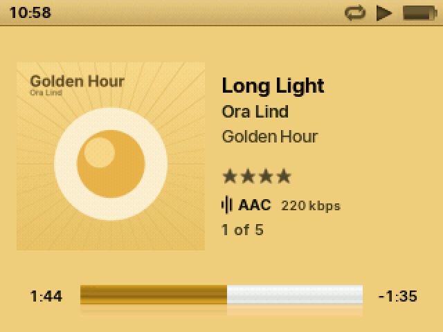

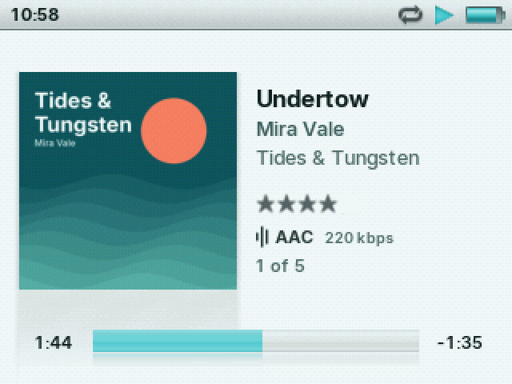 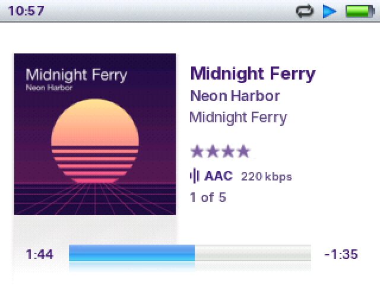

**Fill** spreads the album's colour across the whole screen, so the cover melts into it. The text turns light or dark to stay easy to read.

**Whole Screen** keeps the screen light and gives all of it a soft tint, down to the status bar and the progress bar.

**Text and Stars** leaves the screen white and colours only the words and your rating.

It's off until you want it. Hold Select in Now Playing and choose Colours, or find Cover Colours in Settings.

## It feels like an iPod

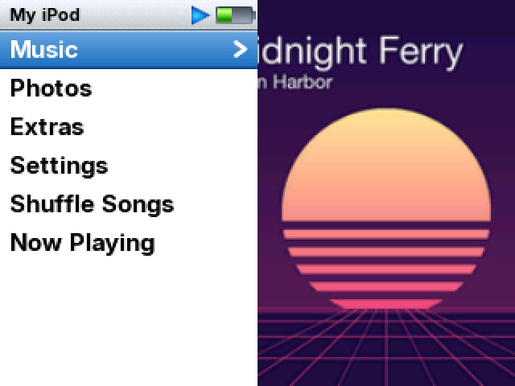 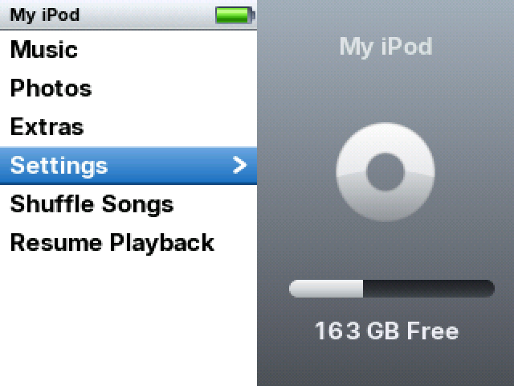

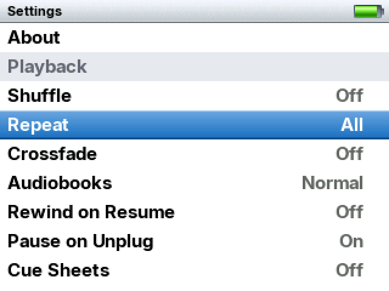 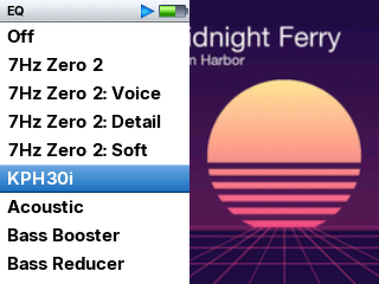

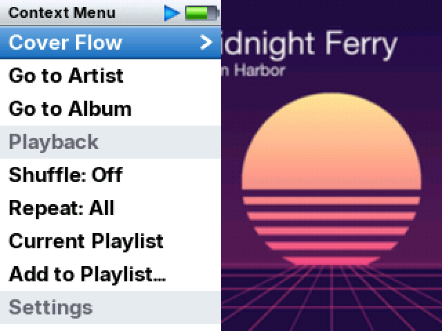 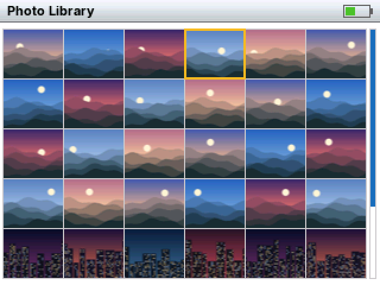

**The menus you remember:** Music, Photos, Extras, Settings, Shuffle Songs and Now Playing, with your iPod's name at the top.

**Settings in one list,** neatly grouped, with every value in plain sight. Most change with a single press.

**Shortcuts your thumb learns quickly.** Hold Play for Now Playing from almost anywhere, and hold Menu to go to the main menu. Press Menu after holding Play to go back to the list you started it from.

**What you reach for while you listen.** Hold Select in Now Playing to open Cover Flow, go to the song's artist or album, or change shuffle, repeat, the EQ, the volume limit, Sound Check, brightness and colours. Press Menu in a list you opened from there, and you're back where you were.

**The EQ from iTunes.** All 22 presets, tuned exactly as they are in iTunes, plus presets made for the 7Hz Zero 2 earphones and the Koss KPH30i headphones. You hear a new preset the moment you pick it, and it doesn't make your music quieter. Presets for more headphones may come in the future.

**Songs at an even level.** Turn on Sound Check, in Settings or by holding Select in Now Playing, and your library plays at about the same volume, using the levels Finder has already worked out.

**Your photos too,** synced by Finder, in the familiar grid and full screen.

**Your place is kept.** Podcasts and audiobooks remember where you left off.

**It speaks your language.** The menus come in more than forty languages, from Japanese and Arabic to Icelandic, and song titles show properly in nearly any alphabet.

**Your videos are still there.** RockWheel doesn't play video itself, but the original firmware stays on the iPod and shares the same library. Turn the Hold switch on while the iPod starts, and your videos play there.

## Under the hood

The iPod Video has two ARM7TDMI cores at 80 MHz and 32 or 64 MB of RAM. RockWheel was built on the 32 MB model, the harder of the two. Making that feel fast took work in nearly every layer: the codecs, the database, the file system, the USB stack and the drawing code.

Covers now appear and long lists start playing about ten times faster. A library update after a sync is more than five times faster. Lists scroll nearly twice as smoothly while MP3s play, and Cover Flow shows more than twice as many covers at a higher frame rate. Writing music over USB is at least twice as fast as in Apple's disk mode.

All of these were measured on the test iPod. "Before" is Rockbox's behaviour or an earlier RockWheel build, whichever the work started from.

| | Before | RockWheel |
|---|---:|---:|
| List scrolling while MP3 plays | 11 fps | **20.7 fps** |
| List scrolling while AAC plays | 17 fps | **20.2 fps** |
| Cover Flow | 14–17 fps with 3 covers, about 8 with music playing | **24 fps with 7 covers**, music paused while you browse |
| Showing a cover on track change | 2–3 s from a 1000×1000 embedded JPEG | **0.1–0.4 s** |
| Playing from a list of 13,180 songs | 4.5 s | **0.3–0.5 s** |
| Library update after a sync | about 90 s for 200 new songs | **about 17 s for 200–300 new**, in a library of 6,810 |
| Writing over USB | 3.2 MB/s in Apple's disk mode, 6.6 MB/s in Rockbox | **8.4–8.7 MB/s** |
| Plugged in to mounted on the Mac | about 12 s | **about 9 s** |

How that was done:

- **Cover Flow draws front to back,** with half of each frame rendered on the second core.
- **Decoding moved to the second core.** MP3 and AAC frames are decoded on the COP into a queue, so the main CPU is free for the UI.
- **Faster codecs where it counted.** A new IMDCT path in libmad takes MP3 decoding from 7.8 to 6.7 ms a frame, and libfaad clears and copies less, taking AAC from 11.4 to 10.55 ms.
- **The whole database in RAM,** paths included, with hash tables instead of repeated disk searches.
- **Work done ahead of time.** Cover Flow's images, each album's colour and the playlist of all songs are prepared while the library updates, so nothing has to be built when you open them.
- **A new colour in about 65 ms,** drawing included. The memory for it is only taken when you choose Whole Screen or Fill.
- **EQ presets keep their level.** The EQ cuts the signal digitally so that its boosts can't clip, and the analog volume rises by the same amount. Near the top of the volume, the peaks of loud music can reach the limit of the amplifier.
- **Sound Check from Finder's own values,** looked up on disk as a track loads. It only ever lowers a track, since Finder's database doesn't say where its peaks are.
- **Journaled library updates.** Cut off at 10 different points in the simulator, an update recovered every time.
- **The device description Finder asks for** is generated from the iPod's own flash the first time it's needed.
- **Finder's database read once,** as a stream in aligned 64 KB blocks, because it doesn't fit in memory.
- **Long files stop being slow.** FAT seek marks mean a jump deep into a 500 MB artwork file doesn't walk the whole chain.
- **Flash-friendly formatting.** The installer places the clusters on 4 MiB boundaries, which raised write speed in disk mode from 1.3 to 3.2 MB/s on the test card.
- **USB write-behind:** blocks are written while the next command arrives, on a dedicated thread with 16 slots.
- **Assembly dithering, and a mixer that ramps** volume changes across samples, which also removed fade clicks.

## Will it work on my iPod?

**Made for:** iPod Video, 5th and 5.5th generation, formatted FAT32, synced from Finder.

**What it was tested on:** one iPod. A 5.5G 30 GB model with 32 MB of RAM, an iFlash card of about 256 GB, macOS 26 and a library of about 13,000 tracks.

**Original hard drives have not been tested.** RockWheel doesn't change Rockbox's disk driver, so I expect it to run, but it was tuned on flash, where a read costs almost nothing. On a hard drive, I'd expect:

- Cover Flow and covers on track changes to be slower, since they read artwork from disk, and more so when the drive has to spin up
- Battery life to be shorter, since those reads keep the drive awake
- The library update after a sync to take longer

If you try it on a hard drive, please open an issue and say how it went.

**Also not tested:**

- The 60 and 80 GB models with 64 MB of RAM. With twice the memory, they should do even better.
- Windows and iTunes. The iPod presents itself the same way to them, so they should work, but only Finder on macOS has been tried.
- Libraries beyond about 13,000 songs on a real iPod. In the simulator, with the memory of a 32 MB iPod, lists, playback, Shuffle and Cover Flow all worked with 40,000 songs. From about 25,000, if the iPod restarts straight into a library update, the theme may not load until the next restart. A library of 100,000 songs won't start, and up to 32,000 songs can be queued at a time.
- Audiobooks on a real device, since the test library has none

Music you bought from iTunes plays, apart from old copy-protected purchases. Apple Music subscription tracks aren't supported. Song titles in Hindi and Thai show, though their combining marks can be out of place, and those two languages aren't offered for the menus.

## Install

1. **Make sure the iPod is formatted as FAT32.** RockWheel needs it, and an iPod formatted on a Mac isn't. Converting erases the iPod, so sync it once and back up anything else you keep on it first: your music comes back with a sync, but plays and ratings not yet synced to the Mac don't. The installer does the conversion for you, and stops unless you type `ERASE`.

2. **Connect the iPod to your Mac, open Terminal and paste this:**

   ```sh
   /bin/bash -c "$(curl -fsSL https://raw.githubusercontent.com/ssarkisy/RockWheel/main/install.sh)"
   ```

   It finds the iPod, checks that it's an iPod Video, converts it if it has to, installs Rockbox's bootloader and the firmware, and ejects it. macOS asks for your password, because the bootloader goes straight onto the disk.

3. **Unplug it.** If it doesn't restart by itself, hold Menu and Select until it does.

4. **Connect it again and sync from Finder as usual.** Don't choose Restore in Finder: that erases the iPod and removes RockWheel.

The stock firmware stays on the iPod, with the same library. To start it, turn the Hold switch on while the iPod boots.

- **To update,** run the same command. Your settings, library and play counts are kept, and all it asks for is your password.
- **To hear about new versions,** choose Watch, then Custom, then Releases, at the top of this page.
- **To see what it would do first,** download [`install.sh`](install.sh) and run `bash install.sh --dry-run`. It changes nothing.
- **To go back,** `bash install.sh --uninstall` removes the bootloader, and the iPod starts its stock firmware.

<details>
<summary>The same steps by hand</summary>

Be careful with disk numbers: pointing these tools at the wrong disk erases that disk.

1. **Make sure the iPod is FAT32.** To convert a Mac-formatted one, which erases it, build `ipodpatcher` from `utils/ipodpatcher` in this repository and use `--convert`. It also handles the 2048-byte sectors the official one refuses, but leaves formatting those to you, with your iPod's disk number in place of `N`: `newfs_msdos -F 32 -c 16 -v IPOD /dev/rdiskNs2`.
2. **Install the Rockbox bootloader** with `ipodpatcher /dev/diskN --add-bootloader bootloader-ipodvideo.ipod`, using the file from [Releases](../../releases), or with the official [Rockbox Utility](https://www.rockbox.org/wiki/RockboxUtility). Either needs root on macOS.
3. **Copy the firmware.** Download `rockbox.zip` from [Releases](../../releases) and unzip it at the root of the iPod. If you had plain Rockbox before, move the old `.rockbox` folder out of the way first.
4. **Restart and sync.** Eject, restart with Menu + Select, connect it again and sync from Finder. When you unplug, the library comes in.

</details>

## Build from source

You need the Rockbox ARM toolchain, which `tools/rockboxdev.sh --target=a` builds.

```sh
mkdir build && cd build
../tools/configure --target=ipodvideo --type=n
make -j8 && make zip     # gives rockbox.zip
```

For the simulator, which is how the screenshots here were made, use `--type=s` and then `make -j8 && make install && ./rockboxui`.

## Credits and license

RockWheel stands entirely on [Rockbox](https://www.rockbox.org) and its contributors, and is based on it at commit `f3ffe789ef`. **Please report RockWheel's bugs here, not to the Rockbox project.**

- **Code:** GNU GPL, version 2 or later. See [LICENSE](LICENSE).
- **Theme:** modified from iClassic Square by Humberto Santana, derived from iLike by Alan Brito and Hayden Pearce, under [CC BY-SA 3.0](https://creativecommons.org/licenses/by-sa/3.0/). See [themes/README.md](themes/README.md).
- **Fonts:** [Inter](https://rsms.me/inter/), under the SIL Open Font License, and GNU Unifont from Rockbox for the alphabets Inter doesn't have.

The screenshots come from the simulator, with a made-up library: the artists, albums, covers, lyrics and photos were generated for them. The disk size, the progress bar and the ratings in them are set by hand.

Apple, iPod, iTunes and Finder are trademarks of Apple Inc. RockWheel has nothing to do with Apple. It contains no Apple logo or firmware, and identifies itself to the Mac as an iPod only so that Finder will sync it.
